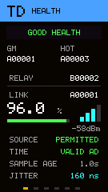
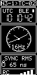

# PToB — Precision Time over BLE

PToB explores shared time over Bluetooth Low Energy periodic advertising, with
explicit source validity, clock quality and availability. This repository is the
home for its firmware, macOS client, draft papers and selected experimental
evidence. [Project website](https://ptob.dev).

**Start with the main paper: [PToB Viability: Rooted BLE Timing Meshes for
Heterogeneous Edge Networks](papers/ptob-viability-preprint.pdf)** — research
draft, 16 October 2026. It brings together the architecture, experimental
evidence, scaling limits and proposed path to a PTP edge extension.
[Supporting research drafts and paper sources](papers/README.md).

## Get started

Follow the **[setup guide](docs/GETTING_STARTED.md)** to plan two grandmasters
(GMs), optional relay clocks, and a USB-connected macOS client with chrony.
A grandmaster supplies reference time; a relay clock (RC) follows the network.
Start with the target matching your hardware:

| Target | Current role | Start here |
| --- | --- | --- |
| Heltec T096 | GM/RC mesh clock or separate DC GNSS/USB image | [T096 README](firmware/t096/README.md) |
| Meshnology W12 | Receiver; optional experimental relay with estimated transmit timing | [W12 README](firmware/w12/README.md) |
| M5Stack StickS3 (SS3) | Receiver and experimental relay with estimated transmit timing | [SS3 README](firmware/ss3/README.md) |
| Meshnology N30 | BLE RC with passive LoRa timing fallback and portrait OLED | [N30 README](firmware/n30/README.md) |
| macOS | USB time client and chrony bridge | [macOS README](clients/macos/README.md) |

For three or four T096 GMs, follow the **[GM operating guide](docs/t096/gm-operations.md)**
for ACTIVE/HOT/COLD setup, receiver/relay connections and both macOS USB paths.

See the [changelog](CHANGELOG.md) for recent development updates.

**Developer preview — build from source:** a generic downloadable image,
public installer/recovery flow and mutable provisioning are not yet available.
Firmware images use private build-time enrollment and must not be uploaded as releases.
Use the target guides for exact supported boards, dependencies and validation
limits. Hardware observations and passing host tests do not establish calibrated
UTC accuracy or qualified failover.

One group uses one private pre-shared key ([PSK enrollment](docs/security/psk.md)) and one
[shared display registry](registry/README.md). Read the
[device ID / name / UUID rules](docs/security/identity-and-names.md) before
provisioning. The [T096 provisioning design](docs/t096/provisioning-design.md)
describes the proposed future storage/API; it is not implemented firmware.

## See the clocks

| T096 · relay clock | W12 · relay clock | StickS3 · network health | N30 · BLE + LoRa clock |
| :---: | :---: | :---: | :---: |
|  |  |  |  |

Firmware-rendered previews with illustrative values, not live measurements.
Select a screen to open its target guide.

[N30 clock, dual BLE/LoRa and receiver screens](firmware/n30/README.md) show its
independent timing inputs and passive LoRa display fallback. N3-1/N3-2 onboarding
requires verified factory identities; hardware qualification remains separate.

For USB timing, ChronyControl tracking and client development updates, see the
[macOS client README](clients/macos/README.md).

## Bring your own target

The **[porting guide](docs/PORTING.md)** covers BLE periodic advertising,
timestamp association, identity, enrollment and acceptance checks. Hardware
oscillator tuning and GNSS are optional; the source and timing requirements
depend on the role. Conventional clients can consume a host time service without
implementing a BLE mesh role. A general GATT time-client service remains planned.

## Research and review

[Read the draft papers](papers/README.md), [inspect the evidence](evidence/README.md),
or follow the [architectural background](docs/V12_TO_R2.md). Paper editions,
wire profiles and current firmware versions have separate identities. Historical
results do not qualify later builds. PToB is not an adopted Bluetooth SIG or IEEE
standard.

**Public review draft, 22 October 2026:** [A Shared Time Base for Bluetooth
Timecode Ecosystems](papers/ptob-bluetooth-timecode-preprint.pdf) explores PToB
as a shared timing source with proposed device-specific compatibility layers.
[LaTeX source](papers/ptob-bluetooth-timecode-preprint.tex) and
[edition manifest](papers/editions/bluetooth-timecode-2026-10-22.json) accompany
the paper; commercial interoperability and physical capture timing remain
unqualified.

For review, identify the target and commit or paper edition, the behavior or claim,
and a reproducible check. Keep credentials and raw private captures out of issues.
See the [publication review checklist](docs/PUBLICATION_REVIEW.md) for remaining
release gates.

By **Jonathan Yantis**, with [acknowledged assistance](CREDITS.md). Original code
and ordinary documentation use [MIT](LICENSE); papers, figures and original
evidence datasets use CC BY 4.0. Preserved third-party terms also apply:
[licensing and attribution](LICENSING.md).
