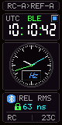
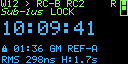
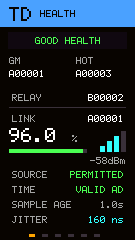
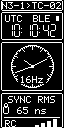

# PToB — Precision Time over BLE

PToB explores shared time over Bluetooth Low Energy periodic advertising, with
explicit source validity, clock quality and availability. This repository is the
home for its firmware, macOS client, draft papers and selected experimental
evidence. [Project website](https://ptob.dev).

**Start with the main paper: [PToB Viability: Rooted BLE Timing Meshes for
Heterogeneous Edge Networks](papers/ptob-viability-preprint.pdf)** — research
draft approved for public review, 30 October 2026. The 17-page revision brings
together the architecture, heterogeneous timing and holdover evidence, scaling limits
and proposed path to a PTP edge extension.
[LaTeX source](papers/ptob-viability-preprint.tex),
[publication approval](papers/editions/viability-2026-10-30-publication.json)
and [supporting research](papers/README.md).

**Public review draft, 26 October 2026:**
[Reducing Timing Tails and Multipath Sensitivity in an Operating BLE Precision Mesh](papers/ble-tail-multipath/main.pdf)
reviews timing mechanisms and proposes practical placement, channel, workload
and recovery tests. [Source, supplement and verification](papers/ble-tail-multipath/README.md)
accompany the nine-page draft. Historical timing tails remain unexplained;
no new hardware experiment or multipath-cause attribution is claimed.

## Get started

Follow the **[setup guide](docs/GETTING_STARTED.md)** to plan two grandmasters
(GMs), optional relay clocks, and a USB-connected macOS client with chrony.
A grandmaster supplies reference time; a relay clock (RC) follows the network.
Start with the target matching your hardware:

| Target | Current role | Start here |
| --- | --- | --- |
| Heltec T096 | GM/RC mesh clock or separate DC GNSS/USB image | [T096 README](firmware/t096/README.md) |
| Meshnology W12 | Receiver; optional experimental relay with estimated transmit timing | [W12 README](firmware/w12/README.md) |
| M5Stack StickS3 (SS3) | Receiver and experimental relay with estimated transmit timing | [SS3 README](firmware/ss3/README.md) |
| Meshnology N30 | BLE RC with passive LoRa timing fallback and portrait OLED | [N30 README](firmware/n30/README.md) |
| M5Stack CoreS3-SE | Precision diagnostics instrument: receiver quality, mesh lineage and GM reference status | [CoreS3-SE README](firmware/corese/README.md) |
| macOS | USB time client and chrony bridge | [macOS README](clients/macos/README.md) |
| Raspberry Pi 5 + M-HAT | Experimental BLE → PPS → chrony → NTP/PTP gateway; private diagnostics | [Pi 5 README](gateways/pi5/README.md) · [setup](docs/pi5/setup.md) · [monitor](gateways/pi5/dashboard/README.md) |

For T096 GMs, follow the **[current GM7 guide](docs/t096/gm7-implementation.md)**
for ACTIVE/HOT/COLD behavior and compatibility. T096 supports
[location-based time zones and automatic DST](docs/t096/auto-time-zone-plan.md);
W12, N30, StickS3 and CoreS3-SE receive authenticated GM time-zone metadata;
the target guides define expiry and boot retention.
StickS3 also exposes signed TZ metadata in passive diagnostics. Check each
target's guide before pairing images. Passing direct-path windows and failed
relay availability remain
separate in the linked validation records; full certification remains open.

See the [changelog](CHANGELOG.md) for recent development updates.

**Developer preview — build from source:** a generic downloadable image,
public installer/recovery flow and mutable provisioning are not yet available.
Firmware images use private build-time enrollment and must not be uploaded as releases.
Use the target guides for exact supported boards, dependencies and validation
limits. Hardware observations and passing host tests do not establish calibrated
UTC accuracy or qualified failover.

One group uses one private pre-shared key ([PSK enrollment](docs/security/psk.md)) and one
[shared display registry](registry/README.md). Read the
[device ID / name / UUID rules](docs/security/identity-and-names.md) before
provisioning. The [T096 provisioning design](docs/t096/provisioning-design.md)
describes the proposed future storage/API; it is not implemented firmware.

## See the clocks

| T096 · relay clock | W12 · relay clock | StickS3 · network health | N30 · BLE + LoRa clock |
| :---: | :---: | :---: | :---: |
|  |  |  |  |

Firmware-rendered previews with illustrative values, not live measurements.
Select a screen to open its target guide.

[N30 screens](firmware/n30/README.md) cover BLE/LoRa selection and timing quality.
The [N30/W12 recovery guide](docs/n30/dual-timing-state-machines.md) covers source
states, diagnostics and offline checks. Exact-device onboarding and hardware
qualification remain separate.

For USB timing, ChronyControl tracking and client development updates, see the
[macOS client README](clients/macos/README.md).

## Bring your own target

The **[porting guide](docs/PORTING.md)** covers BLE periodic advertising,
timestamp association, identity, enrollment and acceptance checks. Hardware
oscillator tuning and GNSS are optional; the source and timing requirements
depend on the role. Conventional clients can consume a host time service without
implementing a BLE mesh role. A general GATT time-client service remains planned.

## Research and review

**Approved public review draft, 4 November 2026:**
[Sparse One-Way LoRa Clock Transfer: Bandwidth Experiments, Authenticated Two-Step Timing, and a Fixed-500-kHz Validation](papers/lora-sparse-timing/sparse-one-way-lora-clock-transfer.pdf)
reports the narrow/high-bandwidth and hopping experiments, wire3 timing format,
and selected 922.4 MHz / 500 kHz / SF11 / CR4/8 design in seven pages.
The complete T096 window retains all 900 future PPS observations with
269.140 ns RMS delivered-model phase after a frozen prior bench correction;
every five-second interval-age bin remains below 296 ns RMS. These are
calibrated GNSS-input/model measurements; independent output, portable UTC
and field-range accuracy remain unqualified.
[Source, selected data and reproduction](papers/lora-sparse-timing/README.md)
and the [approval record](papers/lora-sparse-timing/publication.json)
accompany the paper. Repository publication is prepared locally; the push is
deferred until the firmware fixes are ready.

**Approved public review draft, 3 November 2026:**
[Paired Clock Time Transfer from Starlink over Wi-Fi: Causal Filtering, Drift, and GNSS-Shadow Validation](papers/starlink-wifi-hybrid-timing/starlink-wifi-hybrid-timing.pdf)
is a seven-page study of Starlink NTP combined with Wi-Fi beacon timing.
After fixed prior GNSS phase calibration, the robust hybrid measures
19.226/8.240 microseconds RMS versus 37.180/35.662 for NTP-only timing across
two runs of 900 future PPS each. These are calibrated input-phase comparisons;
portable UTC and physical output accuracy remain unqualified.
[Source, selected data and reproduction](papers/starlink-wifi-hybrid-timing/README.md)
and the [public-review approval](papers/starlink-wifi-hybrid-timing/publication.json)
accompany the draft.

**Approved public review draft, 2 November 2026:**
[A Raspberry Pi Time Server at the Edge of a BLE Timing Mesh](papers/pi5-mhat-gateway/main.pdf)
describes the Pi 5/M-HAT PPS gateway in seven pages. Its complete final window
retains 600/600 pulses, 872 ns GPIO phase RMS, 4.809 µs absolute P99 and 7.017 µs
maximum. These are observations against the disciplined Pi clock; independent
UTC/output accuracy and Ethernet endpoint performance remain unmeasured.
[Source and reproduction](papers/pi5-mhat-gateway/README.md),
[measured results](evidence/pi5/2026-11-02/README.md) and
[approval record](papers/pi5-mhat-gateway/publication.json) accompany the draft.
Linux USB/SOF input from a T096 RC and reverse external-PTP ingress remain
proposed next steps.

**Approved public review draft, 1 November 2026:**
[Trustworthy Hardware Timestamps in Zephyr](papers/zephyr-timing/main.pdf)
examines event association, counter continuity and source publication ordering
in a seven-page implementation and prior-art study for Zephyr engineers.
[LaTeX, source records and verification](papers/zephyr-timing/README.md)
accompany the paper. Comparative hardware evaluation remains proposed.

[Read the draft papers](papers/README.md), [inspect the evidence](evidence/README.md),
or follow the [architectural background](docs/V12_TO_R2.md). Paper editions,
wire profiles and current firmware versions have separate identities. Historical
results do not qualify later builds. PToB is not an adopted Bluetooth SIG or IEEE
standard.

**Approved research draft, 30 October 2026:**
[Empirical Sub-Microsecond Holdover on BLE-Trained Software Clocks](papers/mcxo-holdover-duration/ptob-empirical-sub-microsecond-holdover.pdf)
measures how long frozen W12 clock models retain sampled error below 1 µs at
P99. Fresh BLE-only observations preserve each run's worst sampled error,
changing duration windows, failures and missing witnesses. Temperature remains
shadow-only. [Source, selected data and reproduction](papers/mcxo-holdover-duration/README.md)
accompany the approved MCXO-inspired study. Canonical LaTeX and compact,
checksummed evidence are prepared for GitHub publication.

The **30 October author-review [V14 SIG proposal](papers/ptob-v14-sig-proposal.pdf)**
describes GM7 succession, RC7 paths and TZ/DST; it adds no hardware qualification.

**Public review draft, 26 October 2026:**
[PToB-IPS: Toward GNSS-like Indoor Positioning with Surveyed BLE Timing Beacons](papers/indoor-ips/main.pdf)
explores a local constellation of surveyed timing beacons, with aligned periodic
advertising offsets/rates and a GNSS-like position/clock solve. It quantifies
averaging, bias, finer capture clocks and motion limits for future MCU robotics
and drone PNT. [LaTeX and verification](papers/indoor-ips/README.md) and
[publication approval](papers/editions/indoor-ips-2026-10-26-publication.json)
accompany the theoretical draft; positioning and IPS implementation remain
unqualified.

**Public review draft, 22 October 2026:** [A Shared Time Base for Robotic gPTP and
TSN Systems](papers/ptob-gptp-tsn-robotics-preprint.pdf) investigates extending
a wired robot time domain to wireless acquisition endpoints, with a proposed
PHC-to-radio bridge, ROS 2 adapters and independent validation programme.
[LaTeX source](papers/ptob-gptp-tsn-robotics-preprint.tex) and
[edition manifest](papers/editions/gptp-tsn-robotics-2026-10-22.json) preserve its
scope; gPTP interoperability, TSN conformance and physical actuation remain
unqualified.

**Follow-up research draft, 22 October 2026:** [Precision Bluetooth Timing on
ESP32-S3: Causal Clock Discipline and Hardware Event Capture](papers/ptob-esp32s3-timing-preprint.pdf)
reports the completed 660-second experiment: **166.590 ns relative PPS RMS**
across 657 eligible and three invalid records, with zero nominal missing and
all tails retained. A separate N3-1 transfer measured **150.954 ns RMS** across
48 eligible of 64 records. The observed 49 ns internal display RMS is a
different metric; the sub-100 ns downstream target remains open.
[LaTeX source](papers/ptob-esp32s3-timing-preprint.tex),
[edition manifest](papers/editions/s3-timing-2026-10-22-fine.json) and
[selected evidence](evidence/s3/2026-10-22-fine/README.md) preserve the measured
scope, earlier failures and remaining TX-event/RX-delay validation work.

**Public review draft, 22 October 2026:** [A Shared Time Base for Bluetooth
Timecode Ecosystems](papers/ptob-bluetooth-timecode-preprint.pdf) explores PToB
as a shared timing source with proposed device-specific compatibility layers.
[LaTeX source](papers/ptob-bluetooth-timecode-preprint.tex) and
[edition manifest](papers/editions/bluetooth-timecode-2026-10-22.json) accompany
the paper; commercial interoperability and physical capture timing remain
unqualified.

For review, identify the target and commit or paper edition, the behavior or claim,
and a reproducible check. Keep credentials and raw private captures out of issues.
See the [publication review checklist](docs/PUBLICATION_REVIEW.md) for remaining
release gates.

By **Jonathan Yantis**, with [acknowledged assistance](CREDITS.md). Original code
and ordinary documentation use [MIT](LICENSE); papers, figures and original
evidence datasets use CC BY 4.0. Preserved third-party terms also apply:
[licensing and attribution](LICENSING.md).
