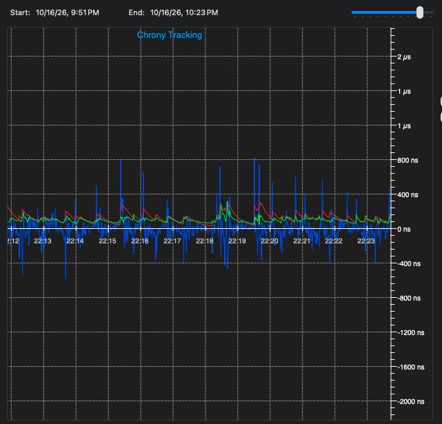

# macOS USB / chrony client

The PToB macOS client receives time from a compatible T096 RC or dedicated
[DC GNSS/USB image](../../docs/t096/direct-connect.md) over USB and
supplies an experimental user clock through a private, unprivileged chronyd.
It provides a live clock display, source diagnostics and chrony tracking while
leaving the macOS system clock unchanged.

[Build guide](../../docs/macos/build.md) · [Chrony integration](chrony/README.md) ·
[USB contract](usb/README.md) · [Group setup](../../docs/GETTING_STARTED.md)

## Client interface

[](../../docs/images/macos-chrony-replay.webp)

Historical client replay with loss and withheld-UTC indicators retained. The
displayed 98 ns is chrony's estimator RMS. This replay and the newer tracking
view below come from separate observations. [Image provenance](../../docs/images/README.md).

## Build and use

Follow the [standalone build guide](../../docs/macos/build.md) for prerequisites,
the shared display registry and the complete offline checks. From the repository
root:

```sh
sh clients/macos/chrony/build.sh
sh clients/macos/build.sh
clients/macos/ptob --self-test
```

After arranging access to a compatible, enrolled T096 RC, launch
`clients/macos/ptob`. Normal launch opens USB and starts its owned chronyd;
`--no-chrony` selects USB-only operation. `--self-test`, reports and precision
replay are offline. In the terminal, `c` opens chrony statistics, `d` diagnostics,
`h` help and `q` closes the client.

Use an RC USB source for the mesh chain, or DC for local GNSS with zero BLE
relay hops. DC uses the same USB contract; it has no group enrollment or runtime
GM/RC toggle. The reviewed normal GM backend does not publish a USB
source map. Direct Mac BLE, SS3 CDC timing input and network time serving are
not supplied. The [chrony guide](chrony/README.md) explains the local daemon and
read-only monitoring options.

## Tracking results and current work

[](../../docs/images/chronycontrol-tracking-10min-20261016.png)

A cleaner, user-selected development interval of approximately ten minutes in
[ChronyControl by Bryan Christianson](https://www.whatroute.net/chronycontrol.html).
The graph shows chrony's tracking statistics against the experimental USB feed.
We are continuing to reduce timing transients, with GM authentication the next
planned focus. See the [optional ChronyControl setup](../../docs/macos/chronycontrol.md)
to view your own tracking logs.

The integrated client adds retained local estimates, USB buffer reuse, reader
ownership checks and automatic rediscovery. The following publication checks
are separate from the later selected screenshot:

| Check | Observed result | Scope |
| --- | --- | --- |
| macOS offline verification | 8,796 native checks passed, plus ownership, decoder, CLI, UI, analysis and adapter checks | Synthetic inputs; no USB access or chronyd launch |
| TC-02 v69, USB64, 60.038 s | 3,839 precision replies: 3,748 valid and 91 explicitly unavailable; zero request errors | Brief transport functionality |
| TC-04 v69, USB64, 60.036 s | 514 replies from 525 sample events: 504 valid and 10 explicitly unavailable; persistent nonresponse after about 8 s | Earlier failed comparison retained for investigation |

Normal client operation uses 32 Hz USB sampling; the two hardware comparisons
above used 64 Hz. The [full stability record](../../evidence/stability/2026-10-16/README.md)
preserves source versions, earlier failures, missing intervals and verification
limits. The [changelog](../../CHANGELOG.md) tracks the implemented fixes.

The screenshot is a selected view rather than a complete-run availability
measurement. Chrony's estimator RMS, agreement against a shared source and
independent UTC accuracy have different meanings. Extended delivery and
independently calibrated timing remain under evaluation.

## Continuity and source handling

With a compatible T096, the optional UTE1 response supplies a retained local
clock estimate. The client shows HOLDOVER / LOCAL ONLY and increasing observation
age separately from valid source observations. Unknown error bounds remain
unknown, and extrapolations never become chrony measurements.

A compatible same-source quality expiry pauses chrony input while preserving
the owned process. Source or counter changes still fence old training. Automatic
rediscovery retries after stale transport errors using fresh helper instances
and I/O mappings, with a per-silicon reader lock. The 500 ms display hold affects
presentation only; withheld UTC remains withheld immediately. Read the
[continuous-estimate contract](../../docs/t096/continuous-estimate.md) and
[USB observation contract](usb/README.md) for the detailed boundaries.

## Source and provenance

PToB owns this client. Its imported baseline is CLI 0.21
(`ptob-mac-cli/0.21-sof-map-gap`); the
[import manifest](imports/2026-10-16.json) records that selection's exact hashes.
Later development is recorded in Git and the project changelog. Public fixtures
use synthetic identities and the shared display registry. See the
[cutover record](../../docs/macos/cutover.md) and
[image provenance](../../docs/images/README.md) for their historical scope.

Copyright (c) 2026 Jonathan Yantis. Original client code and documentation use
MIT; chrony and other third-party terms are preserved. Screenshot/data rights
are recorded with the image provenance.
