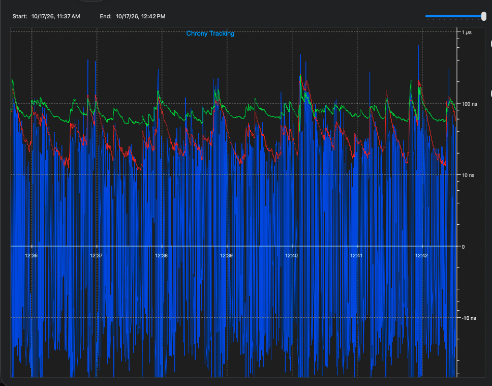

# macOS USB / chrony client

The PToB macOS client receives time from a compatible T096 RC or dedicated
[DC GNSS/USB image](../../docs/t096/direct-connect.md) over USB.
**Timing comes from hardware-captured USB frame boundaries**, independently
matched to the Mac's USB frame reference and mapped to its monotonic clock.
USB packets carry those captured records, so variable delivery latency affects
freshness rather than defining the clock phase.

The resulting time feeds an experimental user clock through a private,
unprivileged chronyd, with a live display, source diagnostics and chrony tracking.
The macOS system clock stays unchanged.

[Build guide](../../docs/macos/build.md) · [Chrony integration](chrony/README.md) ·
[USB contract](usb/README.md) · [Group setup](../../docs/GETTING_STARTED.md)

## Build and use

Follow the [standalone build guide](../../docs/macos/build.md) for prerequisites,
the shared display registry and the complete offline checks. From the repository
root:

```sh
sh clients/macos/chrony/build.sh
sh clients/macos/build.sh
clients/macos/ptob --self-test
```

After arranging access to a compatible, enrolled T096 RC, launch
`clients/macos/ptob`. Normal launch opens USB and starts its owned chronyd;
`--no-chrony` selects USB-only operation. `--self-test`, reports and precision
replay are offline. In the terminal, `c` opens chrony statistics, `d` diagnostics,
`h` help and `q` closes the client.

Use an RC USB source for the mesh chain, or DC for local GNSS with zero BLE
relay hops. DC uses the same USB contract; it has no group enrollment or runtime
GM/RC toggle. The reviewed normal GM backend does not publish a USB
source map. Direct Mac BLE, SS3 CDC timing input and network time serving are
not supplied. The [chrony guide](chrony/README.md) explains the local daemon and
read-only monitoring options.

For a receiver baseline before chrony, use an exact discovered serial:

```sh
clients/macos/ptob --no-chrony --no-ntp --device FULL_USB_SERIAL \
  --rate 32 --duration 120 --jsonl clients/macos/runs/NEW-baseline.jsonl
clients/macos/ptob --precision-replay clients/macos/runs/NEW-baseline.jsonl
```

**RX USB RMS** is the RMS of causal corrected-source prediction errors against
hardware SOF / Apple Mach frame boundaries. Each prediction uses the previous
64–1024 valid source observations; the current sample is scored before joining
the fit. It includes GNSS map corrections, retains residual bias/transients and
does not retrospectively detrend the errors. The separately reported UTC offset
is excluded. Exact immutable-map agreement and resolved direct-port frame
identity are required. Rejected/unavailable samples reset training; gaps over
500 ms also restart it. Source scope changes start a new RMS population. Counts,
warm-up, qualification and rejected observations remain explicit in
`boundary_bridge.rx_corrected_source` and precision replay.

The readout requires four predictions and a source observation younger than
500 ms. It measures relative stream stability using a preceding affine rate
fit, with unknown host/PHY bias and UTC association. It is separate from the
device's SOF span RMS, retrospective source jitter and chrony's estimator RMS;
it does not establish absolute UTC accuracy.

## BLE and USB Direct results — 17 October 2026

[](../../docs/images/chronycontrol-usb-direct-shared-bus-20261017.png)

Jonathan Yantis supplied this updated **USB Direct** view from
[ChronyControl by Bryan Christianson](https://www.whatroute.net/chronycontrol.html).
The log spans 11:37 AM–12:42 PM CDT; the zoomed trace shows roughly
12:36–12:42 PM. The comparison below comes from the native captures, using a
later **concurrent 180-second window, approximately 12:42:10–12:45:10 PM CDT**.

Both paths use the same RX measurement implementation, **32 Hz USB sampling**
and chrony 4.9 with **quarter-second polling** (`poll -2`, `filter 4`,
`maxsamples 64`). RC v0.15.81 follows **GNSS → BLE → RC → USB → macOS**;
DC v0.15.80 follows **GNSS → USB → macOS**, with zero BLE hops. The common
window starts 60 seconds into the RC chrony trial; all later observations
within that fixed window are included, regardless of their magnitude.

**These are shared-bus results. Our USB setup was not a clean bus.** The
measurement methods and observation window are comparable; the separate source
chains and bus conditions do not establish a controlled accuracy comparison.

| Measurement, same 180-second window | BLE source through RC | USB Direct source |
| --- | --- | --- |
| Valid USB timing replies | **5,760 / 5,760** | **5,760 / 5,760** |
| Hardware consistency rejections | 12 tuples | 6 tuples |
| Corrected-source RX RMS, before chrony | **190 ns**, 5,054 predictions | **267 ns**, 5,370 predictions |
| Chrony estimator RMS, median | **31 ns**, 177 status-sampled readouts | **27 ns**, 177 status-sampled readouts |
| Delivered chrony minus fine source | **326 ns RMS**, 837 ns absolute p99; 145 comparisons | **345 ns RMS**, 689 ns absolute p99; 119 comparisons |
| User-clock availability | **147 / 177** status observations; 30 withheld | **119 / 177** status observations; 58 withheld |

RX counts also retain 694 RC and 384 DC warm-up observations following
consistency rejections. Both paths had one source scope, zero unavailable USB
timing replies, zero missing replies and zero transport-error events in this
window. Valid USB input does not imply continuously available user-clock output;
withholding remains visible above. Delivered-status and comparison counts differ
when their separately sampled host brackets do not both permit output.

Chrony's tracking RMS uses the latest synchronized readout at each status point;
it is separate from corrected-source RX RMS and delivered-clock difference.
The last compares chrony with its own fine input
source at the same host wall/Mach instant; it is not independent UTC error.
The screenshot is an after-acquisition display. The numerical window also starts
after acquisition, while retaining every withheld status within it. RC's earlier
slow BLE reacquisition capture remains separate from this settled comparison.
Neither requested two-hour trial was complete when this window was selected.

**Clean-bus validation is pending.** Repeat each source on the same dedicated
USB controller with one timing device attached at a time, recording topology,
power, host load and source placement. Keep the sampling/filter settings and
duration matched, and retain acquisition, rejected samples and withheld output.
A direct USB port or resolved SOF frame identity alone does not establish an
isolated bus. These results do not qualify independent UTC accuracy or durability.

The [current comparison record](results/2026-10-17-ble-vs-direct.json) preserves
exact populations, method/source identities, input hashes and limitations.
The [sanitized observation data](../../evidence/usb/2026-10-17/README.md) lets
reviewers recompute the statistics; private raw captures are excluded.
[Image provenance](../../docs/images/README.md)
records the supplied bytes and display selection. Use the
[ChronyControl setup](../../docs/macos/chronycontrol.md) to review a live capture.

## Continuity and source handling

With a compatible T096, the optional UTE1 response supplies a retained local
clock estimate. The client shows HOLDOVER / LOCAL ONLY and increasing observation
age separately from valid source observations. Unknown error bounds remain
unknown, and extrapolations never become chrony measurements.

A compatible same-source quality expiry pauses chrony input while preserving
the owned process. Source or counter changes still fence old training. Automatic
rediscovery retries after stale transport errors using fresh helper instances
and I/O mappings, with a per-silicon reader lock. The 500 ms display hold affects
presentation only; withheld UTC remains withheld immediately. Read the
[continuous-estimate contract](../../docs/t096/continuous-estimate.md) and
[USB observation contract](usb/README.md) for the detailed boundaries.

## Source and provenance

PToB owns this client. Its imported baseline is CLI 0.21
(`ptob-mac-cli/0.21-sof-map-gap`); the
[import manifest](imports/2026-10-16.json) records that selection's exact hashes.
Later development is recorded in Git and the project changelog. Public fixtures
use synthetic identities and the shared display registry. The
[image provenance](../../docs/images/README.md) records each display's scope.

Copyright (c) 2026 Jonathan Yantis. Original client code and documentation use
MIT; chrony and other third-party terms are preserved. Screenshot/data rights
are recorded with the image provenance.
