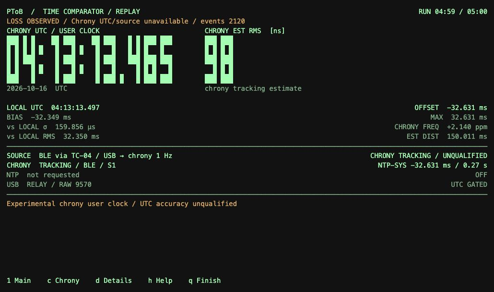
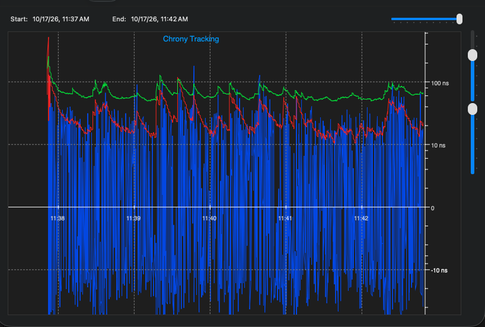

# macOS USB / chrony client

The PToB macOS client receives time from a compatible T096 RC or dedicated
[DC GNSS/USB image](../../docs/t096/direct-connect.md) over USB and
supplies an experimental user clock through a private, unprivileged chronyd.
It provides a live clock display, source diagnostics and chrony tracking while
leaving the macOS system clock unchanged.

[Build guide](../../docs/macos/build.md) · [Chrony integration](chrony/README.md) ·
[USB contract](usb/README.md) · [Group setup](../../docs/GETTING_STARTED.md)

## Client interface

[](../../docs/images/macos-chrony-replay.webp)

Historical client replay with loss and withheld-UTC indicators retained. The
displayed 98 ns is chrony's estimator RMS. This replay and the newer tracking
view below come from separate observations. [Image provenance](../../docs/images/README.md).

## Build and use

Follow the [standalone build guide](../../docs/macos/build.md) for prerequisites,
the shared display registry and the complete offline checks. From the repository
root:

```sh
sh clients/macos/chrony/build.sh
sh clients/macos/build.sh
clients/macos/ptob --self-test
```

After arranging access to a compatible, enrolled T096 RC, launch
`clients/macos/ptob`. Normal launch opens USB and starts its owned chronyd;
`--no-chrony` selects USB-only operation. `--self-test`, reports and precision
replay are offline. In the terminal, `c` opens chrony statistics, `d` diagnostics,
`h` help and `q` closes the client.

Use an RC USB source for the mesh chain, or DC for local GNSS with zero BLE
relay hops. DC uses the same USB contract; it has no group enrollment or runtime
GM/RC toggle. The reviewed normal GM backend does not publish a USB
source map. Direct Mac BLE, SS3 CDC timing input and network time serving are
not supplied. The [chrony guide](chrony/README.md) explains the local daemon and
read-only monitoring options.

For a receiver baseline before chrony, use an exact discovered serial:

```sh
clients/macos/ptob --no-chrony --no-ntp --device FULL_USB_SERIAL \
  --rate 32 --duration 120 --jsonl clients/macos/runs/NEW-baseline.jsonl
clients/macos/ptob --precision-replay clients/macos/runs/NEW-baseline.jsonl
```

**RX USB RMS** is the RMS of causal corrected-source prediction errors against
hardware SOF / Apple Mach frame boundaries. Each prediction uses the previous
64–1024 valid source observations; the current sample is scored before joining
the fit. It includes GNSS map corrections, retains residual bias/transients and
does not retrospectively detrend the errors. The separately reported UTC offset
is excluded. Exact immutable-map agreement and resolved direct-port frame
identity are required. Rejected/unavailable samples reset training; gaps over
500 ms also restart it. Source scope changes start a new RMS population. Counts,
warm-up, qualification and rejected observations remain explicit in
`boundary_bridge.rx_corrected_source` and precision replay.

The readout requires four predictions and a source observation younger than
500 ms. It measures relative stream stability using a preceding affine rate
fit, with unknown host/PHY bias and UTC association. It is separate from the
device's SOF span RMS, retrospective source jitter and chrony's estimator RMS;
it does not establish absolute UTC accuracy.

## USB Direct results — 17 October 2026

[](../../docs/images/chronycontrol-usb-direct-20261017.png)

**DC v0.15.80: GNSS → USB → macOS, sampled at 32 Hz, with zero BLE relay hops.**
Jonathan Yantis supplied this selected 11:37–11:42 AM CDT view from
[ChronyControl by Bryan Christianson](https://www.whatroute.net/chronycontrol.html).
It shows the **experimental quarter-second chrony polling** trial (`poll -2`,
`filter 4`). The normal client configuration still uses one-second polling.
This after-acquisition chart omits no-reference rows and the first selected
update; every later selected observation remains visible regardless of its size.
The numerical population below retains startup and withheld output.

The first fixed **300 seconds** of that same trial, ending a few seconds before
the screenshot, produced:

| Measurement | Observed result | Population |
| --- | --- | --- |
| USB timing replies | **9,600 / 9,600 valid**; zero unavailable or missing replies | All requests; 19 tuples subsequently rejected by hardware consistency checks |
| Corrected-source RX RMS | **188 ns** | 8,364 causal predictions; 1,096 warm-up and 121 initially unqualified observations among 9,581 accepted tuples |
| Chrony estimator RMS | **23 ns median** | 292 synchronized tracking queries; the 25.571 ms initial acquisition maximum remains in the raw population |
| Delivered chrony minus fine source | **358 ns RMS**, 834 ns absolute p99, 2.011 µs maximum | 232 comparisons at the same host wall/Mach instant; shared input source |
| User-clock availability | **232 / 296 status observations** | 64 withheld observations, including startup; point samples do not establish continuous coverage |

These are distinct measurements: the 23 ns tracking statistic is not the RX
residual or independently measured UTC error. An earlier DC run, interrupted
after 1,326 seconds, retained much larger delivered-clock excursions during host
wall-rate changes: 39.334 µs RMS and 554.758 µs maximum, with 1,015 / 1,308 status
observations delivered. Different durations, host conditions and output
populations prevent a controlled improvement claim. Neither run establishes a
completed two-hour result or calibrated UTC accuracy.

The [selected results record](results/2026-10-17-dc.json) preserves exact counts,
definitions, source versions, input hashes and limitations; private raw logs are
excluded. [Image provenance](../../docs/images/README.md) records the unchanged
screenshot and its display selection. Current work targets counter-to-Mach
mapping, host wall-clock response and avoidable output withholding. See the
[ChronyControl setup](../../docs/macos/chronycontrol.md) to inspect your own logs.

## Earlier checks and comparisons

| Check | Observed result | Scope |
| --- | --- | --- |
| Current macOS offline verification | **8,807 native checks passed**, plus ownership, decoder, CLI, UI, analysis and adapter checks | Synthetic inputs; no USB access or chronyd launch |
| DC v0.15.80, USB32, 60 s without chrony | 1,920 / 1,920 valid replies; **329 ns RX RMS**, 1,700 predictions; 3 hardware rejections | Separate finite USB-only baseline |
| DC v0.15.80, USB32, 120 s without chrony | 3,838 / 3,838 valid replies; **257 ns RX RMS**, 3,522 predictions; 3 hardware rejections and 2 skipped polling slots | Separate finite USB-only baseline |
| TC-02 v69, USB64, 60.038 s | 3,839 replies: 3,748 valid and 91 explicitly unavailable; zero request errors | Historical brief transport check |
| TC-04 v69, USB64, 60.036 s | 514 replies from 525 sample events: 504 valid and 10 explicitly unavailable; persistent nonresponse after about 8 s | Historical failed comparison retained |

The [earlier selected tracking view](../../docs/images/chronycontrol-tracking-10min-20261016.png)
remains available. The [October 16 stability record](../../evidence/stability/2026-10-16/README.md)
preserves its own source versions, failures and missing intervals; those
historical populations are separate from the DC observations above. The
[changelog](../../CHANGELOG.md) tracks implemented changes.

## Continuity and source handling

With a compatible T096, the optional UTE1 response supplies a retained local
clock estimate. The client shows HOLDOVER / LOCAL ONLY and increasing observation
age separately from valid source observations. Unknown error bounds remain
unknown, and extrapolations never become chrony measurements.

A compatible same-source quality expiry pauses chrony input while preserving
the owned process. Source or counter changes still fence old training. Automatic
rediscovery retries after stale transport errors using fresh helper instances
and I/O mappings, with a per-silicon reader lock. The 500 ms display hold affects
presentation only; withheld UTC remains withheld immediately. Read the
[continuous-estimate contract](../../docs/t096/continuous-estimate.md) and
[USB observation contract](usb/README.md) for the detailed boundaries.

## Source and provenance

PToB owns this client. Its imported baseline is CLI 0.21
(`ptob-mac-cli/0.21-sof-map-gap`); the
[import manifest](imports/2026-10-16.json) records that selection's exact hashes.
Later development is recorded in Git and the project changelog. Public fixtures
use synthetic identities and the shared display registry. See the
[cutover record](../../docs/macos/cutover.md) and
[image provenance](../../docs/images/README.md) for their historical scope.

Copyright (c) 2026 Jonathan Yantis. Original client code and documentation use
MIT; chrony and other third-party terms are preserved. Screenshot/data rights
are recorded with the image provenance.
