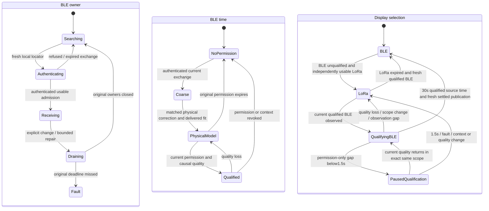

# Dual-timing receiver state machines

Copyright (c) 2026 Jonathan Yantis. MIT.

BLE reception, usable time, relative precision and the displayed clock are
separate states. A packet counter, a discovered parent, a remembered fit or a
working LoRa clock cannot establish BLE output permission. The offline model
executes production selection code with independent physical-source observation
and display-publication schedules. Synthetic cases are regression evidence,
not RF, accuracy or hardware-endurance qualification.



The LoRa receiver has its own acquisition, usable-time, human-HOLD, OFF and fault
states. Its packets and model cannot train the BLE fitter, renew BLE admission,
restore a BLE permission or keep the BLE owner from being supervised.

## Safety and progress obligations

| Boundary | Required behavior |
| --- | --- |
| Admission → time | Authenticate the current exchange; retain the full computed uncertainty and subtract the complete causal source guard. |
| Physical input → output | A matched pair and a finalized deliverable model are distinct observations. Output uses original live permissions. |
| Permission → owner selection | Withdraw output on expiry immediately. A physically arriving direct train may retain acquisition for the bounded15s physical-progress recovery interval; fresh authenticated current-parent PA must continue; this grants no time. Explicit mode, fault, context and operator constraints still fence it. |
| Source observations → display | Observe at main-owner cadence. OLED work, page navigation and console/render delays cannot define source continuity. |
| LoRa → BLE return | Require30s of qualified BLE time in one context, followed by a fresh settled display model. Permission-only gaps below1.5s pause qualification and earn no credit. At1.5s, or on scope/quality/OFF/fault/observer loss, require a new dwell. Expired/unqualified LoRa cannot suppress that current primary clock. |
| No physical progress → recovery | LoRa availability cannot reset the BLE progress timer. Recovery drains exact owners under the original 2s deadline and requires fresh authentication. |
| Diagnostics → behavior | Reads consume no history and change no radio mode, source permission or parent. Queue loss and overwritten RAM history remain explicit. |

The source observation scope includes root identity, root boot, source epoch,
publication/train, local model origin and quality generation. Observer gaps of
250ms or more and backward time reset continuity. Current rendering still
checks its own freshness, permission, mode and settled quality; an observed
history never grants a future output interval.

## Reproduced sequences

A production-owner regression expires source/corrected permission while the
same authenticated direct train has a fresh associated packet. Before the
repair, acquisition protection disappeared immediately, allowing another parent
to compete during a short renewal gap. The regression now checks immediate
output withdrawal, retained exact-parent acquisition and expiry of that
reservation at the bounded 15s physical-progress supervisor limit. Fresh
admission remains due at 1.5s; retained acquisition grants no output time.

The source/publication model first selects LoRa, then supplies qualified BLE
while independently scheduling publications. The previous publication-owned
30s timer could never complete at 250ms or slower publication intervals, or
with recurring delays that crossed its freshness gap. Source observations now
advance that timer independently. The suite also injects qualification loss,
mode/permission changes, scope/train changes, main-observer gaps, expired LoRa
and human LoRa HOLD, with strict original-grant expiry checks.

Run the model and retained-diagnostic checks without opening hardware:

```sh
python3 firmware/n30/tools/state_machine_tests.py --out artifacts/n30-state-model01
python3 firmware/n30/tools/gm_successor_tests.py --idf artifacts/esp-idf --tz \
  --out artifacts/n30-native-owner01
```

The normal N30 host runner includes the state-machine suite. Pre-installation
review also requires the native-owner suite and a native build with its actual
configuration and stack checks. A finite hardware pass does not replace these
sequence regressions or establish long-duration reliability.

## Retained diagnostic reads

`dual read <source-cursor> <parent-cursor>` returns a ten-row nonce/CRC response
using the existing one-use command ticket. Start both cursors at zero. Read
`next` and `parent_next` from `N30_DUAL_CONTRACT`; reuse the same cursors to retry
a response. No read advances either journal.

- `N30_DUAL_STATE` reports current qualification/refusal, display eligibility,
  LoRa latch, remaining dwell, maximum source-observer gap and the first
  interruption while qualified BLE was waiting to replace LoRa. The first
  capsule retains the last qualified scope and the refusal at that interruption.
- Two `N30_DUAL_EVENT` rows return source-observer/selection transitions. Reasons
  1–7 are initial, refused, scope change, observer gap, backward time, qualified
  and display selection.
- Two `N30_PARENT_EVENT` rows return the existing production parent journal,
  including old/new publisher, root, boot, epoch/train, reason and chooser state.
- `overwritten` and `parent_lost` preserve missing-history denominators. Both
  journals hold eight events; the first source-problem capsule survives later
  journal wrap for the remainder of the boot. Diagnostics grant no authority.

The refusal bitmask retains simultaneous causes; `why` names its primary cause:

| Bit | Cause |
| --- | --- |
| 1 / 2 / 4 | Disabled / fault / mode or owner drain |
| 8 / 16 / 32 | No current FOLLOW / missing context / stale snapshot |
| 64 / 128 / 256 | Coarse permission / corrected permission / replay expiry |
| 512 / 1024 / 2048 | Raw quality / quality forecast / retained HOLD |

The source and parent capsules remain in bounded RAM even with logging off.
Live logging is supplemental: bounded UART queues may drop or expire records,
and a partial line cannot replace a complete diagnostic response.

## Coupled pre-installation gate

N30 and W12 share a boot-local source-absence policy. Learned authenticated
boot information, or a fresh healthy LoRa receiver snapshot less than250ms old,
disarms the destructive absence restart. These observations grant no time.
An unlearned receiver without that healthy reception arms a720-second interval;
OFF and maintenance cancel it. Reboot starts a fresh policy.

Actual driver/owner faults use their independent120-second supervisor. Main
and BLE-host worker stalls are declared after at least five seconds; healthy
LoRa time and learned data cannot clear those faults. The offline suite executes
the actual supervisor at timer, recovery, OFF, rollback and RTC-reset boundaries.
W12 CRC fields expose its inputs and separate timers; `wd_sync_expected` means
absence-reset arming. Normal `requested` continues to report BLE enable.

RTC restart evidence binds factory, source and build identity. It can restore
an explicit operator parent pin through the normal selector, while fresh
admission, source permission and clock models remain required.

Run this before preparing an installable N30 or W12 candidate:

```sh
python3 firmware/n30/tools/receiver_state_tests.py \
  --idf /path/to/esp-idf \
  --out artifacts/receiver-state-check01
```

The gate couples actual native publication and read-through expiry, main BLE
eligibility, the production UI adapter and source selection. It also runs
bounded native owner recovery for both targets and W12's production holdover
configuration with acquisition recovery enabled. The receipt records every
selected source hash and failure. N30 commissioning and normal W12 builds
require its passing receipt through `--state-machine-receipt`; changed sources
invalidate it. Current W12 normal-status parser compatibility is checked before
hardware preparation, alongside the native recovery and source tests.

Recurring gaps every1,6 or20 seconds are a separate liveness population from
a single outage followed by uninterrupted reception. Tests cover15ms–1.2s permission gaps,
250ms observation boundaries, scope/quality replacement and deliberate refusal.
Every selected BLE sample must retain current original permission. A source
permission drought may retain direct acquisition only with a live replay
context and a newly associated authenticated PA less than250ms old, within the
15s stall limit. The1.5s fresh-admission request is unchanged.

Retained parent reasons distinguish `PERMISSION_GAP`, `REPLAY_CONTEXT`,
`SUCCESSOR`, `PACKET_SCOPE` and newly admitted `SOURCE_CHANGE`. Schema3 source
diagnostics expose `permission_gap_us` and explicitly declare paused credit and
unchanged output authority. Source/parent histories remain bounded and disclose
overwrite loss. Simulations do not identify every cause of a hardware outage or
qualify RF, UTC precision or endurance.

W12 exposes the same current BLE refusal through `lora diag` in its existing
ten-row CRC response. `remaining_us`, `permission_pause_us`, `losses` and
`resets` show the return dwell independently of the screen. The first-loss
capsule retains the prior qualified root/boot/epoch and interruption reason.
Schema1's `parent_view=LATEST_ONLY` limits its parent summary to the latest
entry. Schema2 returns eight bounded parent vectors, with `parent_overwritten`
and `parent_read_lost` disclosing unavailable history. It also exposes current
BLE scope, automatic rebind count and watchdog input/timer/RTC evidence. Reads
consume no history, and `authority=UNCHANGED` grants no timing permission.

## Source-envelope renewal and physical pairing

The source envelope and RF publication have independent sequences. A new
authenticated envelope may carry a correction for an earlier captured
publication, after that new envelope's creation time. Refusing the physical
pair solely because the carrier's expiry is later discards valid evidence.

For the N30 and W12 recovery profiles, `AUTH_GR3_MATCHED_ORIGINAL_MIN_BOTH_GRANTS_V1`
uses the earlier expiry of the original's envelope and the correction carrier.
Both packet MACs and the admitted root/boot/source/train/capture scope must
validate. The original capture must still satisfy its250ms association limit,
and the full coarse uncertainty/age/enclosure guard still shortens permission.
An uncorrected new header cannot extend an old model. Only a newly matched
physical original under the new grant can supply its later permission.

The gate now executes100 phase, correction-delay and expiry combinations with
actual GR3 encoding/MAC validation for each target profile. It separately checks
shortened grants, expired old grants, corrupted MACs and scope replacement.
Permission-gap credit pauses for at most1.5s, while source observations still
expire at250ms. Every missing interval earns zero qualification credit.

This tests the physical-pairing seam that a synthetic model producer cannot
cover. Validating this receiver bug does not establish that it explains every
observed field gap.
