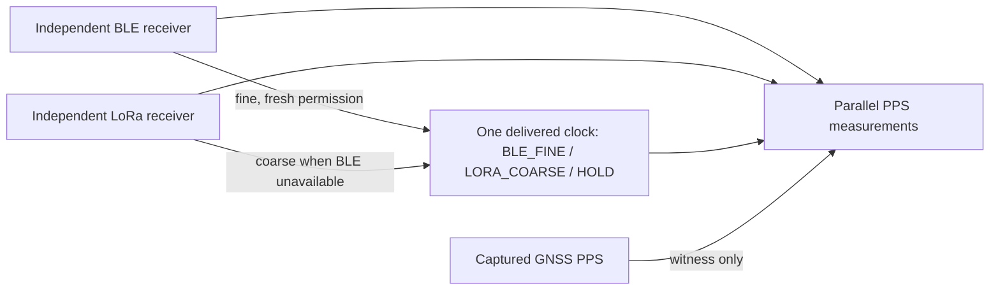

# Longer BLE / LoRa PPS test and shared clock

Status: offline test preparation. Current firmware measures selected BLE timing
against GNSS PPS; parallel LoRa PPS measurement and shared-clock discipline
remain planned. The reference unit's local +2.900 µs BLE adjustment is provisional,
with post-correction residual validation pending. No empirical LoRa offset has
been measured for that unit.

## Required behavior

After separately confirming both offsets, feed **one continuously running
delivered clock** from two independent receiver observations:

- Fresh authenticated BLE supplies fine phase/rate discipline.
- When BLE expires, fresh qualified LoRa supplies slower coarse discipline.
- When both expire, that same clock continues at its learned rate in HOLD.
- BLE return requires fresh admission and the qualified return dwell, then
  bounded slewing into fine timing. Keep the clock instance and counter running.

GNSS is an independent measurement witness throughout; it does not train the
running clock. One main-task owner updates the delivered clock. Radio callbacks
and the LoRa worker supply observations, without writing that clock directly.

Only a new authenticated physical observation may train the common clock.
Repeated polls or projections of the same LoRa timing pair are not new samples
or renewed permissions. Coarse LoRa updates use lower bandwidth and their own
uncertainty floor, preserving the learned fine-rate estimate on handover rather
than replacing it from one coarse packet. Source quality and oscillator-rate
confidence remain separate from the clock's continuously advancing time.



Current `MobileSelection` chooses between independent estimates and
`PresentationClock` smooths the screen. That is not shared oscillator discipline.
Keep the raw BLE and LoRa estimators independent so their errors remain
measurable before they feed a common delivered model. Do not average two
correlated estimates of the same GM while BLE is healthy.

## Readiness gates

The present image does **not** export the parallel measurement contract
`TWATCH_DUAL_RADIO_PPS_V1`, or implement `TWATCH_COMMON_CLOCK_V1`. The prepared
tool reports those missing capabilities; it cannot silently substitute display
snapshots, BLE fit RMS or LoRa prediction RMS for physical PPS errors.

The next measurement candidate must provide:

1. A record for every physical PPS, including rejected/unmapped/reference-loss
   records, with independent BLE and LoRa projections from models available
   **before** the edge. Include model/permission expiry and source/path identity.
2. A measured mapping enclosure between the PPS counter and each model's actual
   counter. BLE fine capture uses MCPWM1; LoRa uses its independent MCPWM0/16 MHz
   model and original GPTimer mapping. Never equate their numeric ticks or add
   cross-core register access that bypasses either owner's capture lock.
3. Original authentication, replay, owner-generation, context and expiry gates.
   The LoRa `watch_valid` human-display fallback is not a timing permission.
   Retain the distinction enforced by `n30::lora_time` and
   `n30::lora_watch_time`.
4. Independent radio statistics while both are enabled, regardless of which
   source the screen selects. Keep firmware, boot, calibration, origin/path,
   counter-domain and GNSS capture changes explicit. Do not pool contexts.
5. Bounded diagnostic records separate from compact USB maintenance control.
   Preserve the original response/drain deadlines and actual OFF proofs.

Only after independent held-out offset validation may the shared-clock candidate
be enabled. It must report one clock instance/domain, source mode, actual output,
rate, source permissions, handoffs and holdover age. LoRa coarse mode must not
retain a BLE fine-quality claim; HOLD must not renew either radio's authority.
Source-context changes require fresh admission and calibration-applicability
review. Do not infer common origins by equating identifiers from different wire
namespaces; retain the authenticated mapping or measure each path separately.

## Campaign

Allow about two hours plus image review/build time: **90 minutes of fixed
measurement windows**, with up to 15 minutes for initial acquisition and another
15 minutes after the correction flash. A timeout remains a failed/missing stage;
do not keep extending windows until favorable samples appear.

Before starting, verify the exact watch, exclusive ownership, recovery, image and
boot identity, unlocked desktop and diagnostic capacity. Archive existing fault
records. Shared NVS has no reviewed diagnostic-only cleanup path: preserve it,
report storage limitations, and retain newly appended faults. GNSS must have a
coherent reference and recurring PPS for 60 seconds; then use the phase-blind
ten-second settling interval. Warm LoRa through authenticated META reception and
fresh timing pairs; its 30-second beat and six-minute metadata cycle matter.
Keep Shadow visible and GNSS powered throughout radio toggles.

| Phase | Duration | Radios | Measurement |
| --- | ---: | --- | --- |
| Parallel training | 20 min | Both on | Separate BLE and LoRa signed offset, absolute P99, RMS and coverage against the same PPS edges. |
| Freeze corrections | Reviewed checkpoint | Both restored on | Derive separate fixed corrections; build/review/app-only flash and verify readback. Reacquire GNSS before validation. |
| Held-out validation | 20 min | Both on | New data only; confirm each corrected offset and applicability before common-clock activation. |
| Shared clock on BLE | 5 min | Both on | Establish the single clock and record its instance, counter, phase and rate. |
| BLE outage | 15 min | LoRa on | Preserve the clock; verify coarse LoRa discipline, original source expiry and growing/appropriate uncertainty. |
| BLE return | 5 min | Both on | Authenticate, qualify and slew the same clock back to fine timing. |
| Both sources absent | 10 min | Both off | Measure that clock's holdover at 1 s, 10 s, 60 s, 300 s and 600 s. |
| Holdover return | 5 min | Both on | Measure continuity, settling, residual and reacquisition. |
| Repeated transitions | 10 min | Scripted | Twice repeat BOTH / LoRa-only / BOTH / both-off / BOTH, one minute each. |

Radio changes require fresh ticket/CRC acknowledgments and original-generation
owner proofs. A requested OFF is not an actual OFF. Restore the starting radio
intent, retain faults and verify host USB/TTY/unit-lock release on completion or
failure. No transmitter, GM configuration or other device is operated by this
preparation.

## Corrections and evidence

Use a fixed full training window, without phase trimming. The prepared analyzer
requires at least 1,080 eligible PPS observations over the 20-minute window and
at least 300 distinct BLE observations / 30 distinct LoRa timing pairs in a
single context before proposing a correction. Report both PPS count and timing
pair count: repeated PPS projections from one LoRa pair are correlated.

Measure the **currently configured residual**. The new total correction is the
existing correction minus that residual mean; do not add the old +2.900 µs a
second time. Keep BLE and LoRa profiles, signs, resolution and evidence separate.
LoRa's existing 99.328 ms engineering event-delay convention is separate from its
unmeasured residual phase correction. Neither constant establishes RF latency
or UTC accuracy.

Freeze the correction profile and application identity before collecting the
held-out window. Freeze numerical acceptance limits before looking at that
window; this preparation does not invent a performance qualification. Compare
first/second-half means, tails, distinct updates, missing/rejected intervals,
origin/path changes and temperature/rate drift. Candidate arithmetic never means
the offsets are confirmed. A failed window remains a result.

The full rollout must show zero clock/counter resets and no backward UTC steps
within each boot. Report handoff phase/rate excursions, fine-to-coarse quality
changes, holdover error versus age and actual observation gaps. Holdover with no
GNSS witness has unknown measured error, not zero error. Cold LoRa-only boot,
GM failover and sleep/wake are separate follow-up cohorts, not pooled into the
fixed calibration windows.

## Offline preparation and analysis

These commands do not open USB or operate hardware:

```sh
python3 firmware/twatch/tools/dual_radio_test.py prepare \
  --out artifacts/watch-dual-radio-plan
python3 firmware/twatch/tests/dual_radio_test_test.py
```

For the already adjusted test unit, pass `--ble-correction-ns 2900`; for other
units supply their actual configured value. An optional `--receipt` checks a
native build's `dual_radio_test_contracts` capability list. A receipt does not
prove hardware acceptance. Results stay in fresh ignored artifact directories.

The future reviewed capture adapter must normalize validated complete firmware
records into JSONL, one object per PPS, using schema 1 and contract
`TWATCH_DUAL_RADIO_PPS_V1`. The regression fixture in
[dual_radio_test_test.py](../../firmware/twatch/tests/dual_radio_test_test.py)
is an executable **synthetic** schema example, not captured data. Each record
contains:

- `run`, fixed `stage`, `stage_elapsed_us`, `boot` and exact `firmware` identity.
- `pps`: physical number/time/capture epoch, coherent-reference and mapping
  validity, and explicit exclusion of GNSS aiding.
- Independent `ble` / `lora` objects: eligibility, authentication, strict
  permission, requested/actual owner state and generation, packet/capture epoch,
  calibrated-context fingerprint, actual counter domain, map enclosure, original
  model availability/expiry/permission ticks, settled time, residual nanoseconds,
  existing correction and distinct physical-observation identity.
- Optional `clock`: the shared instance/domain/counter, UTC, measured PPS phase,
  rate in `rate_ppb`, BLE_FINE/LORA_COARSE/HOLD/UNSYNCED mode, fine/authority flags
  and `holdover_age_us`.
  Its phase can be absent when the GNSS reference is unavailable.

Scopes identify the authenticated origin/boot/epoch/path and calibration profile.
Counter domains identify actual counter incarnations. Do not put refreshed poll
timestamps into original model-availability or permission fields. Convert a
physical PPS into a model domain only with its recorded valid mapping.

```sh
python3 firmware/twatch/tools/dual_radio_test.py analyze \
  --input artifacts/watch-dual-radio-capture/pps.jsonl \
  --out artifacts/watch-dual-radio-analysis
```

The analyzer keeps invalid reasons and missing PPS coverage, separates contexts,
computes exact empirical P99 rather than the watch's coarse display histogram,
and checks common-clock continuity and quality claims. It does not apply
corrections or authorize a flash. Raw identities, captures, calibration profiles
and secret-bearing images remain local. Any selected public measurement export
needs provenance and an explicit dataset license.

Copyright (c) 2026 Jonathan Yantis. MIT.
