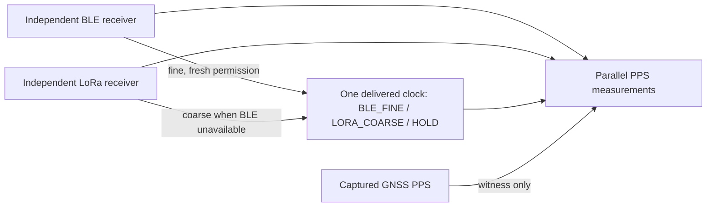

# Longer BLE / LoRa PPS test and shared clock

Status: parallel BLE/LoRa PPS records and the shared delivered-clock controller
are implemented. Shared-clock delivery defaults to **disabled** and requires an
exact-device evidence/profile review. The reference unit's local +2.900 µs BLE
and +3.599390 ms LoRa adjustments have fresh engineering PPS checks and a finite
shared-clock functional test. See the [measurement note](shadow-pps-note.md)
for denominators, rejected intervals and observed coarse/holdover drift. The
full precision campaign and independently measured output/UTC accuracy remain
unqualified.

## Required behavior

After separately confirming both offsets, feed **one continuously running
delivered clock** from two independent receiver observations:

- Fresh authenticated BLE supplies fine phase/rate discipline.
- When BLE expires, fresh qualified LoRa supplies slower coarse discipline.
- When both expire, that same clock continues at its learned rate in HOLD.
- BLE return requires fresh admission and the qualified return dwell, then
  bounded slewing into fine timing. Keep the clock instance and counter running.

GNSS is an independent measurement witness throughout; it does not train the
running clock. One main-task owner updates the delivered clock. Radio callbacks
and the LoRa worker supply observations, without writing that clock directly.

Only a new authenticated physical observation may train the common clock.
Repeated polls or projections of the same LoRa timing pair are not new samples
or renewed permissions. Coarse LoRa updates use lower bandwidth and their own
uncertainty floor, preserving the learned fine-rate estimate on handover rather
than replacing it from one coarse packet. Source quality and oscillator-rate
confidence remain separate from the clock's continuously advancing time.



With delivery disabled, `MobileSelection` chooses between independent estimates
and `PresentationClock` smooths the screen. With an approved calibration profile,
one main-task `watch::dual::Clock` supplies the watch time and calendar; its output
bypasses the presentation smoother.
Keep the raw BLE and LoRa estimators independent so their errors remain
measurable before they feed a common delivered model. Do not average two
correlated estimates of the same GM while BLE is healthy.

## Readiness gates

The candidate exports `TWATCH_DUAL_RADIO_PPS_V1` and implements
`TWATCH_COMMON_CLOCK_V1`. The build receipt records both capabilities and whether
delivery is enabled. The preparation tool distinguishes these capabilities from
authorization to activate the controller.

The observer records every consumed physical PPS, including rejected, unmapped,
unsettled and reference-loss pulses. It projects independently frozen BLE and
LoRa delivered models regardless of screen source selection. BLE retains the
existing G1 causal model history. LoRa uses its original native 16 MHz model,
including both damped acceleration terms and phase slew; rounded display UTC and
`watch_valid` are never timing inputs.

LoRa's worker brackets its own MCPWM0 CURRENT latch with the original XTAL20
counter. The fine owner separately brackets its own MCPWM1 CURRENT latch with
XTAL20. Brackets enclose the hardware latch, excluding subsequent counter
extension and receiver bookkeeping. Both widths are limited to 20 µs; anchors must precede the edge
and expire after two seconds. Conversion carries the entire interval and
quantization allowance under the existing locked APB/XTAL ratio assumption.
A publication interval containing a changed model is rejected. Counter enclosure
is separate from RF bias and UTC accuracy. No task accesses another owner's
capture channel, and no new timer, ISR, UART or radio is started by this observer.
PPS error is signed modulo one second; these comparisons do not establish
integer-second association or an independent UTC accuracy bound.
Original receiver authentication, capture and owner generations, context and
permission expiry remain mandatory. Reference or capture discontinuities reset
the phase-blind ten-second settling interval. Fixed windows retain missing and
rejected samples instead of trimming by phase. Offline analysis separates known
GNSS reference loss/reacquisition even when the hardware capture epoch is
unchanged; those populations cannot combine into a calibration candidate.
The reference parser retains a bounded coherent RMC history so a sentence
received just after a PPS cannot hide the still-fresh preceding reference.
Current fix and freshness checks remain mandatory.
An unmapped pulse remains rejected without inventing a new source from its
absent scope. A fresh eligible pulse may resume the same authenticated context;
an actual new context still starts a new settling interval.

The PSRAM-only 32-record ring is read through **`pps read <after_cursor>`** using
the existing nonce/ticket/factory/boot-bound command envelope. Each response has
four rows, one JSON PPS payload, full Console V3 CRC and the original 1.5-second
response deadline. Compact maintenance responses retain their existing shape and
capacity. Read at least twice per second; drain queued records by advancing the
returned cursor. Ring overwrite counts remain visible. No periodic flash writes
or unsolicited per-PPS serial stream are added.

`firmware/twatch/tools/dual_radio_decode.py` validates saved complete responses
against an exact reviewed Console manifest and boot, rejects CRC/identity/nonce
or cursor errors, and produces the analyzer's JSONL. Each saved request entry has
`request_nonce`, `response_hex`, `after_cursor`, `run`, `stage`, and
`stage_start_device_us`. The stage origin uses the device monotonic microsecond
domain. Drain prior-stage records before starting a window. Keep the original
request and raw-response evidence; the decoder never opens USB.

```sh
python3 firmware/twatch/tools/dual_radio_decode.py \
  --input artifacts/watch-test/responses.jsonl \
  --manifest artifacts/watch-test/reviewed-console-manifest.json \
  --boot <verified-boot> --out artifacts/watch-test/decoded
```

Shared-clock delivery requires an ignored exact-device `--dual-clock-profile`
passed to the native builder. The profile binds the fine-input profile hash,
separate existing/incremental BLE and LoRa corrections, BLE root/parent/depth,
LoRa emitter/root, held-out validation hashes, candidate-review hash and explicit
common UTC alignment confirmation. Different wire namespaces are not equated.
These bindings select where measured extra corrections apply; they do not pin
runtime mesh roots or veto clock availability. A fresh authenticated source on
an unmatched path can still discipline the clock, with its extra path correction
omitted and calibration marked unknown. New boots, roots and capture generations
still require fresh receiver authentication. Root roaming within the enrolled
trusted group does not require a device reboot. A different group/key requires
its own trusted enrollment; calibration never grants membership.

`dual_profile.py` defines the exact profile schema. Without a profile, delivery
is disabled. A measurement-only profile may declare an already installed BLE
adjustment without applying it again. Incremental BLE correction is applied once
to the delivered copy; LoRa correction is applied once to its projection. Neither
modifies the independent fit history. A profile cannot establish physical UTC
accuracy merely by naming an evidence hash.

The controller trains only on advancing physical observation IDs. After the
receiver's authentication, expiry and relative-quality gates pass, BLE return
requires 100 ms of advancing physical progress. Fine updates learn oscillator
rate. Coarse handover preserves that
rate, then fresh physical LoRa pairs adjust it with half gain and a limit of
500 ppb per thirty seconds; shorter intervals receive a proportional budget.
The frequency input includes both damped acceleration terms in the frozen
LoRa predictor. Coarse phase follows the already filtered model with a 5 µs/s
slew limit; fine return permits 50 µs/s. Expiry withdraws authority and cancels
pending phase steering. A fresh valid projection can resume steering without
counting a repeated physical observation as new training. The same counter,
clock instance and latest learned rate continue in HOLD. Coarse mode
never claims BLE fine quality, and HOLD grants neither radio's authority.
Unknown output bounds and unqualified holdover horizons stay unknown.

A short mapping refusal withdraws BLE authority for that interval, while
preserving return qualification only within the existing 500 ms bound on
advancing physical BLE progress. A fresh valid projection from the same context
can therefore resume without another qualification wait. A longer absence or
changed source/domain revokes qualification; original permissions never renew
from polling. Qualified LoRa covers BLE reacquisition when available, and HOLD
continues the same clock when neither source is usable.

`pps read` also exports `live_mode`, `live_valid`, `live_calibrated`, current
counter/UTC and receiver readiness/refusal fields. They describe current state
even with GNSS off or no available PPS record. The embedded PPS JSON remains a
frozen observation at its own captured edge; its calibration-match flags and
applied correction describe that source context. Live status is not a new PPS
measurement or a precision qualification.

For a GNSS-free service study use the separate [common-tick snapshot
contract](gnss-free-snapshot.md), keeping Shadow closed. A reviewed study-only
profile can carry unchanged engineering priors across authenticated paths without
claiming new calibration. This exception does not change the default
matching-only correction policy or turn model agreement into independent truth.

Offline implementation checks:

```sh
python3 firmware/twatch/tools/dual_clock_tests.py --out artifacts/watch-dual-check
python3 firmware/twatch/tests/dual_wire_test.py
```

These exercise the actual projection/controller/runtime and complete CRC decoder,
including a synthetic enabled profile. The long campaign and installed-device
acceptance remain required before enabling delivery on the reference watch.

## Campaign

The reference unit's fixed 120-second corrected-model check and seven-minute
functional handover test used a provisional local activation profile. Those
checks are separate from this longer campaign; they do not replace its
20-minute held-out validation or qualify the coarse controller's accuracy.

Allow about two hours plus image review/build time: **90 minutes of fixed
measurement windows**, with up to 15 minutes for initial acquisition and another
15 minutes after the correction flash. A timeout remains a failed/missing stage;
do not keep extending windows until favorable samples appear.

Before starting, verify the exact watch, exclusive ownership, recovery, image and
boot identity, unlocked desktop and diagnostic capacity. Archive existing fault
records. Shared NVS has no reviewed diagnostic-only cleanup path: preserve it,
report storage limitations, and retain newly appended faults. GNSS must have a
coherent reference and recurring PPS for 60 seconds; then use the phase-blind
ten-second settling interval. Warm LoRa through authenticated META reception and
fresh timing pairs; its 30-second beat and six-minute metadata cycle matter.
Keep Shadow visible and GNSS powered throughout radio toggles.

| Phase | Duration | Radios | Measurement |
| --- | ---: | --- | --- |
| Parallel training | 20 min | Both on | Separate BLE and LoRa signed offset, absolute P99, RMS and coverage against the same PPS edges. |
| Freeze corrections | Reviewed checkpoint | Both restored on | Derive separate fixed corrections; build/review/app-only flash and verify readback. Reacquire GNSS before validation. |
| Held-out validation | 20 min | Both on | New data only; confirm each corrected offset and applicability before common-clock activation. |
| Shared clock on BLE | 5 min | Both on | Establish the single clock and record its instance, counter, phase and rate. |
| BLE outage | 15 min | LoRa on | Preserve the clock; verify coarse LoRa discipline, original source expiry and growing/appropriate uncertainty. |
| BLE return | 5 min | Both on | Authenticate, qualify and slew the same clock back to fine timing. |
| Both sources absent | 10 min | Both off | Measure that clock's holdover at 1 s, 10 s, 60 s, 300 s and 600 s. |
| Holdover return | 5 min | Both on | Measure continuity, settling, residual and reacquisition. |
| Repeated transitions | 10 min | Scripted | Twice repeat BOTH / LoRa-only / BOTH / both-off / BOTH, one minute each. |

Radio changes require fresh ticket/CRC acknowledgments and original-generation
owner proofs. A requested OFF is not an actual OFF. Restore the starting radio
intent, retain faults and verify host USB/TTY/unit-lock release on completion or
failure. No transmitter, GM configuration or other device is operated by this
preparation.

## Corrections and evidence

Use a fixed full training window, without phase trimming. The prepared analyzer
requires at least 1,080 eligible PPS observations over the 20-minute window and
at least 300 distinct BLE observations / 30 distinct LoRa timing pairs in a
single context before proposing a correction. Report both PPS count and timing
pair count: repeated PPS projections from one LoRa pair are correlated.

Measure the **currently configured residual**. The new total correction is the
existing correction minus that residual mean; do not add the old +2.900 µs a
second time. Keep BLE and LoRa profiles, signs, resolution and evidence separate.
LoRa's existing 99.328 ms engineering event-delay convention is separate from its
unmeasured residual phase correction. Neither constant establishes RF latency
or UTC accuracy.

### RF marker and latency

The current SX1262 timestamp is the **HeaderValid rising edge on DIO1 / GPIO14**,
latched by the LoRa owner's 80 MHz MCPWM counter. The owner preserves that edge
through packet completion, CRC checking and authentication. RxDone, task wake,
SPI reads and FOLLOW arrival do not replace it. A PPS residual therefore does
not, by itself, measure receiver latency: it also includes the transmitter's
launch-marker-to-RF separation, the selected PHY's detection point, both clock
paths and propagation. A stable fixed bias and timing variation need separate
measurements.

Semtech exposes an earlier `PreambleDetected` IRQ. `SyncWordValid` is FSK-only;
it is not a LoRa SFD timestamp. The DIO outputs OR their enabled IRQ sources,
and remain asserted until the corresponding flags are cleared. See the
[SX1261/2 datasheet, sections 8.5 and 13.3](https://w2.electrodragon.com/Chip-dat/SemTech-dat/SX1262-dat/DS_SX1261_2%20V2-2.pdf).
Simply adding the preamble bit to the current mask would invalidate the existing
first-edge interpretation.

An earlier-marker experiment must retain separate hardware captures for
preamble, header and completion from the same packet; record merged or missed
IRQs, source/capture generations, RSSI/SNR and CRC/authentication outcomes.
Clear the preamble IRQ before the header can arrive, reject ambiguous ordering,
and associate candidate timing only after the original authenticated packet
checks. Keep HeaderValid as the baseline and the experimental marker out of
clock authority until a separate fixed PPS window establishes its bias,
variation and reception coverage. A smaller average detection delay alone does
not demonstrate a more precise trigger.

Freeze the correction profile and application identity before collecting the
held-out window. Freeze numerical acceptance limits before looking at that
window; this preparation does not invent a performance qualification. Compare
first/second-half means, tails, distinct updates, missing/rejected intervals,
origin/path changes and temperature/rate drift. Candidate arithmetic never means
the offsets are confirmed. A failed window remains a result.

The full rollout must show zero clock/counter resets and no backward UTC steps
within each boot. Report handoff phase/rate excursions, fine-to-coarse quality
changes, holdover error versus age and actual observation gaps. Holdover with no
GNSS witness has unknown measured error, not zero error. Cold LoRa-only boot,
GM failover and sleep/wake are separate follow-up cohorts, not pooled into the
fixed calibration windows.

## Offline preparation and analysis

These commands do not open USB or operate hardware:

```sh
python3 firmware/twatch/tools/dual_radio_test.py prepare \
  --out artifacts/watch-dual-radio-plan
python3 firmware/twatch/tests/dual_radio_test_test.py
```

For the already adjusted test unit, pass `--ble-correction-ns 2900`; for other
units supply their actual configured value. An optional `--receipt` checks a
native build's `dual_radio_test_contracts` capability list. A receipt does not
prove hardware acceptance. Results stay in fresh ignored artifact directories.

The capture adapter normalizes validated complete firmware
records into JSONL, one object per PPS, using schema 1 and contract
`TWATCH_DUAL_RADIO_PPS_V1`. The regression fixture in
[dual_radio_test_test.py](../../firmware/twatch/tests/dual_radio_test_test.py)
is an executable **synthetic** schema example, not captured data. Each record
contains:

- `run`, fixed `stage`, `stage_elapsed_us`, `boot` and exact `firmware` identity.
- `pps`: physical number/time/capture epoch, coherent-reference and mapping
  validity, and explicit exclusion of GNSS aiding.
- Independent `ble` / `lora` objects: eligibility, authentication, strict
  permission, requested/actual owner state and generation, packet/capture epoch,
  calibrated-context fingerprint, actual counter domain, map enclosure, original
  model availability/expiry/permission ticks, settled time, residual nanoseconds,
  existing correction and distinct physical-observation identity.
  New images also export each projection's full `utc_ns` at the same PPS,
  allowing BLE/LoRa integer-second alignment to be checked without modulo
  wrapping. Missing or unprojectable time is zero and supplies no evidence.
- Optional `clock`: the shared instance/domain/counter, UTC, measured PPS phase,
  rate in `rate_ppb`, BLE_FINE/LORA_COARSE/HOLD/UNSYNCED mode, fine/authority flags
  and `holdover_age_us`.
  Its phase can be absent when the GNSS reference is unavailable.

Scopes identify the authenticated origin/boot/epoch/path and calibration profile.
Counter domains identify actual counter incarnations. Do not put refreshed poll
timestamps into original model-availability or permission fields. Convert a
physical PPS into a model domain only with its recorded valid mapping.

```sh
python3 firmware/twatch/tools/dual_radio_test.py analyze \
  --input artifacts/watch-dual-radio-capture/pps.jsonl \
  --out artifacts/watch-dual-radio-analysis
```

The analyzer keeps invalid reasons and missing PPS coverage, separates contexts,
computes exact empirical P99 rather than the watch's coarse display histogram,
and checks common-clock continuity and quality claims. It does not apply
corrections or authorize a flash. Raw identities, captures, calibration profiles
and secret-bearing images remain local. Any selected public measurement export
needs provenance and an explicit dataset license.

Copyright (c) 2026 Jonathan Yantis. MIT.
