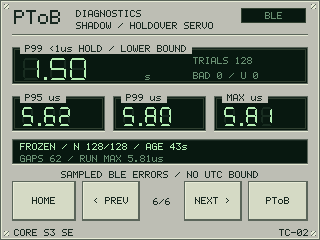

# CoreS3-SE · precision diagnostics instrument

Turn the **M5Stack CoreS3-SE (K128-SE)** into a portable front panel for PToB:
inspect local receiver quality, the timing path, mesh roles and the grandmaster's
reported GNSS reference on a touchscreen. CoreSE receives time and diagnostics;
it does not act as a grandmaster or relay.

[Set up and build](../../docs/corese/build.md) ·
[Understand the readouts](../../docs/corese/diagnostics.md) ·
[Group setup](../../docs/GETTING_STARTED.md) · [Changelog](CHANGELOG.md)

| Clock and receiver precision | Shadow holdover |
| :---: | :---: |
|  |  |

*Recorded on-device frames from the production renderer using the live model.
They are framebuffer captures, not photographs or calibrated accuracy results.
[Capture identities and provenance](../../docs/images/corese-provenance.json).*

## Capabilities and specifications

| Area | Current configuration |
| --- | --- |
| Board | M5Stack CoreS3-SE K128-SE; ESP32-S3, **16 MiB flash**, **8 MiB quad PSRAM**. |
| Display | **320 × 240** landscape ILI9342C color LCD with FT6336U touch; instrument and time-register faces. |
| Timing inputs | Authenticated G1/RC7 BLE reception; separate RC9 functional UTC reception with unknown precision bounds. |
| Fine counter | **80 MHz**, **12.5 ns ticks**, delivered on a **50 ns grid**. Fixed GPIO6/7 route; both pads must be free on a bare board. |
| Mesh diagnostics | Passive GM7 ANN, STATUS, ROLE, GNSS and WITHDRAW reception; legacy GS/GD reports remain readable. |
| Holdover diagnostics | BLE-trained frozen shadow clocks; sampled P95/P99/MAX error and P99 sub-1 µs hold duration. Shadow trials do not steer delivered time. |
| Local time | Instrument and register follow fresh GM time-zone/DST metadata; missing or expired metadata falls back to UTC. Timing calculations and diagnostics stay UTC. |
| Runtime | LCD/touch and timing have separate owners; graphics and shadow workspace use PSRAM. No GM, relay, local GNSS, LoRa or Wi-Fi service. |

## Get started

1. **Prepare the bare board and build tools.** Check the board identity and free
   GPIO6/7, then follow the [build guide](../../docs/corese/build.md) for pinned
   public dependencies, offline tests and renderer previews.
2. **Prepare trust and names.** Supply private PSK enrollment, a verified factory
   binding and the [shared registry](../../registry/README.md). These are local
   build inputs; enrolled images contain secrets and stay private.
3. **Provide a discoverable source.** CoreSE learns the local group ID and key
   epoch from a G1 locator or authenticated GM announcement using its trusted
   PSK. A fresh authenticated JOIN must succeed before timing is admitted.
   RC9 capability alone cannot supply the group needed for cold discovery.
4. **Install through the exact-device procedure.** The build opens no hardware.
   Installation requires the guide's identity, recovery, bounded drain, app-only
   write and readback checks. After boot, inspect the selected source and fresh
   timing before interpreting precision or reference values.

Mesh selection has no fixed group-ID allowlist. After source loss and completed
radio cleanup, the receiver can discover another local context and authenticate
again. It never learns secret keys from advertisements.

## Explore the screens

Choose **PToB** or **DIAG** on the launcher. **PREV/NEXT** cycles the six diagnostic
pages; **FACE** changes the clock presentation and **HOME** returns to the launcher.

| Screen | What it answers |
| --- | --- |
| PToB / Time register | What time is available, from which source? The main face pairs causal RMS with sampled P99 hold seconds. |
| [Mesh](../../docs/images/corese-mesh.png) | Who is ACTIVE, who is nominated HOT, and what has that standby actually reported? Selection age and self-report freshness are separate. |
| Path | Which admitted root and relays lead to this receiver? Node boots, trains and epochs identify the path. |
| [Quality](../../docs/images/corese-quality.png) | How well does the local clock predict received timing? Shows RMS, signed relative offset, matched/refused packets, source age and remaining validity. |
| [Reference](../../docs/images/corese-reference.png) | What does the selected GM report about fix, PPS, qualification, satellites, HDOP and election quality? |
| Wire | Which management reports arrived or failed integrity checks? Shows signed epoch birth, elapsed time from matching current UTC and separate local uptime. |
| Shadow | How long have frozen clock trials stayed within the sampled error criterion? Shows duration, P95/P99/MAX, population and unmeasured gaps. |

Double-click the left power button within **500 ms** to request sleep. Timing
and Bluetooth must complete their bounded drain; a drain fault leaves the unit
awake. Power-on starts a new receiver session. Physical sleep/wake behavior
still needs exact-device validation.

## Interpret precision and history

**Causal RMS** is internal prediction quality. **REL OFFSET** is a fresh signed
prediction residual for the selected root/boot/epoch. Counter tick size, these
statistics and sampled holdover duration are different quantities; none proves
absolute UTC or physical PPS accuracy. Gaps between BLE witnesses remain
unmeasured. RC9 can provide functional UTC, but cannot populate local fine RMS,
relative offset or precision lock.

Reference values describe the reporting GM. HDOP is satellite geometry, not
timing accuracy; legacy reports without HDOP leave it unknown. `VAR NONE` means
no variance was reported, and `ACC UNKNOWN` preserves unknown accuracy. PDOP,
VDOP, antenna health and UTC traceability are unavailable.

Expired reports may remain amber **LAST REPORT / CACHED**; an empty timing
selection may show **LAST GM**. A changed root, incarnation or epoch hides the
previous source's values. ACTIVE/HOT timers describe observed identity/boot
continuity, not uninterrupted remote operation. A HOT nomination and the
standby's own fresh readiness report are separate evidence.

A labeled amber **HOLD** may retain the last delivered clock for at most
**500 ms** after physical delivery, with unknown error. It withholds current
path, precision, offset and source-pulse indications. Neither history, shadow
trials nor a display refresh extends timing permission.

## Development and limits

The [build guide](../../docs/corese/build.md) owns dependency pins, current wire
selection, source overlays, offline checks and installation details. The
[diagnostic reference](../../docs/corese/diagnostics.md) defines fields and
freshness; [source notices](NOTICE.md) and codec provenance identify dependencies.
See the [changelog](CHANGELOG.md) for version changes and finite observations.

Native tests and captures do not qualify continuous diagnostic reception,
physical failover, RF endpoint delay or independent UTC/output accuracy.
Private enrollment, device bindings, recovery images and raw logs stay local.

Copyright (c) 2026 Jonathan Yantis. Original documentation: [MIT](../../LICENSE).
Preserved dependency notices apply.
