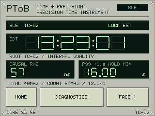
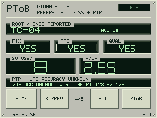
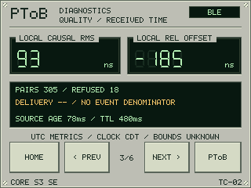
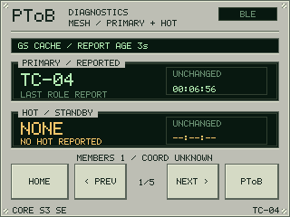

# CoreS3-SE precision diagnostics instrument

**Version 0.1.15** turns the M5Stack CoreS3-SE (K128-SE) into a portable front
panel for PToB timing: inspect receiver precision, source lineage, mesh roles and
the grandmaster's GNSS/PTP quality on a 320×240 touchscreen. It is a dedicated
client with an instrument-style display. Start with the
[build guide](../../docs/corese/build.md).

Version 0.1.15 also clears normal-source selection history when authenticated
RC9 fallback takes over or a direct leader returns after an empty scope. Fresh
boots retain no learned parent, timing model or retry history; explicit operator
pins and calibration remain separate from discovery.

Version 0.1.14 clears old leader selection, discovery, retry and estimator state
on sustained source loss or an authenticated incarnation change. It backports
the W12 0.2.12 recovery policy to the pinned receiver without importing timing
offsets. Pending source-bound diagnostics and scan windows are also retired;
explicit operator pins and the GPIO6/7 counter route survive. Fresh admission
and matched corrections are required before FOLLOW and precision return.

Version 0.1.11 backports [AUTO RC9 recovery](../../docs/w12/rc9.md#auto-client-return-to-normal-ble)
to its pinned receiver baseline. Bounded passive discovery can find a normal BLE
source during a fallback lease; fresh authentication is required before switching.
Root hints and failed admissions retain the original fallback expiry. Existing
CoreSE clock coordinates, GPIO6/7 route and calibration policy remain unchanged.

Version 0.1.12 limits optional diagnostic discovery to 12 ms windows after a
fresh, authenticated, physically associated periodic reception, separated by at
least 200 ms. It reduces overlap with the 62.5 ms timing train. A discovery
window never grants or extends clock permission; diagnostic delivery stays
unqualified.

Version 0.1.13 admits diagnostic windows within 10 ms of the associated PA and
adds a labeled, amber **HOLD** display for at most 500 ms from the last actual
physical clock delivery. Polling cannot renew that limit. HOLD withholds current
source/path, precision, offset and PPS indications; it never grants mesh time
authority. The clock disappears after that finite presentation allowance if no
valid source returns.

| Precision instrument | GM reference diagnostics |
| :---: | :---: |
|  |  |

| Local receiver quality | Mesh role history |
| :---: | :---: |
|  |  |

*Selected on-device screenshots from version 0.1.10. Reference is a completed
LCD framebuffer; the others are production-renderer frames using the live model.
They are not photographs or calibrated accuracy results. Select an image for
native resolution. [Image provenance](../../docs/images/corese-provenance.json).*

## Read the timing chain

The instrument receives authenticated G1/RC7 timing and the separate RC9
functional UTC service. Five diagnostic pages answer different questions:

| Page | Readouts |
| --- | --- |
| Mesh | Reported PRIMARY/HOT identities, source epoch, membership and independent role-change timers. |
| Path | The admitted root-to-client lineage, with node boots, trains and epochs. |
| Quality | Local causal RMS, signed prediction residual, matched/refused packets and remaining source validity. |
| Reference | The selected GM's FIX/PPS/source-QUAL indicators, satellites used, real GGA HDOP and actual election quality tuple. |
| Wire | Authentication/scope/age rejections, replays, sequences and locally observed epoch duration. |

`CAUSAL RMS` measures internal prediction quality. `REL OFFSET` is the fresh,
signed prediction residual for the selected root/boot/epoch. Neither establishes
absolute UTC or physical PPS accuracy. The fine receiver uses an **80 MHz counter
with 12.5 ns ticks**, presented on a 50 ns grid; counter resolution is a separate
property. RC9 can supply functional UTC and upstream metadata but cannot populate
local fine precision or clock lock. Missing delivery denominators stay unknown.

Reference consumes the GM's authenticated occasional GD2 diagnostics, including
real dimensionless HDOP with T096 0.15.168. Legacy GD1 reports leave HDOP unknown.
`VAR NONE` means the GM has not reported a variance measurement; unknown accuracy
stays `ACC UNKNOWN`. HDOP describes satellite geometry, not timing accuracy.
PDOP, VDOP, antenna health and UTC traceability remain unavailable.
See [diagnostic field provenance](../../docs/corese/diagnostics.md) and the
[versioned GD2 contract](../../docs/V14_GM_DIAGNOSTICS_V2.md).

## Fresh reports and useful history

Reports retain their original authenticated receipt deadlines. Duplicates and
screen refreshes cannot renew them. The last same-scope report remains visible
as amber **LAST REPORT / CACHED** after expiry; an empty timing selection can
show **LAST GM** history. A different selected root, incarnation or epoch hides
the previous source's values. Cached data never restores clock permission.

PRIMARY/HOT timers measure time since an observed identity/boot change, not remote
oscillator lock or proof of uninterrupted operation. Passive diagnostic listening
uses protected 12 ms windows at least 200 ms apart after fresh associated
periodic reception. Clock qualification, timing
source expiry and failover rules retain their existing behavior.

## Controls and build

Choose **PToB** or **DIAG** on the launcher. Use **PREV/NEXT** for the five
diagnostic pages, **FACE** for the UTC register, and **HOME** to return.
Double-click the left power button within 500 ms to request sleep through the
bounded timing/Bluetooth drain. A drain fault leaves the instrument awake;
power-on starts a new receiver session.

The board has 16 MiB flash and 8 MiB quad PSRAM. LCD/touch runs separately from
the timing owner. Its fixed fine-counter route requires a bare CoreS3-SE with
**GPIO6/7 free**; no N30 wiring or calibration transfers to this board. There is
no GM, relay, GNSS, LoRa or Wi-Fi runtime owner.

Use the [build and installation guide](../../docs/corese/build.md) for pinned
public dependencies, offline tests and exact-device app-only checks. Shared
N30/W12 receiver sources remain pinned; see [source notices](NOTICE.md).
Private enrollment, device bindings, recovery images and raw logs stay local.
Native builds and screen captures do not qualify RF endpoint delay or UTC accuracy.

Copyright (c) 2026 Jonathan Yantis. MIT; preserved dependency notices apply.
