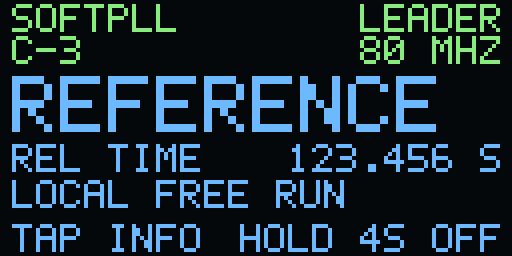
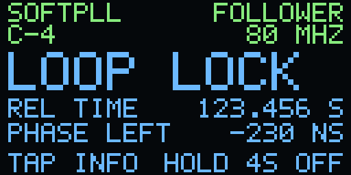
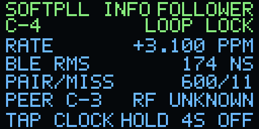
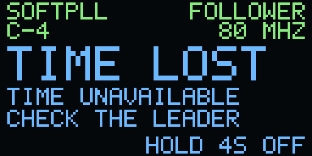
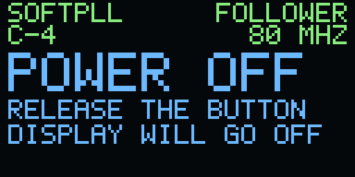

# 01 — Wireless BLE SoftPLL

One free-running ESP32-S3 supplies a relative time base. Nearby followers receive
BLE originals and their later follow-ups, estimate relative frequency and phase,
and gradually align software time. There is no GNSS, NTP, Wi-Fi, UTC or host
timing source. One broadcast train can serve several followers.

**Start with the host simulation.** It uses the same PLL code as the firmware.
Native leader/follower applications and a W12 OLED/button adapter are provided
for hardware tests. Use the display below to follow acquisition, read the loop's
feedback, and recognize source loss. Output precision and power behavior need
their own measurements.

## Run without hardware

From the repository root, with Python 3.9+ and a C11 compiler:

```sh
python3 firmware/examples/esp32-ref/tools/check_01.py --sanitize \
  --out artifacts/esp32-ref-01-review
artifacts/esp32-ref-01-review/wireless_simulation
```

The simulator constructs one leader and two followers at +20 and −15 ppm.
It introduces 500 ns capture quantization, channel offsets, delayed follow-ups
and missing packets. It scores prior predictions before training, retains the
missing-opportunity denominator and verifies source expiry. Every number it
prints is **synthetic**, including its phase spread. It does not qualify a board.

The runner also checks wire tampering with a noncryptographic test fixture,
session/replay rules, event joins, counter health, buttons and bounded shutdown.
The actual W12 power code is compiled against SDK fakes for API-failure tests.
Firmware uses SDK HMAC-SHA256, never the host fixture.

`receipt.json` records source/artifact identities. `w12-preview.png` renders the
actual framebuffer code with illustrative values and approximated panel colors.
Each check needs fresh output and downloads nothing. ASan remains host-limited;
`--sanitize` here selects fatal UndefinedBehaviorSanitizer.

## Read the example

| Read | Purpose |
| --- | --- |
| [simulation.c](simulation.c) | See capture, delayed correction and two independent loops in a short program |
| [ref_softpll.h](../components/ref_softpll/ref_softpll.h) / [.c](../components/ref_softpll/ref_softpll.c) | Follow the observation window, channel-aware fit and continuous actuator |
| [protocol](../docs/wireless-protocol.md) | Understand event matching and fresh session admission |
| [wireless.c](main/wireless.c) | See one task own BLE APIs and hand accepted pairs to the PLL |
| [main.c](main/main.c) | Read the display/button/USB loop and shutdown coordinator |
| [ESP32-S3 port](../docs/esp32s3-port.md) | Inspect the isolated controller-specific capture adapter |
| [display and controls](../docs/w12-reference-display.md) | Interpret the OLED and power-off sequence |

Example 00's clock actuator remains unchanged. This lesson adds automatic rate
estimation and runs on a 20 MHz or 80 MHz local coordinate. A bounded 64-point fit spans
at least two seconds and needs repeated-channel evidence. Channel centering
reduces channel-mix effects on rate; it does not calibrate channel delays.

At capture, save the earlier clock prediction. At follow-up, score that saved
prediction, insert the new pair, project the fitted target to update time, and
reanchor without stepping an already available clock. Acquisition can seed a
new valid segment. A new accepted physical pair sets an exclusive deadline
500 ms after its original. Admission renewal alone cannot renew that clock.

LOOP LOCK requires trained rate, at least 32 causal errors in the current window,
RMS below 1000 ns, less than 1000 ns pending phase and two seconds of qualifying
updates. It describes the software loop. Independent output accuracy remains
unknown even when the indicator is locked.

## Build native firmware offline

Use the public ESP-IDF pin in [dependencies.lock.json](../dependencies.lock.json).
The native builder needs this public repository for the shared registry and
artifact-retention tooling; it imports no operational target source.

```sh
git clone --branch v5.5.5 --depth 1 --recurse-submodules --shallow-submodules \
  https://github.com/espressif/esp-idf.git artifacts/esp32-ref-deps/esp-idf
export IDF_PATH="$PWD/artifacts/esp32-ref-deps/esp-idf"
export IDF_TOOLS_PATH="$PWD/artifacts/esp32-ref-deps/tools"
"$IDF_PATH/install.sh" esp32s3
```

Reuse an already verified installation instead of acquiring another SDK per
build. The builder selects its installed IDF Python environment, verifies the
SDK revision/controller archive, snapshots source, creates local headers,
builds, inspects the image and uses the shared retention lifecycle. It never
opens a port, enumerates attached devices or flashes.

Create a separate example-only experiment key once:

```sh
python3 firmware/examples/esp32-ref/tools/enroll.py \
  --out artifacts/local/esp32-ref/enrollment.json
```

Keep using that same local file for every participant in this experiment.
It contains a random secret, is created owner-only, and must remain ignored.
Use a different key for unrelated experiments. Operational PToB enrollment is
separate. Public host verification requires no enrollment.

Build a generic ESP32-S3 leader, with console output and no selected GPIO output:

```sh
python3 firmware/examples/esp32-ref/tools/build_01.py \
  --idf "$IDF_PATH" --tools "$IDF_TOOLS_PATH" \
  --enrollment artifacts/local/esp32-ref/enrollment.json \
  --role leader --out artifacts/esp32-ref-leader-01
```

Use `--role follower` for other participants. An ordinary follower scans locally
for the example service and authenticates a fresh session; no mesh ID or leader
identity is pinned in the public image. The baseline chooses one locally found
leader. Automatic election, relays and cross-leader continuity are outside 01.

Add `--clock mcpwm80` to build with the S3's 80 MHz capture timer. It keeps
12.5 ns ticks through the local clock model and uses a software latch without
driving a pin. The default `gptimer20` profile is the simpler starting point.
The two profiles share the BLE protocol and time windows. The 500 ns receive
descriptor grid and programmed TX estimate still limit radio observations.
Run the host checks with `--clock mcpwm80` to exercise the finer coordinate.
The W12 research route that captures receive edges on a separate hardware
channel is described in the [S3 timing notes](../docs/esp32s3-port.md#beyond-the-500-ns-receive-grid).

For W12, add `--board w12 --device-config <ignored exact-device JSON>` and
`--registry <shared registry JSON>`. Existing verified W12 device inputs use the
same factory MAC/device ID rules as the repository registry. The image checks
its factory binding before touching board pins. A known integrated LR2021 can
be held in reset with its rails off using `--w12-lora-present`; this example
does not run LoRa. GNSS is unused and no GNSS route is inferred from a label.

Only `esp32_ref_01.bin` is a future application-write candidate. Bootloader and
partition outputs are retained for inspection; they are not an installation
instruction. Real enrollment, identities and images remain ignored locally.

## Read the W12 OLED

These screenshots come from the firmware's 128 × 64 framebuffer at 4× scale.
They use the 80 MHz profile, illustrative readings, and approximate panel colors.
The green band identifies the board and its role. The blue band shows what the
clock is doing and which button actions are available.

| Start the leader | Find it with a follower |
| --- | --- |
|  |  |
| The leader's free-running oscillator supplies shared relative time. | The follower looks for a nearby leader, checks its key, then starts acquiring timing pairs. |

| Watch the loop lock | Tap Info to see why |
| --- | --- |
|  |  |
| `PHASE LEFT` is the correction the loop still needs to apply. `LOOP LOCK` means its software checks passed. | `BLE RMS` compares earlier predictions with later BLE observations. `RF UNKNOWN` means the physical timing bound is unknown. Tap again to return to the clock. |

| When the source expires | When you're done |
| --- | --- |
|  |  |
| The follower clears the timing view and prompts you to check the leader. | Hold four seconds, then release. The screen shows shutdown before the board enters deep sleep. |

The [display guide](../docs/w12-reference-display.md) explains the counters and
power sequence. Run the host checker with `--clock mcpwm80` to regenerate the
individual screenshots and the full state sheet in its output directory.

## Controls and diagnostics

- Short button press: switch between the main view and details.
- Hold four seconds: request radio/output/counter shutdown. Release the button
  for at least 40 ms before sleep can proceed.
- `status` over the local USB console: print a `REF1_STATUS` JSON record.
- `stop`: request the original bounded drain, keep USB/display available, and
  print `REF1_READY` only after every owner has acknowledged OFF.

The console reports source identity, boot/session, role, model availability,
scoreable/unavailable/refused counts, pending phase, causal RMS/maximum and
power stage. A failed drain or power operation stays a fault until reset.
Repeated commands do not extend the two-second drain deadline. Normal launch
starts BLE; the host checks and native builder do not operate hardware.

## Optional electrical witness

`--pulse-gpio <verified pin>` enables a hardware-generated **1 kHz** pulse train.
This rate fits the S3 MCPWM timer's fine 16-bit period. The foreground supplies
the clock model; the peripheral generates edges and bounded fractional-period
updates follow its rate/slew. Initial software phase synchronization has unknown
latency. This is an experimental output path requiring independent measurement.
It is not a calibrated PPS source or a sub-microsecond output guarantee.

On W12, only separately verified GPIO16 is exposed by this example. Default
`-1` creates no output peripheral and leaves the pad unrouted. Check physical
wiring and loads before enabling it.

## Installation and validation boundary

Hardware work requires explicit approval, exact silicon identity, a completed
ownership handoff, existing verified recovery, original bounded application
drain, app-only bounds, actual complete application readback and protected-prefix
comparison. Preserve a necessary partial final sector; do not back up full flash
or copy the installed application for a routine test.

`tools/prepare_install.py` creates an offline review package from an inspected
image, matching host receipt and current/recovery records. It records blockers
when another agent owns the device. It neither claims ownership nor contains a
flash operation. Refresh those records when approval/handoff occurs.

The future physical objective is P99 inter-device edge error below 1 us under
declared conditions. For three or more boards, also measure maximum phase
spread across all members at each common epoch. Preserve missing outputs,
acquisition, failures, bias, RMS, tails and maximum. Timing reaches followers
wirelessly; instrument wires may measure outputs without training the loop.

Copyright (c) 2026 Jonathan Yantis. [MIT](../LICENSE).
