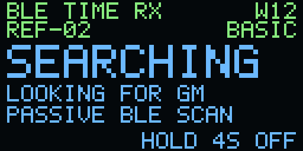
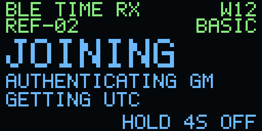
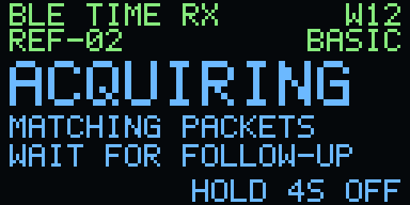
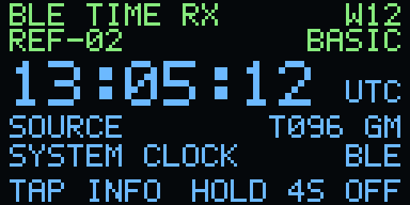
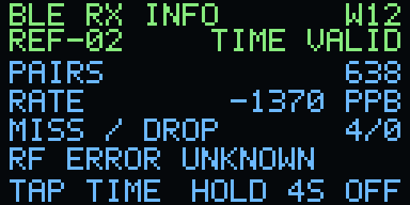
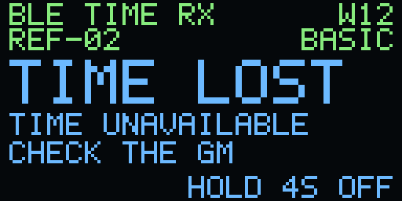
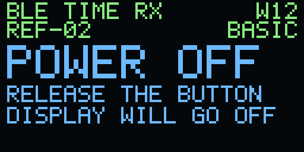

# 02 · Minimal BLE time receiver

Add a disciplined clock to an ESP32-S3 application with one FreeRTOS worker
and the application's NimBLE host. The worker sleeps between reports and
deadlines. The T096 grandmaster supplies UTC at startup and throughout
tracking. A W12 demo provides a clock, an Info page and button-controlled
power-off.

Start with **Basic** and use it in an existing app before trying the tighter
profiles. The hardware accuracy targets are still open.

## Where the time comes from

1. **Find the grandmaster.** Passively scan for a serving T096. Discover the
   mesh ID on air and supply the group PSK and key epoch through enrollment.
2. **Establish UTC and freshness.** Open one short GATT connection and run
   JOIN5. The authenticated reply binds a coarse UTC sample and the source's
   boot, epoch and train to a fresh receiver nonce. A cold receiver has no
   trusted date with which to distinguish a new broadcast from a recording.
   The round trip bounds the age of the startup sample. Disconnect before
   following the periodic train.
3. **Track passively.** The T096 sends a GR3 advertisement and later identifies
   the precise transmit event in a follow-up. The S3 saves the receive
   timestamp and channel from the controller. The worker checks both MACs
   and pairs the original and follow-up by publication, event and channel.
   Those pairs supply the observations that steer the clock.

The receiver checks signed expiry against elapsed monotonic time from JOIN
and checks each pair against the latest accepted event. It withdraws UTC
when clock permission expires and starts a fresh JOIN after losing the train,
on a source context change, or at the end of the example's six-minute
session. Periodic renewal can briefly interrupt valid time. A replay inside a
live freshness window remains possible. A group PSK authenticates group
membership. Each holder can produce a valid group MAC. Applications should
test `ptob_rx_now_ns()` on each use. The USB console exposes status for
an optional host UTC shadow comparison. [PToB protocol contracts](../../../../protocol/README.md) ·
[T096 replay limits](../../../../docs/t096/gm7-implementation.md#wire-diagnostics-and-replay-limits) ·
[S3 timestamp notes](../docs/esp32s3-port.md).

## Copy it into an application

Use the public ESP-IDF v5.5.5 pin in [dependencies.lock.json](../dependencies.lock.json).
The S3 adapter checks the controller archive and live dispatch slots. The
example's [sdkconfig.defaults](sdkconfig.defaults) shows the BLE 5 extended
scan and periodic sync settings, one connection and one sync slot, and the
required CPU0 host and controller placement at 240 MHz. JOIN uses both GATT
roles and a 247-byte preferred ATT MTU. The demo uses the high-resolution
system timer for POSIX time during a boot. For an existing app, merge those
requirements with your settings. ESP-IDF's periodic-advertising option also
enables its sync declarations on this pin. Example 02 never starts an advertiser.
Keep the counter and controller awake and at their checked rates during reception.

From the ESP32-REF collection directory, copy the component and its two
small shared pieces. `APP` is the absolute path to your ESP-IDF project.

```sh
mkdir -p "$APP/components/esp32s3"
cp -R 02_minimal_receiver/components/ptob_rx components/ref_clock "$APP/components/"
cp 01_wireless_softpll/ports/esp32s3/{counter,radio_math}.{c,h} "$APP/components/esp32s3/"
```

Run this in a shell with brace expansion, such as Bash or Zsh. Add
`PRIV_REQUIRES ptob_rx` to your application's component registration.
Call `ptob_rx_start()` after NimBLE initialization and before starting its
host task. Chain `ptob_rx_host_sync()` and `ptob_rx_host_reset()` from your
existing sync and reset callbacks. Reserve the scanner, one connection slot,
and one periodic sync for the component. It registers the JOIN service and
sets the controller's static random address for the discovered mesh. Apps
that also own any of these resources need to coordinate their BLE lifetimes.

```c
#include "ptob_rx.h"
#include <string.h>

/* After NimBLE initialization and before the host task starts. */
PtobRxConfig receiver = {
    .key_epoch = group_key_epoch,
    .discipline_posix = true,
    .step_on_first_lock = true,
};
memcpy(receiver.key, group_key, sizeof receiver.key);
if (!ptob_rx_start(&receiver)) return; /* Report setup failure in your app. */

/* From application code after the existing NimBLE host starts. */
int64_t utc_ns;
if (ptob_rx_now_ns(&utc_ns)) {
    use_utc(utc_ns);
}
```

After stopping, wait for `PTOB_STOPPED` before reassigning the BLE and
counter resources.

Set `discipline_posix` only when this worker is the sole writer of the wall
clock. `step_on_first_lock` permits one initial `settimeofday()`. Subsequent
corrections use paced `adjtime()` with measured read brackets. Time expiry
cancels a correction the worker still owns. Use `ptob_rx_now_ns()` for the
counter-based clock or `gettimeofday()` for application wall time in whole
microseconds. Check receiver validity before treating wall time as fresh.
[ESP-IDF system time](https://docs.espressif.com/projects/esp-idf/en/v5.5.5/esp32s3/api-reference/system/system_time.html).

The demo starts with zero phase correction. An application with an independent
PPS calibration can set `phase_source_id` to the measured grandmaster's ID and
`phase_adjust_ns` to the signed correction before starting the receiver. A
positive correction advances delivered UTC. The accepted range is ±50,000 ns.
Measure the correction for the local receiver and RF path, then freeze it before
testing a fresh window. It applies to the published clock for that source after
the packet checks and fit. [Calibrate and score against PPS](validation/README.md).

## Choose a profile

All three profiles use the same worker and public API. Select `PTOB_TIER`
in CMake for a copied component or `--tier` for the standalone demo.

| Profile | CMake | Change | Acceptance target |
| --- | --- | --- | --- |
| Basic | `0` | 20 MHz GPTimer, 20 µs receive bracket ceiling, two-point history | POSIX clock under 100 µs |
| Refined | `1` | Same timer, 12 µs receive bracket ceiling, 12-point history with phase averaging | POSIX clock under 10 µs |
| Fine descriptor | `2` | 80 MHz MCPWM software capture latch, 32-point fit covering up to four seconds | Counter-based clock under 1 µs |

Fine descriptor keeps 12.5 ns local counter ticks and uses the controller's
500 ns receive timestamp grid. The longer fit tolerates sparse anchor pairs.
When the signed clock deadline expires, the receiver withdraws UTC while it
listens for fresh pairs. The responsive train stays open for up to five seconds
after the last usable report. The fit can reuse recent points on that train,
and the replay watermark survives the outage. Two fresh pairs restore
publication. A source or counter change retires the whole fit.
[Fine bench gate](validation/README.md).

The worker has a 4 KiB static stack, a six-report handoff and bounded sample
history. The S3 adapter retains up to eight reports. Host memory, controller
memory, radio duty and active CPU time are separate costs. The W12 demo only
sends OLED pixels when its framebuffer changes.

## Build the W12 demo

Use the collection's builder from the repository root. The inputs below refer
to owner-only files under ignored `artifacts/`. The builder uses the operational
enrollment's `psk` and `key_epoch`. It discovers the mesh on air. Use the
already verified factory W12 binding and shared display registry.

```sh
python3 firmware/examples/esp32-ref/tools/build_02.py \
  --idf "$IDF_PATH" --tools "$IDF_TOOLS_PATH" \
  --enrollment artifacts/local/enrollment.json \
  --board w12 --device-config artifacts/local/w12.json \
  --registry artifacts/local/registry.json \
  --tier basic --out artifacts/esp32-ref-02-basic
```

For the USB-only demo use `--board generic` and omit `--device-config`.
Use `--w12-lora-present` only on a W12 with the reviewed LR2021 rails.
The output is `target/esp32_ref_02.bin` with an offline build receipt. The
native builder uses the shared retention lifecycle. For a future bench test,
verify the exact W12, currently serving GM profile, recovery image and
ownership with the lab operator. [Hardware validation](validation/README.md).

## Read the OLED

These images come from the firmware's 128 × 64 framebuffer at 4× scale.
The time and counters are illustrative. Panel colors are approximate.

| Find the GM | Get UTC from the GM | Pair timing packets |
| :---: | :---: | :---: |
|  |  |  |

| Clock | Info | Source lost | Power-off |
| :---: | :---: | :---: | :---: |
|  |  |  |  |

The receiver starts on power-up. `status` over USB reports the receiver,
source and power state. `stop` drains the receiver and leaves USB available.

Tap the button to switch between Clock and Info while time is valid.
The clock shows UTC from the receiver's model. **SYSTEM CLOCK BLE** means the
demo has taken ownership of the POSIX wall clock. Info shows accepted pairs,
rate in parts per billion, originals aged out of the pending table, and worker
queue drops. An RF accuracy measurement needs an independent reference.

Hold the button for four seconds, then release it. The W12 waits for the BLE,
worker and timer owners to stop within the original two-second deadline, then
turns off its OLED and enters deep sleep after a stable release. A later press
wakes it. A drain or sleep error stays on **OFF FAILED** with USB status.
The standalone W12 demo owns the full NimBLE host. The copyable task releases
only its own receiver resources.

## Read the code in this order

1. [ptob_rx.h](components/ptob_rx/ptob_rx.h) gives the small application API.
2. [receiver_clock.c](components/ptob_rx/receiver_clock.c) shows the pair lookup,
   bounded rate estimate and gradual phase steering.
3. [ptob_rx.c](components/ptob_rx/ptob_rx.c) owns the worker, source lifetime and
   optional wall-clock discipline.
4. [direct_wire.c](components/ptob_rx/direct_wire.c) reads JOIN5 and GR3.
   [join_nimble.c](components/ptob_rx/join_nimble.c) runs the startup exchange.
   [rx_nimble.c](components/ptob_rx/rx_nimble.c) hands off to passive tracking.
   [receive_stamp.c](components/ptob_rx/receive_stamp.c) isolates the ISR hook.
5. [screen.c](main/screen.c) is the W12 renderer. [main.c](main/main.c) wires
   the standalone demo, USB and button together.

Run the deterministic host checks from the repository root. The same command
regenerates and compares the README images.

```sh
python3 firmware/examples/esp32-ref/tools/check_02.py --sanitize --verify-images \
  --out artifacts/esp32-ref-02-review
```

Copyright (c) 2026 Jonathan Yantis. [MIT](../LICENSE).
