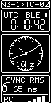
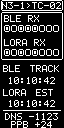
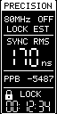
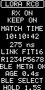

# N30 · BLE clock with LoRa fallback

PToB firmware for the **Meshnology N30 / Heltec WiFi LoRa32 V3**: receive
mesh time, view a portrait clock and compare BLE with an independent passive
LoRa timing input. N30 supports **RC (receiver/relay clock)** only. It has no
GNSS input, and Wi-Fi is disabled.

[Build and set up](../../docs/n30/build.md) ·
[Group setup](../../docs/GETTING_STARTED.md) ·
[RC9 fallback](../../docs/n30/rc9.md) · [Changelog](CHANGELOG.md)

| Clock | BLE + LoRa | Precision | LoRa receiver |
| :---: | :---: | :---: | :---: |
|  |  |  |  |

*Production-renderer previews, not hardware photographs. The precision image's
RMS is a recorded internal prediction statistic; other values are illustrative.
These values are not specifications or independent output accuracy.
[Image provenance](../../docs/images/README.md#n30-precision-preview).*

## Capabilities and specifications

| Area | Current configuration |
| --- | --- |
| Hardware | ESP32-S3, **8 MiB flash** build configuration, **SX1262 LoRa** radio. Fixed board routes; no GNSS profile. |
| Display | **64 × 128** portrait monochrome OLED with clockwise/counterclockwise mount selection, digital/analog clock and moving savers. |
| BLE receiver | Authenticated **G1/RC7**. **BLE100** is standard; **BLE50** is client-only. Optional BLE100 relay uses estimated TX timing with unknown RF/UTC bounds. |
| Fine clock | Optional continuous **80 MHz counter**, **12.5 ns ticks**, delivered on a **50 ns grid**. Requires N30-specific capture routing and calibration; unconfigured builds retain the **20 MHz** backend. |
| LoRa | Passive **wire 3 / schedule 8**, fixed **922.4 MHz**, SF11/BW500 kHz/CR4/8 with SX1262 boosted RX gain, matching an independently configured T096 transmitter. Independent **80 MHz MCPWM group0** HeaderValid capture/model. |
| Functional fallback | Distinct **RC9** direct-client UTC reception with unknown transport/precision bounds; it cannot relay further or train the BLE fitter. |
| Time zone | Clock and savers retain the latest learned authenticated BLE/LoRa time-zone offset in RAM until reboot. New metadata updates it. Timing diagnostics remain UTC. |
| Power and console | GPIO0 page/menu controls and bounded deep-sleep request. UART diagnostic console, not a T096 USB timing source. |

## Get started

1. **Verify the board and identity.** Confirm the factory MAC, board revision,
   display wiring and mounted rotation. Use the [onboarding guide](../../docs/n30/build.md)
   to bind the device to the shared registry; never substitute an alias or
   advertised BLE address for factory identity.
2. **Prepare a compatible source.** Use the [group setup](../../docs/GETTING_STARTED.md)
   with a T096 GM or compatible relay. Match the current
   [coarse TZ wire](../../docs/esp32-time-zones.md). Keep trust enrollment separate
   from runtime discovery; a context change needs fresh authenticated admission.
3. **Build and preview offline.** Follow the [build guide](../../docs/n30/build.md)
   for public dependencies, board configuration, both portrait rotations and
   tests. Enable estimated relay or fine capture only through their explicit
   profiles. Keep enrollment, device bindings and images in ignored local files.
4. **Use the exact-device installation path.** Default builds are offline
   preparation. Commissioning needs verified recovery, physical layout checks,
   bounded owner drain, app-only write bounds and actual readback. Then check
   the selected parent, source freshness and relative lock before interpreting RMS.
5. **Add LoRa if needed.** Configure the matching T096 transmitter and receive
   profile using the build guide. N30 listens passively; it does not supply the
   LoRa source. Validate fallback separately from normal BLE reception.

## Timing and recovery

BLE is primary; fresh direct LoRa supplies **LOR** fallback ahead of RC9.
Returning from live LoRa requires **30 seconds of qualified BLE time** in one
scope. Permission-only gaps below **1.5 s** pause the dwell; longer gaps or
quality/context changes reset it. Expired or unqualified LoRa yields to fresh
qualified BLE. Each input keeps its own model and original timing permissions.

LoRa **AUTO** and **KEEP ON** stay warm through healthy BLE and BLE-owner faults;
**KEEP OFF** stops reception. Overrides return to AUTO at boot. BLE has separate
recovery supervision: eligible nearby reception with **15 s** of no corrected
physical progress can trigger a BLE-only rebind, using the original **2 s** drain
and fresh authentication. Operator selections remain in force.

A trained BLE estimate may show **HOLD** for up to **30 s** after its last
physical observation during GM succession. Learned clocks and retry history
are boot-local; a watchdog may restore an explicit parent pin. Enrollment,
registry and calibration remain separate inputs.

See [recovery and diagnostics](../../docs/n30/dual-timing-state-machines.md) for
`dual read`, source/owner rules and the mandatory offline candidate gate.

## Screens and controls

A press released before **2.0 s** cycles **Clock → BLE + LoRa → Precision →
LoRa → Clock**. Hold **2.0 s** on any page to open the watch menu, then release.
Acquisition continues while the startup splash is displayed.

Inside the menu, a short press selects the next enabled row; a separate
**2.0 s** hold applies it once. The opening hold cannot apply a row. Changes
keep the menu open. **Exit**, or **5 s** without input, returns to the invoking
page; a held button cannot time out. A short screensaver press wakes, and a
continued 2.0 s hold opens the menu.

| Menu row | Action |
| --- | --- |
| UPSTR AUTO / UPSTR RLY | Select the opposite upstream parent policy: automatic or relay-only reception. N30 remains RC-only; it has no GM mode. |
| POWER OFF | Request bounded shutdown. |
| BLE RX OFF / ON | Park BLE reception, or request a fresh authenticated client activation. Continuous AUTO reception remains available; manual LoRa ON/OFF choices remain unchanged. |
| LoRa RX OFF / ON | Set a volatile KEEP OFF / KEEP ON override. The row is omitted without an enrolled transmitter. AUTO remains available through the bound `lora auto` console command and is restored at boot. |
| EXIT | Return to the invoking page. |

While BLE is parked, only fresh LoRa can supply time. BLE/RC9 clocks and cached
BLE pixels are withdrawn; missing LoRa time does not trigger a no-time restart.
BLE ON requires fresh admission; a selected LoRa clock retains the 30-second
qualified BLE recovery dwell.
Actual LoRa faults, all-OFF, maintenance and shutdown retain their existing
fences. A BLE controller fault remains visible and keeps the original fault
watchdog; it cannot revoke an otherwise healthy independent LoRa receiver.

Rows describe the requested next action. **REQUESTED** means the owner accepted
the request; **REFUSED**, **SWITCHING**, radio wait and fault states remain
separate from active reception or valid time. UPSTR is skipped while BLE is OFF.

Release after selecting Power Off. Deep sleep requires the original **2 s**
radio/capture drain and display-worker stop; a new button press reboots the app.
A failed drain remains a fault. Sleep current, battery lifetime and physical
wake behavior need hardware validation.

The clock's signal bars describe fresh authenticated parent RSSI, independently
of lock, and expire after **2 s** without a packet. Precision follows the actual
**CLOCK** input. BLE/RC1/RC2 show their root/path, **BLE RMS**, relative drift
in ppb, counter/tick size and **BLE LOCK** duration. Relative BLE drift is a
diagnostic and does not steer time.

For **LOR**, Precision shows **TX**, **ROOT**, the independent **80 MHz** counter
(**12.5 ns** ticks), and **E**, the software admission enclosure. **PRED RMS** is
the last eight available causal prediction errors, measured before each pair
steers the model. Counter resolution, E and internal RMS do not establish
RF/UTC accuracy; **UTC/RF UNKNOWN** preserves those limits.

LoRa can show an unqualified digital estimate during acquisition or RF absence,
with visible pair/META/error ages. Cached metadata cannot renew timing leases
or admit a new context. Faults, source withdrawal and OFF fence observer time;
descriptive metadata and time zone remain in RAM until reboot. Estimator,
forecast and finite-HOLD details are in the [build guide](../../docs/n30/build.md).

Healthy LoRa reception or learned boot information suppresses destructive
absence restarts. The armed no-time interval is **12 minutes**; actual driver,
counter, transport and cleanup faults retain **120 s** supervision.

## Precision, evidence and development

**Causal RMS is internal prediction quality.** It differs from downstream
relative PPS error, counter resolution and calibrated RF/UTC accuracy. The
sub-100 ns downstream goal remains open. LoRa uses an **unverified 99.328 ms
engineering symbol-delay model**, with unknown board/RF endpoint bias; internal
fit RMS does not measure UTC accuracy. Calibration constants do not transfer
between boards without independent checks.

The [timing research draft](../../papers/ptob-esp32s3-timing-preprint.pdf) and
[selected evidence](../../evidence/s3/2026-10-22-fine/README.md) retain finite
measurements, populations, failures and tails. The [changelog](CHANGELOG.md)
records dated results and firmware changes. Host tests, native builds and
previews establish software properties, not hardware acceptance.

Use the [build guide](../../docs/n30/build.md) for fine-receiver contracts,
diagnostics and update checks. [Source provenance](../../docs/n30/source-provenance.json)
and [notices](NOTICE.md) identify the selected W12/T096 dependencies.
No enrolled binary is distributed. Independent UTC/output accuracy, RF endpoint
delay, physical failover and continuous availability remain unqualified.

Copyright (c) 2026 Jonathan Yantis. Original documentation: [MIT](../../LICENSE).
Preserved dependency notices apply.
