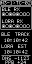
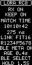

# N30 native RC target

| Clock · page 0 | BLE + LoRa · page 1 | LoRa receiver · page 2 |
| :---: | :---: | :---: |
|  |  |  |

*Illustrative screens from the production renderer, using synthetic values.
Select a screen for its native 64×128 image.
[Image provenance](../../docs/images/README.md#n30-portrait-previews).*

Copyright (c) 2026 Jonathan Yantis. MIT; preserved source notices apply.

**PToB owns N30 native G1/RC7 development.** Version **0.2.12** supports an **RC**
with **two timing inputs: BLE and passive LoRa**, a portrait OLED clock and a
receiver-status console. The Meshnology N30 / Heltec WiFi LoRa32 V3 route uses
an ESP32-S3, 8 MB flash and a 128×64 OLED mounted as 64×128. Start with the
[build and onboarding guide](../../docs/n30/build.md).

BLE100 reception is standard; BLE50 is client-only. An optional BLE100 relay
uses experimental estimated transmit timing with unknown RF/UTC bounds. The
N30 has no GM profile or GNSS input. Its UART console is not a T096 USB timing
source. WiFi stays disabled.

## BLE and LoRa timing

The N30 keeps **independent BLE and LoRa clocks**. BLE supplies the ordinary
G1/RC7 mesh clock; passive RC8 wire3 LoRa from an explicitly configured T096
transmitter provides display fallback. A valid, settled BLE relative lock has
display preference. When BLE is marginal or pending and LoRa time is available,
the clock dashboard uses `LOR`, keeps its analog dial and PPS lamp, and labels
its quality `LINK RMS`.

Automatic BLE selection accumulates one minute without relative lock, then
seeks a fresh relay. Brief lock flickers pause this loss budget; only a full
minute of continuously observed lock clears it. A failed parent gets at most
one new admission attempt per minute, leaving radio opportunities for relays.
Even a transient raw lock cannot suppress discovery after that trial fails.
Named-parent and relay-only choices retain their explicit policy. All timing
streams keep their original permission, model and source expiry.

If a GM loses and later regains its source, a fresh returning-GM locator can
use the bounded retry path even after its old binding expires. It must complete
a new authenticated exchange; a remembered failure cannot blacklist that sole
returning GM indefinitely. Fresh alternatives retain priority.

A separate watchdog reboots after **five continuous minutes without current BLE
FOLLOW time or available LoRa time** while reception is requested. Valid time
from either input cancels that interval. Precision lock is not required;
source-less membership, packet traffic, stale snapshots and local HOLD do not
reset it. Explicit OFF and update maintenance inhibit this watchdog. Existing
fault/stalled-worker supervision retains its independent two-minute timer.

LoRa **AUTO** starts after **180 accumulated seconds without live BLE lock**.
Brief good samples pause that budget rather than restarting it. Only
**180 seconds of continuous BLE lock** clears the loss and stops AUTO reception.
A lock dip restarts that recovery interval. Radio control runs independently of
the OLED, its displayed lock settlement and the screensaver. The LoRa driver is receive-only, using the fixed 915 MHz
SX1262 configuration, shared group authentication and exact transmitter identity.
LoRa hardware stays disabled unless the build binds a transmitter from the shared
registry. Its 12-second functional hold does not establish source freshness. LoRa never
trains the BLE clock or grants downstream timing authority.

N30 retains delayed authenticated physical corrections instead of discarding
those captured before the latest model publication. Each original carries its
capture-time prediction for causal scoring. A dense 64-point fit follows
oscillator changes, and acceleration uses an observed one-second rate baseline.
The 1 µs lock threshold, full causal tails and 16-second quality history remain
unchanged. See the [acquisition and recovery tests](../../docs/n30/build.md#version-028-intermittent-gm-recovery-and-acquisition).

The dual-radio page shows each clock separately, BLE and LoRa activity, `DNS`
(BLE minus LoRa nanoseconds) and drift in `PPB`. Comparison requires matching
full root identity, root boot and source epoch, with current LoRa companion
metadata. Unavailable or mismatched inputs show dashes. These are relative
estimates; display refreshes do not create new comparison samples or qualify
absolute UTC accuracy. See the [LoRa build and timing details](../../docs/n30/build.md#version-023-passive-lora-receiver).

Reusable timing diagnostics default OFF and can be enabled through the bound
console for up to ten minutes, with selectable sampling. A fixed RAM history
retains descriptor fields, clock-mapping brackets and matched causal corrections.
CRC reads use a non-consuming cursor; missing records remain counted. Recording
does not change the delivered clock, quality gates, source permission or radio
schedule. An offline interval-fit shadow and pinned SDK audit help distinguish
500 ns descriptor quantization from clock estimation and hardware-capture leads.
See the [timing investigation workflow](../../docs/n30/build.md#version-029-reusable-timing-diagnostics).

An optional, evidence-bound aggregate-path profile adjusts the estimated relay's
advertised correction for every downstream receiver. It reuses the W12 schema1
total adjustment, including the nominal ADDRESS conversion exactly once. The
profile requires BLE100 estimated relay, this publisher and the measured direct
root/boot/source scope; other scopes select the ordinary nominal conversion.
It leaves the received clock and unknown RF/UTC bounds unchanged. See the
[provisional offset workflow](../../docs/n30/build.md#version-0210-downstream-composite-offset).

A default-OFF raw marker observer reserves MCPWM group1 separately from LoRa
only after an identity-bound finite command. The default build drives no pins
and tests the synchronous CURRENT latch alone. An optional, separately reviewed
exact-board GPIO4/5 profile observes native SYNCFOUND and PKT_TX_ON edges on the
same 80MHz counter. Its RF endpoint, coalesced-edge count and packet association
remain unknown; the observer never trains the delivered clock or changes its
existing aggregate offset. See the [raw-capture experiment](../../docs/n30/build.md#version-0211-raw-native-marker-observer).

## Screens and controls

A short press cycles **clock → dual radio → LoRa → clock**. The first press
while blanked or in the saver wakes the screen and is consumed.

| Screen | What it shows | Hold action |
| --- | --- | --- |
| Clock | UTC, admitted source, analog clock, relative RMS, reception mode and bars | 1.5 s toggles automatic upstream selection / relay-only reception. This does not enable relay transmission. |
| Dual radio | Independent BLE/LoRa clocks, producer activity, relative difference and drift | 1.5 s opens RF help; 4 s blanks the display while timing continues. |
| LoRa | RX state, AUTO/manual policy, time, link fit, root/parent and age | 1.5 s overrides AUTO to the opposite RX state; KEEP ON → KEEP OFF → AUTO. |

`BLE`, `RC1` and `RC2` describe the admitted BLE upstream path; `LOR` identifies
the LoRa display fallback. The clock footer shows `R` for relay-only reception
and `>` during a pending mode change. Holds produce one action per press;
LoRa overrides are volatile and boot into AUTO.

The clock and LoRa pages refresh at 4 Hz; the dual-radio page at 8 Hz. Clock
frames follow the modeled UTC phase. The PPS lamp is a 250 ms display pulse
with a live timing gate, not a physical PPS output. A 500 ms presentation grace
holds the last displayed clock through a brief quality dip, with PPS suppressed
while the live gate is lost. Timing validity and radio authority retain their
actual expiry throughout that visual grace.

## OLED screensaver

After five idle minutes, a currently locked clock enters a moving saver at
half the normal OLED contrast. Normal saver refresh remains 4 Hz. After
15 minutes of actual saver activity, only the moving UTC/source header and
250 ms PPS lamp remain, with no routine rendering or I2C refresh during the
remaining 750 ms of each second. Positions advance every 30 seconds.

Both layouts share one saver session and its 15-minute timer. BLE/LoRa source
switches, a precision-lock dip with usable following time, and a reset of the
pixel cache keep that session running. The saver exits only after 500 ms with
neither live following BLE time nor available LoRa time, or an explicit user
wake/navigation action. Local HOLD and stale snapshots do not count as live
synchronization. The PPS lamp keeps its existing live-lock gate.

Minimal mode blocks the display task between timer, model and button events;
unused legacy indicator calculations pause. BLE/LoRa workers and source expiry
continue. The continuous XTAL timing counter retains its chip light-sleep lock.
Half contrast is a controller setting, not a measured luminance or battery-life
ratio. Power draw and long-duration saver behavior require separate observations.

## Build, identity and verification

The [build guide](../../docs/n30/build.md) covers pinned public ESP-IDF/toolchain
setup, offline tests/previews, BLE50/100 and optional relay builds, and passive
LoRa configuration. The target compiles the actual W12 timing core and selected
T096 RC8 codec/policy sources; it owns its display, UART and RX-only radio adapters.
See [source notices](NOTICE.md), [entry-point provenance](imports/2026-10-20.json)
and [LoRa provenance](imports/2026-10-20-lora.json).

N3-1 and N3-2 use the [shared display registry](../../registry/README.md).
Factory identities, real maps, group enrollment and enrolled images remain
ignored local inputs. Onboarding requires an independently verified factory MAC;
an alias is not device identity or installation permission. No enrolled binary
is distributed. Default builds remain `OFFLINE_NOT_FLASHABLE`; commissioning
requires clean committed sources and a separate exact-device hardware review.

Host/sanitizer tests, native builds and illustrative screens establish software
properties. Finite console/display/reception checks do not qualify sustained
interoperability, 180-second physical AUTO dwell, estimated relay accuracy,
failover or independently measured UTC/PPS accuracy. Preserve failures and
missing intervals separately. See the [project changelog](../../CHANGELOG.md)
and [build guide](../../docs/n30/build.md) for development history and limits.
