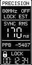

# N30 native RC target

**Version 0.2.35** brings BLE reception, passive LoRa fallback and a portrait
OLED to the Meshnology N30 / Heltec WiFi LoRa32 V3. It uses an ESP32-S3,
8 MiB flash and a 64×128 display. N30 is RC-only, with no GNSS input; WiFi is
disabled. Start with the [build guide](../../docs/n30/build.md).

Version 0.2.35 receives and forwards T096's authenticated coarse TZ metadata.
The front digital/analog clock uses local time with `CDT`, `CST` or `LOC` while
its selected parent's TZ lease is live, and returns to `UTC` on expiry/unknown.
N30's clock screensaver follows the same rule. LoRa/RC9 and timing diagnostics
retain UTC. This uses the fixed mesh configuration from T096 0.15.205;
automatic geographic/DST selection is not implemented. Old coarse revisions
cannot admit this profile. See [wire compatibility and checks](../../docs/esp32-time-zones.md).

Version 0.2.34 preserves a recently trained local clock through a direct GM
handoff. The display stays in HOLD through the successor's coarse JOIN; its
first authenticated physical correction resumes continuous phase steering
with the learned rate. New source permission, fit points and lock quality are
acquired independently. Carry expires30s after the last physical observation;
large time steps still fence the clock and require ordinary acquisition.

Version 0.2.33 consumes authenticated GM7 revision-3 successor announcements.
Withdrawal, completed timed yield, an observed successor promotion or sustained
source loss starts fresh recovery with a short preference for the named GM.
The replacement still requires authenticated admission and new timing samples.
See the [handoff behavior and offline checks](../../docs/w12/build.md#gm-successor-recovery).

Version 0.2.32 retires an active periodic-sync owner when the pinned SDK
returns a successful HCI terminate acknowledgement or confirms it is already
absent. Its later queued notification cannot retire a replacement capture.
Pending create cancellation still requires its real completion; original drain
and quiet deadlines remain enforced. The compact fault site distinguishes
terminate API errors, late acknowledgement and unclosed drain expiry. Native
regressions establish software behavior only.

Version 0.2.31 also clears obsolete trials and backoff when a freshly
authenticated RC7 response changes the root, boot, source epoch or publisher
path through the same relay. Its current response and ACL survive the fence;
the old PA retains its actual drain deadline. An unchanged-path renewal keeps
its existing policy. Operator pins and per-device calibration survive.

Version 0.2.30 also clears old normal-source selection history when RC9 fallback
first takes over, and when a direct root authenticates after an earlier empty
scope. These transitions retain authenticated fallback expiry and actual radio
drain ownership; stale trial history cannot defer the replacement leader.

Learned parents, leader sessions, clock models and retry history exist only in
RAM and start empty on every boot. Bluetooth bonding/NVS persistence is disabled;
the application does not load or write learned state in flash. A watchdog
restart can restore only an explicit operator parent pin from its RTC record.
Enrollment, registry and calibration remain build inputs. Fresh advertisements
may select the same parent again, but require a new authenticated admission.

Version 0.2.29 retires the old leader's session, timing model, queued timing
samples, discovery locators, cooldowns and selection history after 1.5 seconds
of continuous source-permission loss, or immediately after an authenticated
source-incarnation change. Short gaps retain acquisition. Operator pins and
per-device calibration survive. Fresh discovery and authenticated admission
are required before FOLLOW returns; a JOIN alone grants no precision. Repeated
cache resets cannot grant a recovery admission more often than every five seconds.
Exact duplicate incoming relay connections retain their existing owner and
deadline; valid capacity overlaps are refused and drained by the worker.
Hardware failover and precision remain subject to exact-image verification.

Version 0.2.28 fixes automatic return from RC9 fallback to normal BLE after
mesh recovery. It reuses bounded passive discovery, requires fresh normal
admission and preserves fallback expiry, explicit pins and separate clock
models. See [AUTO recovery](../../docs/w12/rc9.md#auto-client-return-to-normal-ble).

| Clock | BLE + LoRa | Precision | LoRa receiver |
| :---: | :---: | :---: | :---: |
|  |  |  |  |

*Production-renderer previews, not hardware photographs. Precision shows a
recorded **49 ns causal SYNC RMS** from the completed N3-2 research run;
its other values are illustrative. Select an image for native resolution.
[Image provenance](../../docs/images/README.md#n30-precision-preview).*

## BLE and LoRa timing

BLE and LoRa maintain independent clocks. Settled BLE lock takes display
priority; available LoRa time supplies the `LOR` fallback. LoRa uses its original 20 MHz XTAL counter for DIO1 capture mapping, independently
of the BLE fine counter. LoRa never trains the BLE clock or grants downstream
timing authority. Its receiver requires an
explicitly configured T096 transmitter and uses the fixed 915 MHz profile.

LoRa AUTO starts after three accumulated minutes without live BLE lock and
stops after three continuous minutes of recovery. BLE automatically seeks a
fresh parent after sustained lock loss. See the [timing and recovery details](../../docs/n30/build.md).
BLE100 is standard; BLE50 is client-only. Optional BLE100 relay transmission
uses estimated TX timing with unknown RF/UTC bounds. The UART console is not
a T096 USB timing source.

Version0.2.25 also consumes the distinct W12 **RC9** direct-client service.
It carries functional LoRa-derived UTC with unknown transport/precision bounds,
separately from the normal BLE fitter. Fresh direct LoRa takes priority over
RC9; settled normal BLE retains priority over both. RC9 cannot relay further.
See [RC9 behavior and checks](../../docs/n30/rc9.md).

Version0.2.26 aligns AUTO's BLE lock input with the existing controller: current
source and model permission must be live, while the one-second quality forecast
uses the original replay horizon. Short permission renewals no longer suppress
continuous recovery. UTC delivery deadlines and the180s AUTO dwell are unchanged.
The LoRa diagnostic reports the worker's actual `ble_locked` input.

The experimental fine profile associates supported packets with captured
controller events on one continuous **80 MHz counter (12.5 ns ticks)**, then
delivers timestamps on a 50 ns grid. It requires its own calibration and GPIO
review; unconfigured builds retain the 20 MHz backend. Reusable diagnostics
default OFF and support finite, configurable collection. See the
[fine-receiver contract](../../docs/n30/build.md#empirical-fine-receiver-candidate)
and [diagnostics guide](../../docs/n30/build.md#version-029-reusable-timing-diagnostics).

## Latest precision results

| Measurement | Result | Population and limits |
| --- | --- | --- |
| N3-2 internal causal SYNC RMS | **49 ns observed** | Rolling prediction quality; three 49 ns readings among 311 finite readings in 313 status snapshots. |
| N3-2 downstream relative shadow PPS | **166.590 ns RMS** | Full 660 s window: 657 eligible + 3 invalid, zero nominal missing; mean −106.811 ns, maximum absolute error 1591 ns. All tails retained. |
| N3-1 same-correction transfer | **150.954 ns RMS** | Separate short check: 48 eligible + 16 invalid, no sequence gaps; mean +115.167 ns, maximum 362 ns; one terminal unread edge. |

**Display RMS is internal prediction quality, not downstream PPS accuracy.**
Counter resolution and calibrated RF/UTC accuracy are also separate. The
sub-100 ns downstream target remains open.

The full N3-2 run used a fixed 50909 ns relay correction. N3-1 carries the
revised **51016 ns total correction** derived from that run, with its own
publisher and direct-root scope. The fresh N3-1 check kept a positive mean:
the same constant did not transfer zero mean across boards. No refit was made
during that check.

The [eight-page research draft](../../papers/ptob-esp32s3-timing-preprint.pdf)
and [selected evidence](../../evidence/s3/2026-10-22-fine/README.md) document
these results and the remaining TX-event, RX-delay and causal-validation work.
Earlier results remain in the historical paper editions.

## Screens and controls

Boot shows a PToB splash for up to 1.5 seconds after its first successful OLED
transfer. BLE reception and clock acquisition start before OLED initialization
and continue throughout the splash. A current settled BLE lock with internal
SYNC RMS below 1 µs ends it early. A fresh eligible GM starts admission
immediately, without the initial discovery collection wait.

A short press cycles **Clock → BLE + LoRa → Precision → LoRa → Clock**.

Version 0.2.23 enters the 1 ppm fine phase slew below 2 µs. The screensaver
retains its existing 500 ms exit after continuous loss of both timing inputs.
A brief Precision-header flash on both boards remains under investigation;
optional console capture now records surface transitions and completed OLED
write spans without changing that exit policy.

The clock page's bars show fresh RSSI from the active BLE parent, for direct GM
and relay or RC9 reception. They remain independent of clock lock and expire after
two seconds without an authenticated packet. Unknown signal and LoRa fallback
show empty bars. Strong-signal thresholds are −85, −70 and −55 dBm.

| Page | Hold action |
| --- | --- |
| Clock | 1.5 s toggles automatic parent selection / relay-only reception. |
| BLE + LoRa | 1.5 s opens RF help; 4 s blanks the display. |
| Precision | 1.5 s opens precision help; 4 s blanks the display. |
| LoRa | 1.5 s overrides AUTO: KEEP ON → KEEP OFF → AUTO. |

Precision shows the root name, BLE/RC1/RC2 path and PPS indicator, causal RMS,
`REL ±ppb`, selected clock/tick size and continuous settled-lock duration.
REL estimates the recent prediction-error trend; it does not steer the clock.
The dual-radio page compares clocks only when their root, boot and source
scope match. LoRa overrides reset to AUTO on boot.

## Build and verification

Use the [build and onboarding guide](../../docs/n30/build.md) for pinned public
dependencies, offline tests, previews and exact-device installation checks.
The target reuses W12 timing and selected T096 RC8 sources; see
[source notices](NOTICE.md) and [source provenance](../../docs/n30/source-provenance.json).

N3-1/N3-2 use the [shared registry](../../registry/README.md). Verified factory
identities, enrollment and enrolled images stay in ignored local files;
no enrolled binary is distributed. Host tests and native builds establish
software properties, not hardware acceptance or calibrated output accuracy.

Copyright (c) 2026 Jonathan Yantis. MIT; preserved source notices apply.
