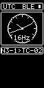
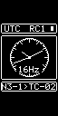
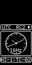

# N30 offline RC target

Copyright (c) 2026 Jonathan Yantis. MIT; preserved source notices apply.

**Version 0.2.1 adds passive RC8 wire3 LoRa timing with BLE priority, 180-second
AUTO acquisition/recovery dwell and a third T096-style receiver page. Physical
LoRa reception and timing accuracy require separate hardware observations.**
Meshnology N30 / Heltec WiFi LoRa32 V3 is the proposed board route: ESP32-S3,
8 MB flash, 128×64 OLED mounted as a 64×128 portrait display, UART0 console via
USB serial bridge. Exact incoming revision, display controller, rail/pin route,
orientation, USB path and recovery/partition compatibility remain unverified.
The original offline preparation operated no hardware. Subsequent arrival identification confirmed two ESP32-S3 revision0.2 /8MB devices and their factory OTA partition tables; first-install tests remain separate. No enrolled image is
published. Default build products remain `OFFLINE_NOT_FLASHABLE`; `--commissioning` requires clean committed sources and a separate exact-device hardware review.

| Clock · page 0 | Dual RF · page 1 | LoRa · page 2 |
| :---: | :---: | :---: |
|  |  |  |

Production-renderer previews with synthetic values for N3-1; no measured
performance. [Reproduction and arrival checklist](../../docs/n30/build.md).

| Screensaver · BLE | Screensaver · RC1 | Screensaver · RC2 |
| :---: | :---: | :---: |
|  |  |  |

## Behavior and boundaries

- **RC only, no GPS/GNSS.** BLE100 receiver by default; BLE50 remains client-only.
  `--estimated-relay` retains the existing optional BLE100 experimental relay,
  programmed TX estimate and unknown RF/UTC bound. No GM, DC or PC profile exists.
- The G1/RC7 timing, authentication, capture association, source expiry, parent
  selection, replay handling, controller ownership and watchdog implementation
  compile directly from W12. W12 and T096 firmware sources are unchanged.
- Three portrait pages adapt T096's clock/RF composition with native bitmap text,
  analog hands, relative synchronization RMS, RC footer and reception bars.
  Monochrome lamps use a center dot for RX/event and a filled cell for TX/API.
  WiFi remains disabled. Screen 2 adds separate raw BLE and LoRa times, event
  lamps, `DNS` (BLE minus LoRa nanoseconds) and `PPB` drift. Comparison requires
  matching full root identity, root boot and source epoch, plus current LoRa
  companion metadata; unavailable/mismatched clocks show dashes. BLE time has
  microsecond quantization. Drift advances only with a new original corrected
  LoRa event, never because the display refreshed. These are relative estimates,
  not calibrated RF delay or independently measured UTC accuracy.
- **LoRa is RX only.** The exact configured T096 transmitter, shared group HMAC
  and original RC8 context must match. The actual T096 codec/receiver policy is
  compiled directly. No SetTx command exists in the N30 owner. After 180 seconds
  without live BLE relative lock, AUTO enables the SX1262 receiver; it remains
  on until BLE stays locked continuously for 180 seconds. A dip resets that
  recovery interval. BLE retains preference whenever its following clock is
  actually usable. Otherwise available LoRa time can drive the dashboard/saver
  as `LOR`, with `LINK RMS` and no BLE precision-lock icon. Its 12-second
  functional hold, original event/envelope, replay handling and unknown source
  freshness remain distinct; companions and display refreshes cannot renew it.
  LoRa never trains BLE, grants downstream authority or enables GM/GNSS/USB time.
- On the third screen only, hold 1.5 seconds to select `KEEP ON` while AUTO is
  off, or `KEEP OFF` while AUTO is on. A hold in `KEEP ON` selects `KEEP OFF`;
  the next hold from `KEEP OFF` returns to AUTO. One press
  produces one action; leaving the page cancels it. Override is volatile and
  boots into AUTO. The automatic dwell tracking continues during an override.
  The new page follows T096's RX/mode/time/link-quality/root/parent composition.
  Full original scope, companion quality, counters, capture/SPI state and policy
  diagnostics are available through the bounded `lora diag` console snapshot.
  Unknown bounds stay unknown; this target has no durable LoRa fault journal.
- RF lamps show published producer counters: HEL discovery callbacks; SRC group
  records; PRE periodic reports; ACK accepted JOINs; CMT accepted corrected-model
  updates; SRV controller TX calls; ERR rejects/drops/API errors. These are
  different populations, not packet delivery denominators or actual RF TX
  timestamps. RDY has no equivalent event and remains dark (`N/A` in help).
- The analog dial/lock use W12's existing settled relative-quality display gate.
  On the first (main clock) page, the last successfully displayed UTC digits,
  analog hands, source/identity and footer freeze together for500ms after loss
  of the live analog gate. The RMS digits and lock indication remain live
  during that brief grace; the PPS lamp goes dark without a live lock. The
  screensaver retains the rest of its last frame and position instead of flashing the normal page at the top and reappearing.
  Recovery resumes live clock rendering; at500ms of continuous loss the current
  syncing/error page appears. Wake/navigation, blank/help and transfer failures
  discard the cache. The normal30s saver movement phase is never reset by a
  reception dip. This is a pixel presentation cache: timing models, source
  expiry, radio authority and console status retain their actual live validity.
  HOLD remains a local estimate; it grants no source or downstream authority.
  No GNSS/PPS activity or independent accuracy is implied. Direct-GM reception
  bars remain unknown unless a producer supplies a delivery denominator.
- Short press cycles clock → dual RF → LoRa → clock. On the main clock page, hold1.5s toggles automatic
  upstream selection / relay-only reception using the unchanged W12 mode API.
  One hold produces one toggle, even beyond4s; the footer shows `R` for relay-only
  and `>` while a mode change is pending. Relay-only reception does not enable
  the optional estimated relay transmitter. On the RF page, hold1.5s opens help;
  short press leaves help, and hold4s blanks the display while the clock continues. This is display blanking,
  not verified board poweroff/deep sleep. The first wake press is consumed.
  After five idle minutes a currently locked clock dims and moves the T096-style
  source/dial/identity assembly. `BLE`, `RC1` or `RC2` describes the actual admitted
  upstream path, independent of requested mode; outside the brief presentation grace, stale/pending time shows `WAIT`
  and a valid local hold shows `HOLD`. No unavailable source is invented.
  There is no runtime GM/RC toggle. Boot-held buttons do not trigger actions.
- A sole low-priority display/button worker on core 1 owns I2C; the main timing
  task and BLE host/controller remain on core 0. Clock/saver updates target 4 Hz,
  RF 8 Hz and LoRa 4 Hz, aligned to the current modeled UTC quarter/eighth-second grid. An
  `esp_timer` one-shot only wakes the worker; it does no rendering or clock work.
  Buttons retain 10 ms polling and page/wake redraws run promptly. Fresh models
  rephase pending wakes; missed frames are dropped without catch-up. Both clock
  surfaces show a 250 ms PPS lamp at the modeled second edge, only while live
  and relatively locked; HOLD/stale/fault/pending time cannot blink. OLED pages
  containing the PPS and seconds digits transfer first in either rotation,
  after the edge, without displaying a predicted future second. `phase_us` is
  the worst observed routine UTC-slot render-start lateness; it excludes user
  forced frames and is not a photon/PPS/UTC accuracy measurement. Display transfers retain one 50 ms
  whole-frame deadline and a truthful invalidation after any partial failure.
  The UART console retains bounded queues, CRC frames, tickets and2s update drain.
  `W12_*` console record names remain compatible; `N30_TARGET`/`N30_UI` identify
  this target. This console is not T096 UTS1 USB timing or a macOS time source.

## Names and shared registry

The arriving clocks are reserved as **N3-1** and **N3-2** in
[onboarding.json](onboarding.json). Their factory identities are retained only in the ignored local onboarding records.
No placeholder entries were added to a deployment map. During onboarding,
[tools/onboard.py](tools/onboard.py) takes an operator-verified factory MAC,
retains the ESP32 identity rule (`0000` + full factory MAC), validates and
atomically updates the ignored shared `registry.json`, and writes a separate
ignored device configuration. It refuses alias/identity collisions, preserves
other target rows and UUIDs, and opens no hardware. Give the updated map to all
subsequent target builds; installed maps still require rebuilding.

## Source and verification

[Selected adaptations](imports/2026-10-20.json) record the public W12 entry-point,
console and font origins. The target keeps its own entry point, UART adapter,
GNSS-absent API, display and build tooling; it shares the actual W12 core rather
than copying that implementation. Build receipts snapshot/hash both target and
shared source boundaries and bind registry, factory, orientation and configuration
into the runtime identity. [Source notices](NOTICE.md) and the
[build guide](../../docs/n30/build.md) describe dependencies and commands.

Host/sanitizer tests, static stack checks, native builds and previews establish
software properties only. New LoRa/display/BLE coexistence,
recovery, sustained interoperability, actual estimated relay behavior and UTC
accuracy are unvalidated. Hardware operations require separate exact-device authorization/review; current
commissioning candidates do not imply completed hardware acceptance.

Version0.2.1 coalesces a forced page/wake redraw with a modeled UTC edge when
starting the50ms whole-frame work budget would cross it. Navigation can wait
less than50ms; routine4/8Hz cadence is unchanged. Transfers that occupy a later
slot drop that missed slot instead of issuing a catch-up burst. This corrects
the first0.2.0 canary's27ms render-start process failure on the third page;
actual display-edge and independent UTC accuracy remain unqualified.
