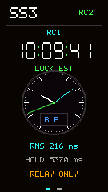
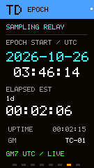
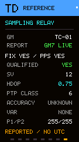

# StickS3 native RC example

 

*Network-health view (V17 renderer) and an earlier relay-clock view, both with
illustrative inputs. These are not current-build hardware captures or measured
accuracy. [Image provenance](../../docs/images/README.md).*

Copyright (c) 2026 Jonathan Yantis. MIT; inherited source notices apply.

**PToB owns SS3 native G1/RC7 development.** Source firmware version **0.1.6**
receives the current **GM7 implementation3** diagnostics used by CoreSE 0.1.26,
alongside legacy GS/GD1/GD2. The receive-only codec and monitor are selected with
[explicit provenance](contracts/gm7_diagnostics_provenance.json); no election or
GM transmitter is imported. Side-button navigation cycles eight pages: Health,
Stream Quality, Relay Test, RF Health, Sample Detail, Source Health, **Epoch**
and **Reference**.

**Epoch shows the signed mesh start as a UTC date and time, with a timer since
that birth.** The mesh birth survives leader and timing-incarnation changes;
it is independent of when SS3 booted or first received a report. Passive TD mode
uses the authenticated GM7 ANN UTC sample plus local elapsed time, labeled
**ELAPSED EST**. Original report freshness is shown as LIVE/LAST; this estimated
diagnostic timer never supplies timing permission, clock training or output.
Without a signed birth/UTC sample the missing values stay unknown. Local uptime
is shown separately. Version 0.1.5's locally observed epoch timer did not provide
the requested mesh-start semantics and is superseded.

Reference shows reported fix, PPS, qualification, satellites, real GGA HDOP and
the raw PTP-shaped election tuple from GM7 GNSS or legacy GD1/GD2. A reported
qualification flag describes the GM, not SS3 output. Canonical advertiser,
64-bit GM7 replay/sequence, lineage, current scope and original expiry guards
are preserved. Expired or mismatched reference values become unknown. Existing
passive survey windows, radio ownership, source permissions and timing models
are unchanged; the older health page retains its ten-second observed HOT dwell.

 

*Current production renderer, synthetic values. [Preview provenance](../../docs/images/ss3-diagnostics-provenance.json).*

The original baseline is imported source `56740553885420a7f6f301c12de10696a9c8d432`, the M5Stack StickS3
K150 V17 application with TD diagnostics and a 150 ms health-display hold.
The Relay Test screen keeps the four strongest nearby relays visible, ordered
by fresh smoothed RSSI with stable identity ties. It shows the displayed/nearby
count; missing signal sorts last and expired observations leave the list.
An early PToB splash stays visible for at least one second while USB and BLE
initialize. Existing passive scans check signed GM role changes at most once
per second. Root, boot, source epoch, membership and HOT withdrawal update
promptly; a new HOT needs matching fresh observations spanning ten seconds.
Scan gaps can delay that observation. The two-minute unchanged-status fallback,
radio schedule, task priority and timing authority are unchanged.
Version 0.1.4 retires deferred sync cleanup after an asynchronous create failure,
bounds survey-phase drain, and supervises LCD progress independently. LCD SPI
waits are finite; timed-out transfers keep their DMA storage until completion.
The one-second header activity mark and periodic full repaint make idle display
activity visible. Finite testing does not establish indefinite reliability.
See the [standalone build guide](../../docs/ss3/build.md),
[cutover record](../../docs/ss3/cutover.md),
[explicit import provenance](imports/2026-10-16.json) and [notices](NOTICE.md).

The supported profile is **RC at BLE100**, including an experimental estimated-TX
relay. No GM, local election, GNSS, external PPS, LoRa, WiFi or PTS service is
provided. The relay advertises an unknown TX timing bound and does not claim
actual TX capture. Source expiry, physical receive/correction matching,
controller ownership and bounded update drain remain independent of display
health. A 150 ms LCD hold never extends timing permission.

Direct BLE100 authentication renews after 225–240 seconds, with a fixed
six-minute session. Fresh matched GR3 physical corrections maintain the coarse
replay anchor inside that session; signed source/map expiry, uncertainty and
ownership limits remain independent. RC7 admission remains five minutes with a
six-minute lease. This successor is prepared and checked offline; C-4 W12
observations do not qualify SS3 hardware.

The target consumes the [shared display registry](../../registry/README.md).
Factory binding, group enrollment and enrolled images are ignored local inputs.
No public enrolled binary or generic installation/recovery tool is supplied.
The USB interface is a diagnostic CDC console, not the T096 UTS1 timing service
used by the macOS client. Build/tests do not qualify physical RF timing,
independent output accuracy, optical scanout or continuous reliability.

For a complete group, follow the [two-GM setup guide](../../docs/GETTING_STARTED.md).

## Timing schematic

Shared-family reference illustrated for W12; its optional GNSS/PPS and other
W12-specific paths do not imply StickS3 support. See the supported profile above.
Select the preview to open the [full interactive schematic](https://ptob.dev/hardware/esp32-s3/timing/).
[Capture provenance](../../docs/images/README.md).
