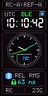
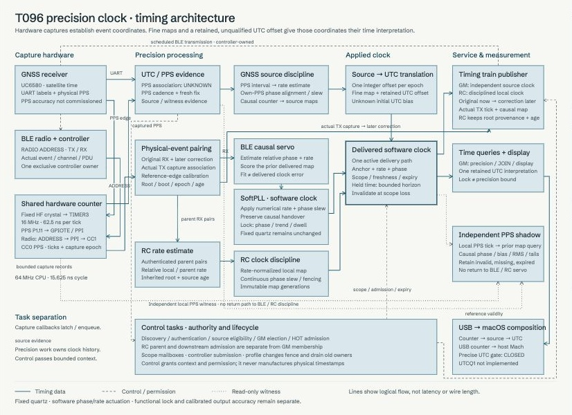

# T096 firmware example

*Illustrative firmware-rendered RC screen; displayed values are not measured
performance. [Image provenance](../../docs/images/README.md).*

**PToB owns T096 RC7 development.** Current source version **0.15.132** supplies the
ordinary **GM** and **RC** mesh profiles, with USB timing compiled by default.
[Build from source](../../docs/t096/build.md) with pinned public dependencies
and ignored local enrollment. No enrolled binary is distributed.

The display uses an exact 17-color palette and one bounded DMA staging buffer,
recovering 7,680 bytes of static RAM without changing its pixels or cadence.
LoRa hardware defaults to disabled unless a private exact-factory binding is
explicitly supplied. Host checks and native memory inspection do not establish
physical SPI/BLE coexistence or delivered-time accuracy.

The [RC8 wire3 integration](../../protocol/rc8/README.md) adds exact actual-GM or
selected authenticated locked-BLE follower exports, an independent lower-quality functional
estimate, page7 controls and a bounded priority11 radio worker. BLE remains
preferred while usable. A transmitting follower needs no local PPS; an actual
GM retains its own PPS/source gate. Timing packets carry the full root identity and source epoch; a missed companion
still permits functional acquisition. Companions describe boots, parent and measured
quality about every120 seconds and on significant changes. Cold passive freshness and total uncertainty are UNKNOWN;
optional independent admission improves assurance. RC8 grants no RC7 timing,
GM promotion, RC9 or USB authority. Version131 adds a separate negative GM
election constraint: a live foreign LoRa root inhibits local ACTIVE/HOT unless
current direct matching-root BLE admission permits normal coordination. An
immediate relay parent cannot substitute for the actual GM. Self-root echoes
remain rejected, and original hold/withdrawal/source fences are retained.
This source corrects prior-correction validation ordering: the full immutable context
is populated before validating a carried prior event. Version124 discarded those
corrections despite mapped physical TX events. It remains an unqualified canary integration until its
separate native/resource and authorized exact-device checks pass.

Page7 shows source/parent diagnostics and an RX-only LoRa link affine residual
RMS from4..16 matched physical radio event pairs. COLLECTING/NO TIMING identify
missing local fit data. The metric measures relative consistency; it is separate
from advertised parent/BLE quality and grants no absolute accuracy bound.
Reset-aborted software launches consume their possibly transmitted sequence,
retire fully and restart at a bounded cadence; real completed-launch timeouts
remain faults. Timing and companion hardware cutoff durations are unchanged.
Version126 also resets an actual BUSY-high deadline only while SetTx is
unfinished and DMA has retired without a transport fault. The ambiguous sequence
is consumed before bounded closure/retry. Other BUSY deadlines stay faulting;
new diagnostic count/opcode fields distinguish this path without added RAM.
Version127 captures the first LoRa fault through the existing event journal and
uses the hardware watchdog for real transport faults or a frozen owner. Unsafe
DMA is retained until MCU reset. The record distinguishes actual closure and
journal success/failure; a conditional retained reset capsule carries the cause
across a same-image watchdog boot. Source/RF silence alone never requests reset.
The journal's startup scan scratch funds this observer without added static RAM.
Version128 also cancels an in-progress start before the out-of-band fault fence;
a returning worker cannot release reset after the watchdog has inhibited it.
Version129 keeps the original chip/FEM launch budget at software retirement,
and wakes/prioritizes inhibited drain work above console/diagnostic writers.
BLE priorities, the200ms drain bound and all existing reserves remain unchanged.
Version130 fires the LoRa toggle once at1.5s and consumes that press, while
intentional4s poweroff stays on other pages. Its schema6 journal carries the
primary fault through ordinary commits/page erases until a newer terminal
cause supersedes it, within the existing bank0 owner and RAM reserve.
Version132 gives the dedicated radio owner its GPIO NSS line. Successful
completion of the SetTx bytes starts the original FEM window and releases NSS
in one bounded GPIO/timer fence. A delayed worker return cannot turn an already
committed healthy launch into a reset/retry storm. Precommit, source deadline,
BUSY/DMA and true completed-command timeout guards remain separate. No SPI or
wait is added to the completion callback, and BLE priorities stay unchanged.

T096 participates in the shared G1/RC7 mesh with W12 and StickS3 receivers and
experimental relays. RC selection considers aged timing/delivery history as
well as signal strength, gives authenticated relays time to acquire or recover,
and retains a healthy parent. Both RC1 and RC2 streams are eligible; a receiver
following RC2 stays a leaf. Earlier authentication renewal, preserved retry
backoff and source-aware recovery retain opportunities before the original
binding expires. Explicit parent identities support bounded comparisons;
normal operation uses automatic selection. A newly detected signed serving-GM
announcement requests a direct authentication attempt before relay acquisition
protection or old non-root cooldown. Scanning resumes when a connected parent
stops supplying usable time. A previously working parent is retired once usable
time has been absent for ten seconds and PA is no longer synchronized. Exhausted
acquisition or degraded recovery also clears the selection even when no other
parent is visible. The old owners drain before selection and timing state are
cleared; returning identities require fresh admission. The announcement grants
no timing permission.

An established downstream train can survive a timing interruption for up to
30 seconds using packets with no corrections. Timing permission withdraws
immediately; source/map expiry, child leases, authentication, startup lock and
controller drain deadlines retain their bounds. A brief analog-display grace
and longer watchdog recovery allowances do not extend timing authority.
See the [changelog](../../CHANGELOG.md) for policy details and the
[selection and diagnostics guide](../../docs/t096/diagnostics.md) for checks.

RC exports its accepted BLE clock over USB independently of downstream relay
transmission. Use a compatible RC for the current
[macOS USB timing chain](../../clients/macos/README.md). The normal GM backend
has no reachable USB source-map publisher; its USB interface alone does not
establish UTC delivery. Continuous BLE/USB service and calibrated UTC/output
precision remain unqualified. The dated
[stability collection](../../evidence/stability/2026-10-16/README.md) preserves
earlier failures and its own source identities.

**[Direct Connect (DC)](../../docs/t096/direct-connect.md)** is a separate,
flash-only GNSS-to-USB image with Bluetooth compiled out. It uses no group
enrollment and cannot be selected through the GM/RC toggle. A second USB serial
function carries original GNSS output and bounded RTCM/configuration input;
raw observations depend on receiver firmware and do not imply onboard RTK.
DC and RC share an immutable USB publisher whose original source, map and
session deadlines cannot be renewed by polling.

**[Power Control (PC)](../../docs/t096/power-control.md)** is a separate,
flash-only awake BLE leaf experiment. Fixed listening/HOLD budgets and causal
BLE/PPS observations characterize experimental relative precision. It does not
implement sleep or measure energy, and cannot select an ordinary profile.

All targets use the [shared display registry](../../registry/README.md).
[PSKs](../../docs/security/psk.md),
[identity rules](../../docs/security/identity-and-names.md) and the
[group setup guide](../../docs/GETTING_STARTED.md) describe local deployment
inputs. Real enrollment, maps and secret-bearing images remain ignored.
Mutable [provisioning/storage](../../docs/t096/provisioning-design.md) and a
generic public installation/recovery flow remain pending. Hardware updates
require separately authorized exact-device guards.

[Source provenance](imports/README.md),
[baseline limitations](../../docs/t096/baseline.md) and the
[cutover record](../../docs/t096/cutover.md) distinguish the current application
from selected historical sources. The
[V14 papers](../../papers/README.md),
[RC1 contract](../../protocol/v14_rc1/README.md) and
[R2 evidence](../../evidence/v12/r2/README.md) retain their own editions and
qualification limits. Build or simulation success does not qualify hardware.

## Timing schematic

Logical capture, clock-discipline and delivery paths.
Select the preview to open the [full interactive schematic](https://ptob.dev/hardware/t096/timing/).
[Capture provenance](../../docs/images/README.md).
