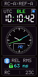

# T096 · GNSS, BLE mesh and USB clock

PToB firmware for the **Heltec T096 (HT-n5262G)**. Use it as a GNSS-backed
grandmaster, a BLE receiver/relay with a local clock display, or a dedicated
GNSS-to-USB source for macOS. Optional LoRa supplies a separate fallback timing
path.

[Set up a group](../../docs/GETTING_STARTED.md) ·
[Build firmware](../../docs/t096/build.md) ·
[Troubleshoot](../../docs/t096/diagnostics.md) · [Changelog](CHANGELOG.md)

*Illustrative firmware-rendered RC screen. Displayed values are not measured
performance. [Image provenance](../../docs/images/README.md).*

## Choose a profile

A **grandmaster (GM)** supplies reference time. A **relay clock (RC)** follows
received time and can make it available to downstream clients.

| Profile | What it does |
| --- | --- |
| **GM** | GNSS-backed grandmaster. One serving **ACTIVE** nominates a preferred **HOT** successor; standbys arm locally after independent qualification and physical shadow preparation. |
| **RC** | Receives authenticated BLE time from a GM or relay, displays it and exports it over USB. Supports the RC7 relay path; following an RC2 stream stays a leaf. |
| **DC** | Dedicated GNSS-to-USB image with Bluetooth disabled and no enrollment. Includes a second GNSS serial/correction bridge. [DC guide](../../docs/t096/direct-connect.md). |

The ordinary mesh image switches between **GM and RC**. DC requires a separate
flash. ACTIVE/HOT/COLD are GM states; RC1/RC2 describe relay depth. A GM needs
local GNSS fix, live PPS and source qualification, including a **60-second dwell**,
before serving time. COLD can receive BLE timing while qualifying locally.

## Get started

1. **Prepare compatible firmware.** Follow the [build guide](../../docs/t096/build.md)
   with verified device identity, private trust enrollment and a shared
   [name registry](../../registry/README.md). Keep trusted credentials separate
   from local mesh discovery; a context change requires fresh authentication.
   Enrolled images stay local. Use matching coarse-wire profiles across the group.
2. **Start the source.** Select GM and give GNSS a clear view of the sky. Check
   fix, PPS and source readiness on the quality/precision screens. For several
   GMs, follow the [GM coordination guide](../../docs/t096/gm7-implementation.md)
   and allow the nominated standby to finish local shadow preparation.
3. **Add receivers.** Select RC in range of the source. Check the actual selected
   parent, fresh timing and relative clock lock before adding another hop.
   Automatic parent selection considers delivery as well as signal strength
   and searches again when usable time is lost.
4. **Connect USB if needed.** Use **GM → BLE → T096 RC → USB → macOS**, or
   **GNSS → T096 DC → USB → macOS**. Follow the
   [macOS guide](../../clients/macos/README.md). Normal RC images include USB
   timing; the normal GM backend does not publish a USB source map.

## Capabilities and specifications

| Area | Current configuration |
| --- | --- |
| Hardware | Heltec T096 / HT-n5262G; Nordic **nRF52840**, **UC6580 GNSS** with PPS, **SX1262 LoRa** radio. |
| Display | **80 × 160** portrait color TFT; digital/analog clock, RF activity, precision, GNSS quality, system and shadow-PPS pages; LoRa page when enabled. |
| Display behavior | Normal refresh **4 Hz**, RF page **8 Hz**. Eligible screensaver starts after **5 minutes** idle at **50% brightness**. |
| BLE timing | Authenticated **G1/RC7** precision reception and relay. Current coarse TZ wire uses **GM7 revision 4, JOIN revision 5, RC control/capability revision 8**. |
| GM coordination | Broadcast ANN/STATUS/ROLE, persistent G1 following without GM admission, local HOT readiness and independent GNSS qualification. Client GATT admission remains required. |
| LoRa timing | **Passive wire3** fallback with one designated transmitter, exporting qualified local GM time or authenticated locked BLE time. |
| USB | Hardware-captured USB frame boundaries; RC exports BLE time, DC exports local GNSS time to the macOS client. |
| Local holdover | BLE-only guarded rate consensus, paired frozen shadow clocks and a120s local watch estimate; [policy and verification](../../docs/t096/holdover.md). |
| Time zone | GM uses its GNSS location and pinned IANA offset calendars; manual-zone/fixed-offset overrides. Live mesh metadata remains leased. The display retains its learned zone for the current boot, with pinned DST calendars. |
| Development | Zephyr-based native builds with pinned public dependencies; private device binding and GM/RC enrollment. No enrolled binary is distributed. |

W12, N30 and CoreS3-SE consume the current coarse TZ profile; StickS3 retains
its own selected profile. Check each target's guide before pairing images.
Precision payload names alone do not establish coarse-wire compatibility.
[Wire contract](../../protocol/time-zone-v1/README.md) ·
[W12/N30 TZ behavior](../../docs/esp32-time-zones.md) ·
[Automatic time zones and DST](../../docs/t096/auto-time-zone-plan.md).

## Passive LoRa fallback

The [current LoRa design](../../docs/t096/lora-protocol.md) defines passive wire3,
separate from historical RC8. Select the slow 60/300 s variant and one exact
transmitter factory at build time. Listeners request RX at boot in both GM and
RC profiles; GM participation does not suppress passive RX. The designated
GM-profile device requests TX and may export qualified own-GNSS time or fresh
authenticated locked BLE time from another GM. Becoming ACTIVE does not enable
LoRa TX on another device. There is no automatic backup emitter.

The slow profile sends precision/control every 60 s and full META nominally every
300 s. Matched current receivers are required for its 7 s SYNC offset and delay
validator. GNSS and BLE timing retain priority. Internal precision/META retries
retain owed work after proven closure; clients send no ACK or retransmission.
See the [build guide](../../docs/t096/build.md#optional-lora-configuration) for
selection and the [soak guide](../../docs/t096/lora-soak.md) for measured checks.

Runtime state is RAM-only: boot resets airtime, cooldown/session state, fits,
faults and replay history. Profile/source changes within a boot retain airtime.
Historical flash ledger/journal bytes remain unused and untouched. The 72 s per
rolling-hour engineering cap has no cross-boot enforcement and establishes no
FCC compliance. The [design](../../docs/t096/lora-protocol.md#range-and-fcc-compliance-considerations)
records RF/antenna considerations and future slow-profile range goals; field
coverage, power and emissions remain unmeasured.

LoRa can drive the digital and analog watch when BLE is unavailable. The watch
shows **LOR**, relative **LOR RMS**, authenticated emitter identity, actual mode,
measured RX-strength bars and a **60 s** badge. UTC remains the internal clock
coordinate. Native fitting needs four points spanning 180 s. RMS describes
relative physical-link consistency, not independent UTC accuracy, BLE lock or
an uncertainty bound. LoRa grants no GM service/election, HOT, BLE relay or USB
timing authority. Passive wire3 has no RTT/ToF exchange.

A cold slow watch may show amber **ACQ** UTC after its first authenticated pair.
It uses nominal rate and a frozen reference. Trained maps continue as amber
**HOLD** through loss/retraining. More than **120 s** without accepted precision
exits/blocks the screensaver; more than **300 s** hides the dial and shows
**ACQ/SYNCING**. Cached UTC/TZ remain in RAM. DISC/META cannot renew these limits;
**REF AGE** measures the frozen reference. A new fit replaces it. OFF,
context/capture changes, authenticated TIME_INVALID and faults clear the map.
ACQ/HOLD have unknown uncertainty and grant no export authority.

Authenticated selected TZ can teach a boot-local display cache before UTC.
Valid changed metadata replaces it; unknown metadata and timing loss do not
erase it. Known geographic zones follow pinned calendars at displayed UTC;
calendar failure hides conversion while retaining identity. Reboot clears the
cache. It grants no timing authority.

For one bounded lab META/pair, use the boot-bound
[`lora-utc` diagnostic](../../docs/t096/lora-utc-diagnostic.md). Its explicit
per-job cap override applies only to that request, never to ordinary
qualification. It does not bypass source/capture, channel or physical RF guards
or replace180 s training. The finite fast variant and historical RC8 controls
are described in the build guide; check the selected image before using them.

## Button controls

| Action | Result |
| --- | --- |
| Short press outside the menu | Next page. A short press from the screensaver only wakes the display. |
| Hold **2.0 s** on any ordinary page | Open the menu. Release before selecting an item. |
| Short press in the menu | Next enabled item; wrap after Exit. |
| Hold **2.0 s** in the menu | Select the highlighted item once. A continued hold cannot select again. |
| Select **Exit**, or leave the button alone for **5 s** | Close the menu and return to the invoking page. Each press restarts the idle interval; a held button cannot time out. |

Every release before **2.0 s** is a short press; the hold duration uses the
observed button edges so release debounce cannot turn it into a selection.

The ordinary GM/RC menu contains **GM Mode / RC Mode**, **Power Off**, **BLE RX
Off / On**, **LoRa RX Off / On**, and **Exit**. Rows name the next action; the
header shows the current mode. Changes keep the menu open and show a brief
result. Power Off requires its own selection hold and uses orderly shutdown.
The separate DC/PC images retain their own controls.

The factory-bound LoRa transmitter has **LoRa TX Off / On** in the LoRa row
instead of RX. Its TX row is unavailable in RC. Entering GM re-enables its TX
request; a manual OFF otherwise remains in effect for that GM session.

BLE RX OFF drains and parks the BLE owner in either GM or RC mode. It does
not restart either profile, elect a GM, or restart the display, GNSS/capture or
LoRa owners. BLE and local-GNSS timing are unavailable to the watch while OFF;
only a fresh independent LoRa receive source can supply its time. Intentional
OFF suppresses automatic BLE recovery and its no-sync watchdog. Core and LoRa
fault protection remain active. Re-enabling BLE uses a fresh locally discovered,
authenticated context. Profile selection while OFF does not start BLE.

Radio requests are volatile; an ON request does not prove RF activity or valid
time. Source, cap or hardware gates may still inhibit LoRa.

The precision page separates stream RMS, local PPS continuity and ACTIVE/HOT
duration. Shadow-PPS compares the selected BLE or LoRa clock with local PPS
when eligible. LoRa records expose raw phase and the phase after its measured
RTT endpoint-delay correction; PPS never trains the LoRa clock.
These are relative timing statistics, not independent UTC accuracy measurements.
Clock calculations, USB timestamps and diagnostics stay UTC.

## Development and limits

Continuous BLE/USB availability, durable multi-GM failover and calibrated
UTC/output accuracy remain unqualified. Current acceptance records retain
passing direct-path windows, failed relay availability and incomplete successor
gates in the [GM acceptance plan](../../docs/t096/gm-standby.md#development-checkpoint-and-remaining-acceptance)
and [TZ validation record](../../docs/t096/time-zone-test-plan.md).
Host tests and previews establish software behavior only. Public installation
and runtime provisioning remain pending; hardware work needs exact-device scope,
verified recovery and the build guide's update checks.

| Explore further | Guide |
| --- | --- |
| Build and inspect an image | [Build guide](../../docs/t096/build.md) |
| Investigate source selection or faults | [Diagnostics](../../docs/t096/diagnostics.md) · [GM coordination](../../docs/t096/gm7-implementation.md) |
| Use GNSS directly over USB | [Direct Connect](../../docs/t096/direct-connect.md) · [macOS client](../../clients/macos/README.md) |
| Review changes and source origins | [Changelog](CHANGELOG.md) · [Import provenance](imports/README.md) · [Cutover](../../docs/t096/cutover.md) · [Notices](NOTICE.md) |
| Explore the architecture | [Interactive timing schematic](https://ptob.dev/hardware/t096/timing/) · [Papers](../../papers/README.md) · [Evidence](../../evidence/README.md) |
| Explore proposed features | [PC awake timing experiment](../../docs/t096/power-control.md) · [Provisioning design](../../docs/t096/provisioning-design.md) |

Copyright (c) 2026 Jonathan Yantis. Original documentation: [MIT](../../LICENSE).
Preserved dependency notices apply.
