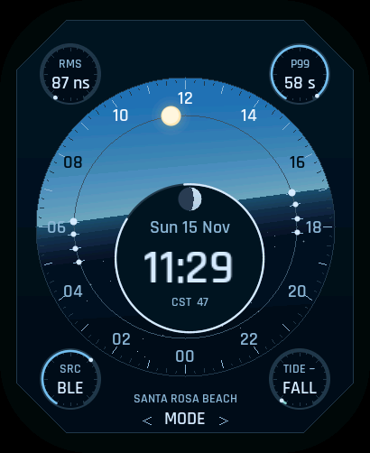
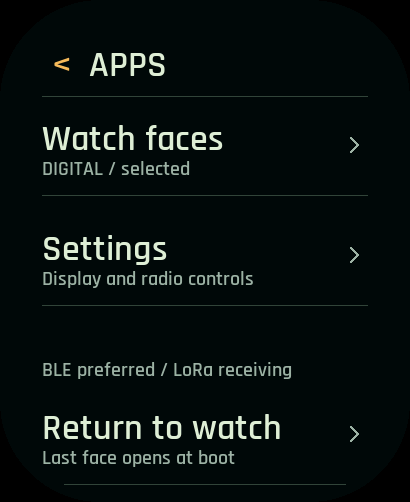

# LILYGO T-Watch Ultra

A PToB timing watch with three faces, authenticated BLE time and passive LoRa
fallback. Built for the **T-Watch Ultra V1 with SX1262**, ESP32-S3 and
**410 × 502 AMOLED**. The watch remembers your selected face.

| Digital | Instrument | Solar |
| :---: | :---: | :---: |
| [](../../docs/twatch/images/digital.png) | [](../../docs/twatch/images/instrument.png) | [](../../docs/twatch/images/solar.png) |

**Digital** puts time and timing status at a glance. **Instrument** uses smooth
analog complications for reception, lock, RMS, hold and battery reserve.
**Solar** follows the sun through sunrise, sunset and twilight, with a moon-phase
graphic and corner dials for RMS, P99 hold, source strength and tides.

These are [native-renderer previews](../../docs/twatch/images/README.md) with
synthetic timing inputs, not photographs or accuracy measurements.

## Use the watch

| Control | Action |
| --- | --- |
| Swipe left / right | Switch faces. |
| Tap MODE or click the lower-left button | Open the launcher. |
| Settings | Adjust brightness, choose **15 / 30 / 60 / 90 seconds** of screen time, or turn either radio on/off. Default: **30 seconds**. |
| Touch or click after screen sleep | Wake the screen; use a second gesture to operate it. |
| Double-click the lower-left button | Power down. Hold the upper-left POWER button for about one second to start again. |

| Launcher | Settings |
| :---: | :---: |
|  |  |

USB power keeps the display on. Face, brightness and timeout are saved; both
radios start enabled after reboot. Wrist wake is experimental and can miss
raises or wake unexpectedly; touch and button wake remain available.

BLE is preferred, with LoRa receiving in parallel when enabled. **HOLD** means
the watch is keeping time from its last valid clock; it can continue until reboot,
but its accuracy is unknown. **Sync RMS** describes internal timing fit quality.
**P99** is a sampled sub-1 µs hold statistic; `--` means evidence is not ready.
Neither value certifies UTC accuracy.

## Build and flash

1. Confirm **Ultra V1 / SX1262**; SX1280 variants are not supported. Prepare
   private enrollment and a verified device entry using [group setup](../../docs/GETTING_STARTED.md)
   and the [build guide](../../docs/twatch/build.md#inputs-and-build).
2. Install the pinned ESP-IDF toolchain from that guide, then build:

   ```sh
   python3 firmware/twatch/tools/build.py --idf "$IDF_PATH" \
     --out artifacts/watch-build-01 \
     --enrollment artifacts/local/enrollment.json \
     --device-config artifacts/local/watch.json \
     --registry artifacts/local/registry.json
   ```

3. Connect USB and follow [USB update entry](../../docs/twatch/build.md#usb-rom-entry).
   Install only the application into the verified application partition; preserve
   enrollment and other partitions, then verify application readback before restarting.
   The ROM helper enters/exits download mode; it does **not** write firmware.
4. If the application cannot enter download mode, hold the lower-left **BOOT**
   button, press and release recessed **RESET** on the right between USB-C and
   the SD slot, then release BOOT. Use the verified recovery procedure in the build guide.

There is no generic pre-enrolled download or one-command public installer yet.
Build output requires device-specific installation review; do not erase the
whole flash or use another watch's enrolled image.

## Set the location

Solar ships for **Santa Rosa Beach / 30A, Florida**, with automatic US Central
DST and **Destin / East Pass** predicted tides for **2026–2027**. GNSS stays off;
location does not update automatically.

- Change `Latitude` and `Longitude` in [calendar.hpp](main/calendar.hpp), then
  rebuild and flash. Longitude west of Greenwich is negative. Update the
  `SANTA ROSA BEACH` caption in [watch.cpp](main/watch.cpp) to match.
- For another time zone, also update the Central-time rules in
  [calendar.cpp](main/calendar.cpp) and the corresponding calendar tests. There
  is no location or time-zone picker on the watch yet.
- For another tide reference, update the station ID and station metadata in
  [calendar_data.py](tools/calendar_data.py), plus `TideStation` in
  [calendar.hpp](main/calendar.hpp). Regenerate the table using the
  [calendar guide](data/README.md#reproduce-and-refresh), test, then rebuild.
  Coordinates alone do not change the tide station.

Tides are nearby predictions, not measured beach conditions. Expired coverage
shows unavailable. Brightness is currently manual; automatic solar brightness
is not enabled.

## Development status

This is an experimental source target. BLE roaming/failover, wrist recognition,
independent timing accuracy and battery endurance still need field qualification.
LoRa stays in continuous receive; its power-saving schedule is shadow-only.
Radio recovery preserves the running clock and first-fault diagnostics, but an
unsafe shutdown remains contained rather than forcing a whole-watch restart.

[Changes](CHANGELOG.md) · [Build and diagnostics](../../docs/twatch/build.md) ·
[Power plan](../../docs/twatch/power.md) · [Source provenance](imports.json) ·
[Dependency notices](NOTICE.md)

Copyright (c) 2026 Jonathan Yantis. Original code and documentation: [MIT](../../LICENSE).
