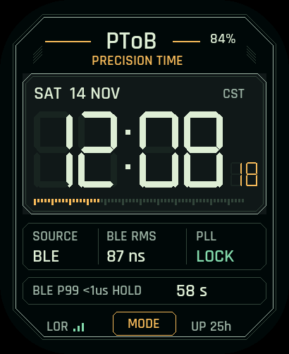
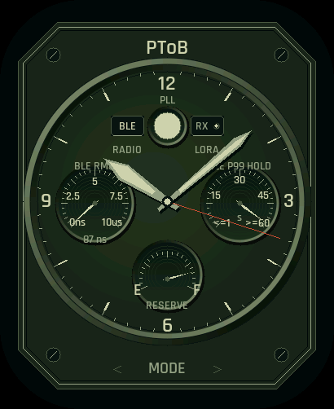
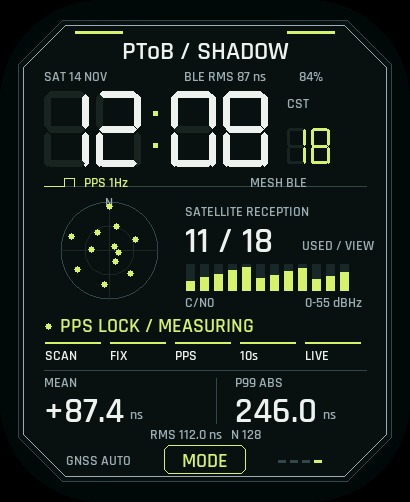
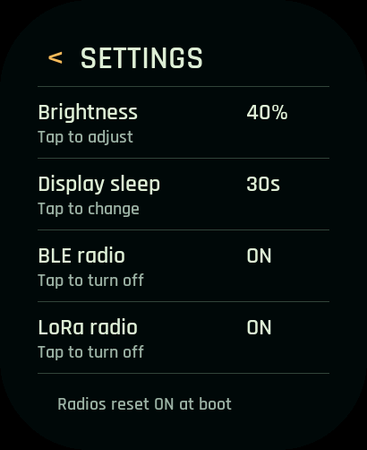
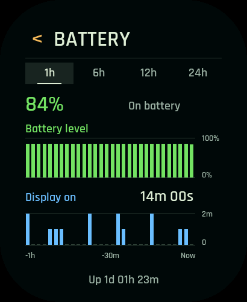

# LILYGO T-Watch Ultra

A PToB timing watch with four faces, authenticated BLE time and passive LoRa
fallback. Built for the **T-Watch Ultra V1 with SX1262**, ESP32-S3 and
**410 × 502 AMOLED**. The watch remembers your selected face.

| Digital | Instrument | Solar | Shadow |
| :---: | :---: | :---: | :---: |
| [](../../docs/twatch/images/digital.png) | [](../../docs/twatch/images/instrument.png) | [](../../docs/twatch/images/solar.png) | [](../../docs/twatch/images/shadow.png) |

**Digital** puts time and timing status at a glance. **Instrument** uses smooth
analog complications for reception, lock, RMS, hold and battery reserve.
**Solar** follows the sun through sunrise, sunset and twilight, with a moon-phase
graphic and corner dials for RMS, P99 hold, source strength and tides.
**Shadow** compares the eligible BLE receiver model with the built-in GNSS PPS, with a
satellite sky plot, reception bars and a ten-second settling countdown.

These are [native-renderer previews](../../docs/twatch/images/README.md) with
synthetic timing inputs, not photographs or accuracy measurements.

## Use the watch

| Control | Action |
| --- | --- |
| Swipe left / right | Switch faces. |
| Tap MODE or click the lower-left button | Open the launcher. |
| Click the upper-left POWER button | Sleep the display immediately, including on USB power. Click again to wake. |
| Battery | View battery percentage and display-on history; choose **1h / 6h / 12h / 24h**. Default: **1h**. |
| Settings | Adjust brightness, choose **15 / 30 / 60 / 90 seconds** of screen time, or turn either radio on/off. Default: **30 seconds**. |
| Touch or click after screen sleep | Wake the screen; use a second gesture to operate it. |
| Double-click the lower-left button | Power down. Hold the upper-left POWER button for about one second to start again. |

| Launcher | Settings |
| :---: | :---: |
|  |  |

Panel sleep retains touch wake. CPU frequency scaling can reduce idle speed
with BLE off; the timing counters continue running. USB diagnostics become
dormant on battery and resume after reconnect.

USB power keeps the display on until you explicitly sleep it. Face, brightness and timeout are saved; both
radios start enabled after reboot. Wrist wake is experimental and can miss
raises or wake unexpectedly; touch and button wake remain available.

**Battery** pairs green percentage columns with blue display-on bars over the
same selected period, plus its display-on total and compact system uptime.
It samples the gauge every 30 seconds, including while the display sleeps, and
keeps minute-resolution history for the latest 24 hours since boot. History and
the chart scale reset at reboot. Empty intervals stay empty; this is percentage
and screen-use tracking, not a current measurement or battery-life estimate.



BLE is preferred, with LoRa receiving in parallel when enabled. **HOLD** means
the watch is keeping time from its last valid clock; it can continue until reboot,
but its accuracy is unknown. **BLE RMS** shows a fresh BLE receiver fit whenever
available, including during acquisition; **LOR RMS** is the fallback. The label
identifies the receiver independently of the clock SOURCE and PLL status. Values
use ns, us, ms or s without hiding large fits. Expired or missing evidence stays
`--`. **BLE P99** is a sampled sub-1 µs hold-duration statistic for the BLE
receiver, not a prediction of the common clock’s holdover accuracy. Neither
metric certifies UTC accuracy. Shadow shows receiver RMS in its header and keeps
GNSS comparison error statistics separate below.

## Shadow PPS

Swipe to **Shadow** to power the GNSS receiver automatically. Leaving the face,
opening an app or sleeping the display switches its main supply off; GNSS backup
power is preserved. The face progresses through satellite search, fix, physical
PPS, ten seconds of settling and measurement. The sweep shows acquisition;
the pulse marker flashes only for a captured PPS edge.

The comparison uses the BLE receiver model, including when common-clock
delivery is enabled; it does not measure the common clock’s electrical output.

**MEAN** is signed clock offset; **P99 ABS** is the 99th percentile of absolute
offset, with **RMS** and sample count below. Here P99 is an error statistic; on
the other faces it remains the sampled sub-1 µs hold duration. `~` marks coarse
histogram tails. Missing evidence stays `--`. Collection requires fresh selected
BLE/RC1/RC2 timing and an independent GNSS fix/PPS reference. LoRa, RC9 and local
HOLD show waiting. Source/context changes, GNSS reference loss, PPS gaps and a
new visit restart the ten-second window. A short BLE permission gap hides the
numbers and excludes uncertain pulses; previously scored samples from that
same context resume only after a fresh eligible PPS.

GNSS is a read-only witness: it does not discipline BLE, admit a mesh, supply
clock authority or update Solar's fixed location. Receiver bias and absolute UTC
accuracy remain unqualified. GNSS reception, timing accuracy and power savings require field validation.
Installation uses the separately authorized exact-device procedure.

The [device measurement note](../../docs/twatch/shadow-pps-note.md) records the
tested unit's local BLE/LoRa adjustments, fresh post-correction residuals and
finite shared-clock checks, including observed coarse/holdover drift.

The [longer BLE/LoRa test](../../docs/twatch/dual-radio-test.md) prepares separate
offset measurements, held-out validation and shared-clock handover and holdover
trials. The firmware records parallel BLE/LoRa PPS and implements one clock controller
with BLE fine timing, LoRa coarse fallback and learned-rate HOLD. Shared delivery
defaults to disabled; an exact-device profile enables reviewed local operation.
The tested profile remains provisional. Physical PPS precision and longer
handover/holdover acceptance require the full measurement campaign.

For work with GNSS off, [common-clock snapshots](../../docs/twatch/gnss-free-snapshot.md)
expose both receiver models and the delivered clock at one causal local tick.
They measure service and model consistency; they do not supply an independent
accuracy witness.

## Build and flash

1. Confirm **Ultra V1 / SX1262**; SX1280 variants are not supported. Prepare
   private enrollment and a verified device entry using [group setup](../../docs/GETTING_STARTED.md)
   and the [build guide](../../docs/twatch/build.md#inputs-and-build).
2. Install the pinned ESP-IDF toolchain from that guide, then build:

   ```sh
   python3 firmware/twatch/tools/build.py --idf "$IDF_PATH" \
     --out artifacts/watch-build-01 \
     --enrollment artifacts/local/enrollment.json \
     --device-config artifacts/local/watch.json \
     --registry artifacts/local/registry.json
   ```

3. Connect USB and follow [USB update entry](../../docs/twatch/build.md#usb-rom-entry).
   Install only the application into the verified application partition; preserve
   enrollment and other partitions, then verify application readback before restarting.
   The ROM helper enters/exits download mode; it does **not** write firmware.
4. If the application cannot enter download mode, hold the lower-left **BOOT**
   button, press and release recessed **RESET** on the right between USB-C and
   the SD slot, then release BOOT. Use the verified recovery procedure in the build guide.

There is no generic pre-enrolled download or one-command public installer yet.
Build output requires device-specific installation review; do not erase the
whole flash or use another watch's enrolled image.

## Set the location

Solar ships for **Santa Rosa Beach / 30A, Florida**, with automatic US Central
DST and **Destin / East Pass** predicted tides for **2026–2027**. Solar keeps this fixed location even when Shadow uses GNSS;
location does not update automatically.

- Change `Latitude` and `Longitude` in [calendar.hpp](main/calendar.hpp), then
  rebuild and flash. Longitude west of Greenwich is negative. Update the
  `SANTA ROSA BEACH` caption in [watch.cpp](main/watch.cpp) to match.
- For another time zone, also update the Central-time rules in
  [calendar.cpp](main/calendar.cpp) and the corresponding calendar tests. There
  is no location or time-zone picker on the watch yet.
- For another tide reference, update the station ID and station metadata in
  [calendar_data.py](tools/calendar_data.py), plus `TideStation` in
  [calendar.hpp](main/calendar.hpp). Regenerate the table using the
  [calendar guide](data/README.md#reproduce-and-refresh), test, then rebuild.
  Coordinates alone do not change the tide station.

Tides are nearby predictions, not measured beach conditions. Expired coverage
shows unavailable. Brightness is currently manual; automatic solar brightness
is not enabled.

## Development status

This is an experimental source target. BLE roaming/failover, wrist recognition,
independent timing accuracy and battery endurance still need field qualification.
LoRa sleeps between learned transmit windows, with generous receive margins.
A missed window restores continuous listening until the schedule is reacquired.
Battery savings and physical wake reliability remain unmeasured.
Radio recovery preserves the running clock and first-fault diagnostics, but an
unsafe shutdown remains contained rather than forcing a whole-watch restart.

[Changes](CHANGELOG.md) · [Build and diagnostics](../../docs/twatch/build.md) ·
[Power plan](../../docs/twatch/power.md) · [Source provenance](imports.json) ·
[Dependency notices](NOTICE.md)

Copyright (c) 2026 Jonathan Yantis. Original code and documentation: [MIT](../../LICENSE).
