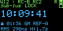
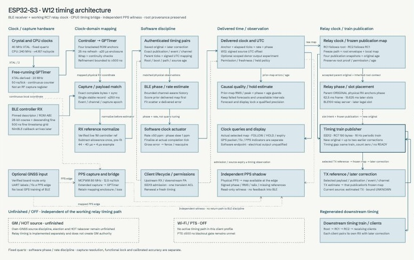

# W12 native RC example

*Illustrative firmware-rendered OLED screen. RC2 indicates relay depth within the
RC role. [Image provenance](../../docs/images/README.md).*

Copyright (c) 2026 Jonathan Yantis. MIT; preserved source notices apply.

**PToB owns W12 native G1/RC7 development.** Current version **0.1.21** builds on the initial 0.1.0 successor
from the selected native application at `48b9ab7`. See the
[build guide](../../docs/w12/build.md), [cutover record](../../docs/w12/cutover.md),
[explicit import provenance](imports/2026-10-16.json) and [source notices](NOTICE.md).

The supported public profile is **RC**: BLE50 client-only or BLE100 receiver,
with an optional experimental estimated-TX relay. An explicit Meshnology W12
L76K hardware profile enables GNSS reception/PPS/fix indicators; it does not
provide GM service or GNSS discipline of the BLE clock. GNSS is disabled by
default. LoRa, WiFi, PTS and donor output correction experiments are not supplied
by this target. Original signed source expiry, physical receive/correction matching,
controller ownership, bounded update drain and precision refusal remain in force.
The estimated relay has unknown TX uncertainty and no actual TX capture claim.
On the explicit GNSS profile, bounded capture also records the production G1
clock against physical PPS. It retains prior model availability, original
permission deadlines and empirical GNSS reference status, separately from the
strict R2 diagnostic. This observer neither disciplines the BLE clock nor
qualifies UTC accuracy.
Its shared BLE1M path converts the programmed packet start to the nominal
ADDRESS endpoint, 40 microseconds later, before emitting a correction. This
repairs a packet-reference mismatch; controller/RF delay remains unknown.
An explicit per-device provisional aggregate-path profile preserves its legacy
total adjustment from the raw programmed start, including this reference
component. It applies to every child consuming that publisher, and does not
identify TX versus RX bias or qualify precision. See the
[timestamp reference](../../docs/w12/tx-reference.md).
Both RC discovery advertisers request 100 ms, matching T096. The independent
precision train remains 62.5 ms (16 Hz), with its existing parent-relative phase.
Warm control retries preserve acquisition and use a rolling start budget.
Direct BLE100 authentication renews after 225–240 seconds, with randomized
scheduling and an immutable six-minute session limit. Newly authenticated,
physically matched GR3 corrections maintain the coarse replay anchor inside
that session; receipt, polling and held predictions cannot do so. Source/map
expiry and the 250 ms coarse uncertainty ceiling remain independent. Missing
corrected progress falls back to the existing bounded bootstrap/retry policy.
BLE50 and RC7 relay admission retain their earlier policies.
Current authenticated precision reception reserves radio scheduling even during
a relative-quality dip for a bounded trial. Automatic selection gives a GM at
least 60 seconds to lock; without sustained relative lock it seeks a fresh relay,
even when GM packets keep arriving. A failed parent is deferred for five minutes
to give alternatives a chance. Explicit parent pins keep their requested policy.
Warm initiation requests 5 ms scan windows per 20 ms;
precision reports are drained between control calls under one shared eight-report budget per worker iteration.
Direct BLE100 control uses a separate 1 s queue-age limit, up to 4 s initiation,
500 ms supervision and GATT wait bounded by the original 5 s authenticated
exchange. Warm retries allow six starts per rolling minute, at least
5 s apart, with 5–10 s failure backoff; BLE50 and RC7 retain their earlier control bounds.
These control allowances do not relax precision freshness or clock authority.
Outgoing adopted-ACL termination installs its owner and original deadline before
its yielding SDK call, so a delayed CONNECT can acknowledge cleanup without
restarting GATT. Bounded incoming relay-owner diagnostics distinguish admission,
refusal, descriptor/handle state and original drain timing. These source changes
do not establish a cause or repair for the observed incoming-owner fault.
An established downstream train survives a timing or quality interruption for
up to 30 seconds, with canonical packets carrying no corrections while time is
unavailable. Existing child leases keep their original deadlines; two seconds
of continuously observed recovery reset the loss episode. Startup still needs
parent lock, and stop, fault and source/path changes withdraw the old train.
The OLED can retain a local HOLD estimate after source/replay expiry; its error
bound is unknown and it grants no downstream authority. Passive bounded capture
diagnostics distinguish control replies and corrected-model loss. W12 supplies
no USB timing stream. See the [changelog](CHANGELOG.md).
The [stability results](../../evidence/stability/2026-10-16/README.md) retain the
rejected stack-overflow candidate, finite C-4 observation and limited C-1/C-2
startup verification separately.

The [shared registry](../../registry/README.md) supplies display aliases. Device
factory binding, group enrollment and real maps are explicit ignored local
inputs. No enrolled binary is distributed and runtime mutable provisioning is
not implemented. Build/host-test success is separate from physical precision,
absolute UTC, RF duty and reliability qualification.

The selected source includes the application under `main/`, a closed historical
display/GNSS include boundary under `legacy/`, contracts and host checks, pinned
public SDK acquisition, and a no-hardware builder. The legacy code path supplies
compatibility types and display routines; its presence does not activate other
radios or GPS. A generic public installation/recovery tool remains pending.

For a multi-device deployment, see the [group setup guide](../../docs/GETTING_STARTED.md).

## Timing schematic

Logical receive, clock-discipline and relay paths.
Select the preview to open the [full interactive schematic](https://ptob.dev/hardware/esp32-s3/timing/).
[Capture provenance](../../docs/images/README.md).
