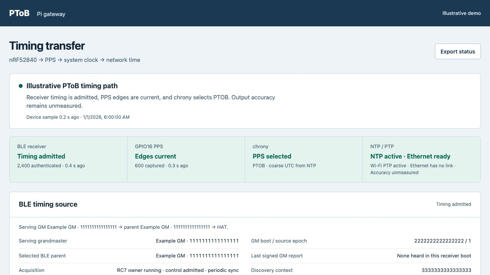

# Raspberry Pi 5 timing gateway

Copyright (c) 2026 Jonathan Yantis. MIT.

An experimental BLE → hardware PPS → chrony → NTP/PTP bridge for a regular
Raspberry Pi 5 Model B running Raspberry Pi OS arm64. A Particle B504e/nRF52840
M-HAT receives authenticated PToB timing, generates hardware-timer PPS through
the HAT bus, and exports UART diagnostics. The Pi's internal Bluetooth stack
is not the implemented precision timing input.

**[Setup guide](../../docs/pi5/setup.md)** ·
**[Monitoring website](dashboard/README.md)** ·
**[Scripts](tools/README.md)** ·
**[Paper and measured results](../../papers/pi5-mhat-gateway/README.md)** ·
**[Next USB/PTP bridge experiments](../../docs/pi5/bridge-work.md)**

## Current path and limits

| Stage | Implementation |
| --- | --- |
| BLE reception | [M-HAT native RC firmware](../../firmware/mhat/README.md); local discovery and fresh authenticated admission |
| PPS | nRF TIMER/PPI/GPIOTE one-shot → D2/RTS → Pi GPIO16, physical pin 36 |
| Diagnostics | HAT TX/RX → Pi header UART `/dev/ttyAMA0`, 115200 8N1 without flow control |
| System clock | Chrony: PPS phase and NTP coarse UTC; one clock writer |
| NTP | Chrony serves the disciplined Pi system clock |
| Wi-Fi PTP | PTPd, software timestamps, domain 24, application-specific timescale |
| Ethernet PTP | Guarded system → PHC transfer and server-only linuxptp, L2/E2E, domain 24 |
| Monitoring | Read-only Python API, plain HTML/JavaScript charts and bounded local history |

Ethernet cable/endpoint testing and sub-microsecond output accuracy remain
unqualified. GPIO PPS uses Linux IRQ timestamps; receiver fit residuals,
chrony's RMS estimate and raw GPIO phase have different meanings. The native
PHC's packet timestamp support supplies no external PPS capture or periodic
output pins. See [clock ownership and recovery](../../docs/pi5/clock-chain.md).
Dated measurements, all tails and denominators belong in the linked
[results collection](../../evidence/pi5/2026-11-02/README.md).

## Prepare and operate

Follow the separate **[setup guide](../../docs/pi5/setup.md)** for SD/OS setup,
verified SSH host pins, the private connection profile, exact HAT enrollment,
build/recovery prerequisites, header wiring, service installation and reboot
checks. No OS image, key, network password or enrolled firmware is distributed.

Run workstation helpers from the repository root. The private profile defaults
to `~/.config/ptob/pi5.json`, with SSH keys and host pins outside Git.
`remote.py` verifies the pinned host key, Pi model, factory serial and enrolled
image before executing a payload. Raw reports remain in ignored `artifacts/`.

```sh
python3 gateways/pi5/tools/remote.py inventory
python3 gateways/pi5/tools/remote.py timing-status
```

Install/update commands, including full dashboard reinstallation, restart owned
services. Use the setup guide and [script map](tools/README.md); never run them
during a measurement window. `clock-install` is the narrower Ethernet-chain
update for an already configured gateway. Build and flash M-HAT firmware through
its separate exact-device guide, preserving recovery and protected regions.

Trusted credentials remain separate from runtime mesh selection. A source or
context change requires fresh authenticated admission. Production images must
not pin one mesh or GM. The monitor distinguishes the currently admitted GM
from the selected parent and retained source history. It labels stopped PPS as
holdover and derives Ethernet readiness from fresh guard observations.

## Monitoring



Illustrative screenshot of the shipped frontend using synthetic source identities
and values; it is not a measurement or a view of a private deployment.
The [monitoring README](dashboard/README.md) includes charts, exports, API details
and a local preview. The device web server binds only to loopback. Access it
through an operator-owned SSH forward or private VPN/HTTPS setup; no lab address,
tailnet identity or credential is included here.

## Offline verification

```sh
python3 -B -m unittest discover -s gateways/pi5/tests -v
python3 -B -m unittest discover -s gateways/pi5/dashboard/tests -v
node gateways/pi5/dashboard/tests/source_ui_test.cjs
node gateways/pi5/dashboard/tests/chart_ui_test.cjs
node gateways/pi5/dashboard/tests/output_ui_test.cjs
python3 -B tools/verify_pi5_gateway.py
```

These checks do not connect to hardware or qualify physical output accuracy.
The [next-session plan](../../docs/pi5/bridge-work.md) starts with a USB-connected
T096 RC and shadow Linux USB/SOF association. That adapter and reverse
external-PTP → PToB operation remain future work.

Original target code and ordinary documentation use MIT. Separately acquired
Raspberry Pi OS, Debian, Linux, BlueZ, chrony, linuxptp, PTPd, Tailscale and
Particle tools retain their terms. See [notices](NOTICE.md) and
[licensing](../../LICENSING.md). Paper, original scientific figures and selected
measurement datasets use CC BY 4.0, credited to Jonathan Yantis.
