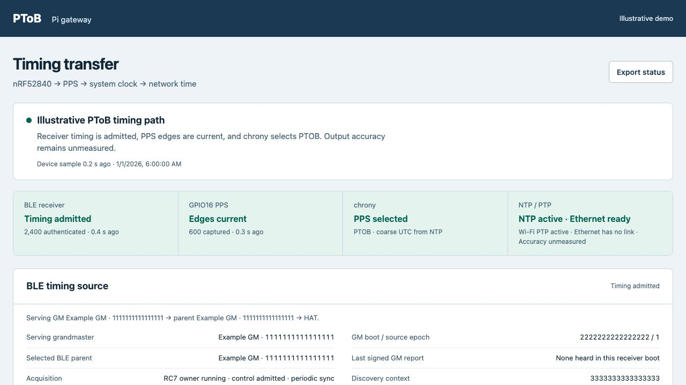
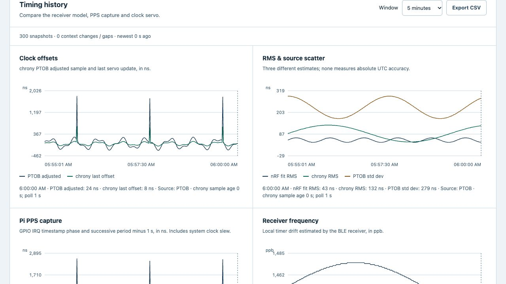

# Pi timing monitor

Copyright (c) 2026 Jonathan Yantis. MIT, including these documentation screenshots.

A read-only web view of BLE source admission, M-HAT hardware PPS, chrony clock
discipline and NTP/PTP service readiness. The device runs a small Python service
with plain HTML/CSS/JavaScript; it requires no frontend framework or external
assets. Use the [Pi setup guide](../../../docs/pi5/setup.md) to install it.

## Timing path and source reporting



The screenshots render the shipped frontend with **illustrative synthetic data**.
Names, identities, dates and values are examples, not laboratory measurements.
They contain no real device, network, account or private-access details. Actual
[measured results](../../../evidence/pi5/2026-11-02/README.md) remain a separate,
checksummed population.

Each timing stage has its own state and observation age. “Complete” requires
fresh admitted receiver timing, current PPS and selected PTOB in chrony. Holdover
is explicit when PPS stops, even if chrony keeps selecting its previous source.
Ethernet readiness uses fresh PHC-transfer and PTP-server guard state; a running
supervisor does not by itself mean a child is serving. Link absence remains
visible. None of those states measures output accuracy.

Source reporting separates the admitted GM from the immediate BLE parent,
shows source incarnation and recovery progress, and retains the last valid root
as history after withdrawal. Signed role reports describe received announcements;
they are not current timing admission or independent proof of GM liveness.
Stale observations and a lost dashboard connection withdraw current-source claims.

## Charts and exports



The history view compares PTOB adjusted samples, chrony last offset and RMS,
PTOB regression scatter, nRF internal fit RMS/drift, and GPIO PPS phase/period.
Nanosecond units describe resolution; each metric has a different measurement
boundary. Repeated servo estimates are snapshots, not independent updates.

Select one minute through six hours, inspect by pointer/touch or arrow keys,
and export the full window as CSV. The table reports population, mean, RMS,
centered standard deviation, absolute percentiles and extrema before chart
reduction. Lines retain real gaps and source changes; isolated points remain
visible. Block means use unique contiguous PPS edges with denominators and
correlation, without assuming independent errors or a square-root accuracy gain.

History is recorded at 1 Hz, held locally for up to 24 hours and written in
10-second batches. Status refreshes every two seconds; history refreshes every
ten seconds. The collector continues without a browser open. The read-only
server does not flash firmware, reset a radio or write any clock.

## Files, API and access

| Component | Responsibility |
| --- | --- |
| `collector.py` | Exact-source UART validation, source state, cached clock/service observations and history |
| `history.py` | Integer-nanosecond parsing, bounded SQLite storage, gaps and full-population statistics |
| `server.py` | Loopback HTTP service and fresh owned-guard observations |
| `static/` | Status rendering, responsive layout and SVG timing charts |
| `preview.py` | Loopback-only synthetic preview for documentation, without hardware/profile access |

`GET /api/status` returns current observations with freshness and actual guard
state; `/api/export` downloads that status. `/api/history?seconds=300` returns
the chosen window and full statistics; `/api/history/export?seconds=300`
downloads every recorded snapshot. Live state lives under `/run/ptob-dashboard/`
and history under `/var/lib/ptob-dashboard/`. Factory validation stays in the
private collector binding; exported source identities and history can still be
sensitive. Review/redact real exports before sharing.

The installed listener is `127.0.0.1:8080`. Use your own verified SSH forward or
operator-owned private VPN/HTTPS access as described in the setup guide. No
private hostname, tailnet identity, IP address, login URL or credential is
included in this README or its screenshots. Public web exposure is not configured.

## Reproduce a generic preview

From the repository root, Python 3.9+ is sufficient:

```sh
python3 -B gateways/pi5/dashboard/preview.py --port 8090
```

Open `http://127.0.0.1:8090/`; `/#trends-title` opens the history panel. Add
`--holdover` to demonstrate source withdrawal, or choose another unused port.
Stop with Ctrl-C. This serves the production static files with synthetic status
and history and changes only the demo/private-access labels in the preview HTML.
It reads no receiver profile, raw capture, registry, private key or hardware.
It is not installed as a device service or a substitute for the live monitor.

[`images/manifest.json`](images/manifest.json) records the screenshot and
frontend/preview identities. Captures show the page content without browser
chrome and were inspected for generic identities and readable charts.
